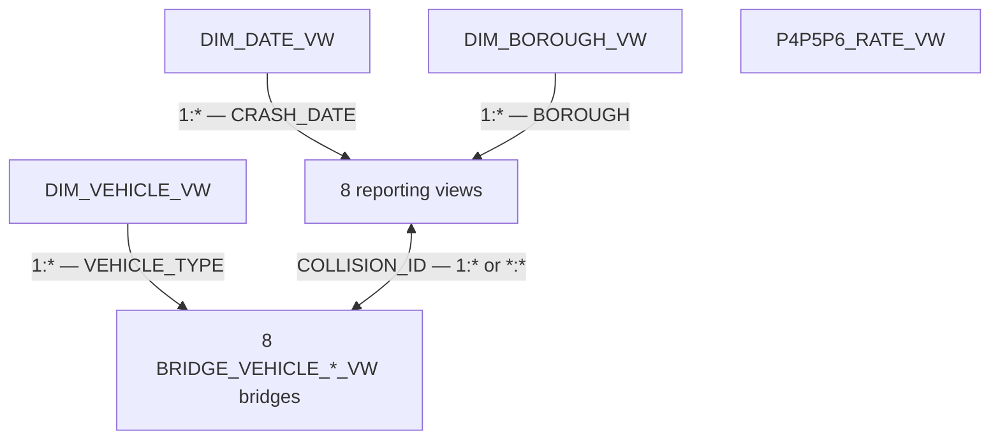

# New York City Traffic Collisions in 2020

## From Raw Data to a Report on Street Safety

An analytics project combining **MySQL, spatial data processing, and Power BI**. Using data on reported traffic collisions in New York City, it examines their scale, consequences for road users, distribution over time, and geographic patterns.

I prepared this analysis to support discussions about street safety: to identify locations and situations that warrant further investigation, taking into account both collision frequency and the number of people injured or killed.

I developed the project for a webinar delivered as part of the **KajoDataSpace** data analytics course. The platform's owner invited me to participate as a guest and lead the webinar. During the session, I covered data preparation in SQL and report development in Power BI.

Recordings of the presentation are available **in Polish only**:

1. [Power BI presentation](https://vimeo.com/1237617344).
2. [SQL presentation](https://vimeo.com/1237618906).

**[Open the interactive Power BI report](https://app.powerbi.com/view?r=eyJrIjoiOWIzYWE4NGYtZmI1OS00MWU1LThmYzktZDI4M2UwYmE3YmI0IiwidCI6ImE0ZmE1ZWNhLTdhM2YtNDRhYS04ZTI4LTc2MjBhMzk0NjEwZiJ9)**

> **Data coverage:** January 1–August 29, 2020, comprising 74,881 collisions. Despite the year in the project title, the included dataset does not cover the whole of 2020. August is a partial month.

| Item | Scope |
| --- | --- |
| Analysis and report author | Paweł Bugowski |
| Geographic coverage | New York City: Bronx, Brooklyn, Manhattan, Queens, Staten Island |
| Input data | `Raw Data/NYC.csv`, 74,881 records and 29 columns |
| Data grain | One row represents one collision |
| Collision identifier | `COLLISION_ID` |
| Data preparation | 7 documented MySQL scripts |
| SQL layer | 2 tables and 20 views |
| Report | 6 Power BI pages |
| Report hosting | KajoDataSpace, as credited in the report footer |

## Table of Contents

- [Objectives and Analytical Questions](#objectives-and-analytical-questions)
- [Data and Coverage](#data-and-coverage)
- [Key Findings](#key-findings)
- [Repository Contents](#repository-contents)
- [Data Preparation in SQL](#data-preparation-in-sql)
- [Data Model and Aggregation Rules](#data-model-and-aggregation-rules)
- [Power BI Report](#power-bi-report)
- [How to Reproduce the Project](#how-to-reproduce-the-project)
- [Data Quality Checks and Validation Queries](#data-quality-checks-and-validation-queries)
- [Sources and Credits](#sources-and-credits)

## Objectives and Analytical Questions

A collision map is the starting point for the analysis. To develop useful recommendations for further observation of streets, collision counts need to be considered alongside their consequences, timing, and location context.

The project addresses the following questions:

1. How many collisions were recorded, and how often did they involve injuries or fatalities?
2. How are injuries and fatalities distributed among pedestrians, cyclists, and people traveling in motor vehicles?
3. Which months, days of the week, and times of day have the most collisions?
4. Which boroughs and street names account for the largest number of reports?
5. How do vehicle types and reported contributing factors differ between collisions without casualties, injury collisions, and fatal collisions?
6. Which locations and situations warrant closer analysis before planning fieldwork?

Throughout this document, **“collision”** refers to every record in the dataset, including those with no injuries or fatalities. This distinguishes the full set of collisions from those resulting in harm to people.

## Data and Coverage

### Origin and Unit of Observation

The `Raw Data/NYC.csv` file contains the traffic collision data used in this project. The report footer credits **Police Department (NYPD), via NYC Open Data**. The corresponding public dataset is [Motor Vehicle Collisions – Crashes](https://data.cityofnewyork.us/Public-Safety/Motor-Vehicle-Collisions-Crashes/h9gi-nx95).

The unit of observation is a collision, rather than a person or an individual vehicle. Each record includes a date, time, location, injury and fatality counts, and up to five fields describing vehicle types and five fields describing reported contributing factors.

The included file contains **74,881 distinct `COLLISION_ID` values**, with no missing or duplicate identifiers. The dates span all 242 days from January 1 to August 29, 2020. This does not automatically establish that the file is a complete record of every traffic collision in the city.

The public source dataset is updated over time. The results in this project refer to the specific `Raw Data/NYC.csv` file, so a later export from NYC Open Data may contain different counts or revised records.

### Key Field Definitions

The CSV headers contain spaces, while the corresponding SQL column names use underscores. `COLLISION_ID` retains its original name.

| Group | SQL Fields | Meaning |
| --- | --- | --- |
| Identification | `COLLISION_ID` | Collision identifier |
| Time | `CRASH_DATE`, `CRASH_TIME` | Date and time of the collision |
| Administrative area | `BOROUGH`, `ZIP_CODE` | Borough and ZIP code |
| Coordinates | `LATITUDE`, `LONGITUDE`, `LOCATION` | Collision location; `LOCATION` is stored as WKT text in the CSV, such as `POINT (...)` |
| Streets | `ON_STREET_NAME`, `CROSS_STREET_NAME`, `OFF_STREET_NAME` | Street name, intersecting street name, and off-street location description |
| Total casualties | `NUMBER_OF_PERSONS_INJURED`, `NUMBER_OF_PERSONS_KILLED` | Number of people injured and killed |
| Pedestrians | `NUMBER_OF_PEDESTRIANS_INJURED`, `NUMBER_OF_PEDESTRIANS_KILLED` | Pedestrians injured and killed |
| Cyclists | `NUMBER_OF_CYCLIST_INJURED`, `NUMBER_OF_CYCLIST_KILLED` | Cyclists injured and killed |
| People traveling in motor vehicles | `NUMBER_OF_MOTORIST_INJURED`, `NUMBER_OF_MOTORIST_KILLED` | Injuries and fatalities in the `Motorists` category, which includes more than drivers alone |
| Reported contributing factors | `CONTRIBUTING_FACTOR_VEHICLE_1`–`5` | Factors assigned to the successive vehicle positions |
| Vehicle types | `VEHICLE_TYPE_CODE_1`–`5` | Vehicle types recorded in the successive positions |

The five vehicle positions reflect the structure of this export; they do not mean that five vehicles were involved in every collision. Empty positions may indicate that there was no additional vehicle or that its type was not recorded.

### Input Data Quality

The following figures were calculated from the raw CSV, **before missing boroughs were filled using spatial geometries**.

| Check | Number of Records | Share of Dataset |
| --- | ---: | ---: |
| Missing `BOROUGH` | 25,741 | 34.38% |
| Missing coordinate pair | 5,946 | 7.94% |
| Coordinates present, but at least one is zero | 63 | 0.08% |
| Missing or zero coordinates combined | 6,009 | 8.02% |
| Missing `ON_STREET_NAME` | 19,437 | 25.96% |

The date, time, identifier, and eight injury and fatality count fields are complete in this file. For every record, the sum of injured pedestrians, cyclists, and people in the `Motorists` category matches the total number of people injured. The same reconciliation holds for fatalities.

Missing location data affects interpretation: the set of collisions displayed on a map may be smaller than the set used to calculate the main KPIs. Nonzero coordinates alone do not establish that a location is correct.

## Key Findings

The figures below were calculated directly from `Raw Data/NYC.csv`, using the flag definitions in the SQL scripts. The six main KPIs match the overview page of the public report when all filter values are selected.

### Collision Volume and Outcomes

| Metric | Value | Interpretation |
| --- | ---: | --- |
| All collisions | **74,881** | Unique collisions during the analysis period |
| No reported injuries or fatalities | **54,371** | 72.61% of collisions |
| Injuries, with no fatalities | **20,375** | 27.21% of collisions |
| At least one fatality | **135** | 0.18% of collisions |
| People injured | **27,448** | Number of people, including those injured in fatal collisions |
| People killed | **144** | Number of people, rather than the number of fatal collisions |

**135 fatal collisions and 144 people killed represent two different measures.** Similarly, 20,375 injury collisions without fatalities is not equivalent to 27,448 people injured.

| Road User Group | Injured | Killed |
| --- | ---: | ---: |
| Pedestrians | 4,099 | 56 |
| Cyclists | 3,273 | 9 |
| Motorists | 20,076 | 79 |
| **Total** | **27,448** | **144** |

Pedestrians account for approximately **14.93% of injuries**, but **38.89% of fatalities** in this dataset. This supports examining pedestrian collisions separately. These shares do not measure the probability of a collision during a journey, because the dataset contains no counts of pedestrians, trips, or distances traveled.

### Distribution Over Time

| Month in 2020 | Number of Collisions |
| --- | ---: |
| January | 14,287 |
| February | 13,684 |
| March | 11,057 |
| April | 4,116 |
| May | 6,149 |
| June | 7,616 |
| July | 9,225 |
| August, through August 29 | 8,747 |

April has the fewest reported collisions among the months included in the analysis. Its collision count is approximately **71.19%** lower than January's. The report presents this pattern in the context of COVID-19 events. Coinciding timing alone, however, is insufficient to determine how individual restrictions affected collision counts.

**Fridays have the most collisions: 12,271.** Among the two-hour intervals, **16:00–18:00 has the highest count: 10,193**. These are totals for the entire analysis period. A detailed comparison of weekdays should also account for how many times each weekday occurs in the calendar.

### Examples of Locations for Further Investigation

The following examples compare collision frequency with outcomes. The calculations group records by `ON_STREET_NAME` after trimming leading and trailing spaces. They do not merge different name variants or identify individual intersections.

| Street or Route Name | Collisions | Total Injured | Total Killed | Pedestrians Injured | Question for Further Analysis |
| --- | ---: | ---: | ---: | ---: | --- |
| BELT PARKWAY | 1,241 | 689 | 1 | 3 | On which sections and at what times do collisions concentrate? |
| BROADWAY | 575 | 248 | 1 | 53 | Which locations account for collisions involving injured pedestrians? |
| GRAND CENTRAL PKWY | 581 | 342 | 5 | 1 | What were the circumstances of the two collisions in which five people were killed in total? |

These examples help narrow the analysis; they are not a risk ranking. The same street name can cover multiple sections and sometimes locations in different boroughs. Before conducting a site visit, the analysis should move to coordinates, intersecting streets, and specific `COLLISION_ID` values.

## Repository Contents

The repository is organized into three directories: `SQL/` for scripts, `Assets/` for WebP images, and `Raw Data/` for raw CSV data. The `README.md` file is located in the repository root. Source files retain their original names.

| File | Contents |
| --- | --- |
| `Raw Data/NYC.csv` | Input data used in the analysis |
| `SQL/1. Database & Table.sql` | The `WEBINAR_NYC_ACCIDENTS` database and `accidents` table |
| `SQL/2. Import of data.sql` | CSV import and handling of empty values and time fields |
| `SQL/3.1. Normalization of data.sql` | Missing-value placeholders and standardization of vehicle types and contributing factors |
| `SQL/3.2. Multipolygons.sql` | Boundaries of the five boroughs and spatial assignment of missing `BOROUGH` values |
| `SQL/4.1. Creation of reporting views.sql` | Outcome flags, time buckets, and 9 reporting views |
| `SQL/4.2. Creation of dimension views.sql` | 3 dimension views: date, borough, and vehicle type |
| `SQL/4.3. Creation of bridges.sql` | 8 bridge views for filtering by vehicle type |
| `README.md` | Project, findings, model, and reproduction documentation |
| `Assets/cover.webp`, `Assets/cover-thumb.webp` | Project cover and thumbnail |
| `Assets/gallery-01.webp`, `Assets/gallery-01-thumb.webp` | Collision timing analysis and thumbnail |
| `Assets/gallery-02.webp`, `Assets/gallery-02-thumb.webp` | Collision location analysis and thumbnail |
| `Assets/gallery-03.webp`, `Assets/gallery-03-thumb.webp` | Injury collision analysis and thumbnail |

The public link provides access to the interactive report, and the scripts reproduce the SQL layer. The diagram in the data model section shows the relationship structure. The files do not include a `.pbix` or `.pbit`; DAX measure definitions, interaction settings, and full formatting remain part of the report file.

## Data Preparation in SQL

### 1. Creating the Database and Table

The first script creates the `WEBINAR_NYC_ACCIDENTS` database with `utf8mb4` encoding and the `utf8mb4_unicode_ci` collation.

The `accidents` table retains the wide format of the source CSV. Dates and times are stored as `DATE` and `TIME`, coordinates as `DECIMAL(10, 7)`, casualty counts as `INT`, and the identifier as `BIGINT`. ZIP codes remain text.

`COLLISION_ID` serves as the logical collision key. However, the original DDL does not declare a `PRIMARY KEY` or `UNIQUE` constraint on this column, so uniqueness needs to be checked during import.

### 2. Import and Initial Preparation

The import uses `LOAD DATA LOCAL INFILE`. The script skips the header, reads comma-separated values, and handles optional double quotes. Values are first loaded into user-defined variables and then assigned to the destination columns.

`NULLIF(..., '')` converts empty fields to `NULL`. `TRIM` is also applied to the date and time fields. Time is converted using `STR_TO_DATE(..., '%H:%i:%s')`. Dates in `YYYY-MM-DD` format are assigned to the `DATE` column without a separate `STR_TO_DATE` call.

### 3. Standardizing Values

Script `3.1` first replaces missing values with defined placeholders, such as `NO BOROUGH`, `NO ZIP CODE`, and `NO STREET NAME`, and replaces missing coordinates with zero. It then applies `CASE` rules separately to all five vehicle and contributing-factor positions.

Examples of category mappings:

| Area | Example Input Value | Standardized Category |
| --- | --- | --- |
| Vehicles | `Sedan` | `SEDAN` |
| Vehicles | `Station Wagon/Sport Utility Vehicle` | `SUV` |
| Vehicles | `Pick-up Truck` | `TRUCK` |
| Vehicles | `Motorcycle` | `MOTORBIKE` |
| Contributing factors | `Driver Inattention/Distraction` | `DISTRACTION` |
| Contributing factors | `Unsafe Speed` | `DRIVING AT EXCESSIVE SPEED` |
| Contributing factors | `Following Too Closely` | `FAILURE TO MAINTAIN DISTANCE` |
| Contributing factors | `Unspecified` | `NO FACTOR` |

The rules use `LOWER`, `LIKE`, and the order of conditions within `CASE`. This groups variations in descriptions into categories suitable for charts. Unmatched values are assigned **`OTHER`**. After the rules are applied, missing vehicle types become `NO TYPE`, and missing contributing factors become `NO FACTOR`.

“Normalization” in the script name primarily means **standardizing category values**. It is not full relational normalization into separate collision, vehicle, and factor tables. The wide table remains the foundation, while views transform selected fields into a long format.

### 4. Assigning Missing Boroughs Through Spatial Analysis

Script `3.2` creates the `borough_boundaries` table. Borough boundaries come from the [Borough Boundaries — NYC Open Data](https://data.cityofnewyork.us/City-Government/Borough-Boundaries/yqww-f9f3) dataset. The table stores the borough name and a `MULTIPOLYGON` geometry in **WGS 84, SRID 4326**. Multipart geometries represent boroughs that include separate land areas and islands.

Borough assignment follows these steps:

1. A spatial point is created from `LONGITUDE` and `LATITUDE`.
2. `ST_GeomFromText` interprets the coordinates in longitude–latitude order through `axis-order=long-lat`.
3. `ST_Contains` checks whether the point falls within a borough's geometry.
4. The update applies to records with `BOROUGH = 'NO BOROUGH'` and nonzero coordinates.

Existing borough names are not overwritten. Records without usable coordinates or a matching geometry remain unresolved. The result should be checked by comparing the number of `NO BOROUGH` records before and after running the script. This documentation does not provide an unverified count of records filled in this way.

### 5. Outcome Flags and Time Analysis

Script `4.1` adds three flags:

| Flag | Definition in the Code | Purpose |
| --- | --- | --- |
| `ACC_WO` | None of the injury or fatality fields is greater than zero | Collisions with no reported casualties |
| `ACC_W_INJURED` | At least one injury field is greater than zero and `NUMBER_OF_PERSONS_KILLED = 0` | Injury collisions with no fatalities according to the total fatalities field |
| `ACC_W_KILLED` | At least one fatality field is greater than zero | Fatal collisions |

The conditions treat `NULL` in numeric fields as zero through `COALESCE`. In the included CSV, these fields are complete and internally consistent, so the flags form three mutually exclusive groups covering all collisions. This property must be checked again for a different input dataset: the injury flag checks total fatalities, while the fatality flag also checks the detailed fields.

`TIME_BUCKET` and `TIME_BUCKET_NUMBER` divide the day into 12 two-hour intervals. The start boundary is inclusive and the end boundary is exclusive; for example, 16:00 belongs to the 16:00–18:00 interval. The number from 1 to 12 enables correct label sorting in Power BI.

`DAYOFWEEK` and `DAYNAME` provide the weekday number and name. In the MySQL numbering used here, Sunday is 1. Script `4.2` also creates `CRASH_DATETIME`, combining the date and time.

### 6. The View Layer

| View | Contents | Grain |
| --- | --- | --- |
| `P1_VW` | Outcome flags and injury and fatality counts | One row per collision |
| `P2_VW` | Date, time, weekday, and time bucket | One row per collision |
| `P3_VW` | Coordinates, street name, borough, and date | One row per collision |
| `P4P5P6_FACTOR_VW` | Five contributing-factor fields combined into `FACTOR` | Five rows per collision |
| `P4P5P6_VEHICLE_VW` | Five vehicle fields combined into `VEHICLE` | Five rows per collision |
| `P4P5P6_RATE_VW` | Monthly proportions of the three outcome categories | One row per collision with a non-null date, repeating the monthly proportion |
| `P4P5P6_MAP_VW` | Identifier, date, borough, and outcome flags | One row per collision; no coordinates |
| `P4P5P6_HEAT_VW` | Outcome flags, weekday, and time bucket | One row per collision |
| `P4P5P6_STREET_VW` | Outcome flags and street name | One row per collision |

The factor and vehicle views use `UNION ALL`, preserving duplicates and positions assigned a missing-data category. For this dataset, each should contain **374,405 rows**, five times as many as the collision table.

The proportions view uses window functions partitioned by year and month. For example, `INJURED_RATE` is the monthly sum of `ACC_W_INJURED` divided by the number of all collisions in that month.

## Data Model and Aggregation Rules

### Model Layers

The Power BI model consists of **20 tables based on SQL views**: three dimensions, eight reporting views connected to dimensions and bridges, eight vehicle bridges, and one disconnected view of monthly proportions. It is a multi-fact model with shared date, borough, and vehicle-type dimensions.

The `accidents` table and the `borough_boundaries` table belong to the data preparation layer in MySQL. They are not shown as separate tables in the Power BI model presented here.

The diagram below shows the relationships in the Power BI model. The view names correspond to the objects created by the SQL scripts. Arrows indicate filter direction. Relationships between reporting views and their corresponding bridges are bidirectional.



### Dimensions

| Dimension | Logical Key | Role |
| --- | --- | --- |
| `DIM_DATE_VW` | `DATE` | Continuous calendar from the earliest to the latest `CRASH_DATETIME` date; year, quarter, month, day, and `YEAR_MONTH` |
| `DIM_BOROUGH_VW` | `BOROUGH` | Unique non-null borough names |
| `DIM_VEHICLE_VW` | `VEHICLE_TYPE` | Unique types from the five vehicle positions, excluding `NO TYPE` |

The calendar is generated using a recursive CTE with `WITH RECURSIVE`. It covers 242 days for the included data. The borough dimension excludes `NULL`, but may still contain `NO BOROUGH` if some locations remain unresolved after spatial assignment.

### Vehicle Bridges

A collision can involve several vehicle types, and one type can appear in many collisions. The bridge views transform the five vehicle columns into **`COLLISION_ID`–`VEHICLE_TYPE`** pairs and exclude `NO TYPE`.

Separate bridges are created for `P1`, `P2`, `P3`, and the `FACTOR`, `HEAT`, `MAP`, `STREET`, and `VEHICLE` components of pages P4–P6. All read the same five source columns. Separate names organize their use across the different parts of the model.

Because `UNION ALL` is used, a collision–type pair can occur more than once. If a collision involved two sedans, the bridge contains two corresponding entries. The bridge does not retain the vehicle position number or a separate vehicle identifier.

### Keys, Relationships, and Filtering

The date and borough dimensions have **one-to-many (`1:*`)** relationships with eight views: `P1_VW`, `P2_VW`, `P3_VW`, `P4P5P6_FACTOR_VW`, `P4P5P6_HEAT_VW`, `P4P5P6_MAP_VW`, `P4P5P6_STREET_VW`, and `P4P5P6_VEHICLE_VW`. Filters propagate in one direction, from the dimensions to these views.

The `DIM_VEHICLE_VW` dimension filters the eight bridges in one direction through `VEHICLE_TYPE`, also using `1:*` relationships. Each bridge then connects to its reporting view through `COLLISION_ID`, with filtering in both directions. This allows a vehicle-type selection to reach the collision records used in the corresponding part of the report through the bridge.

| Reporting View | Corresponding Bridge | Cardinality: View–Bridge | Filter Direction |
| --- | --- | --- | --- |
| `P1_VW` | `BRIDGE_VEHICLE_P1_VW` | `1:*` | Both directions |
| `P2_VW` | `BRIDGE_VEHICLE_P2_VW` | `1:*` | Both directions |
| `P3_VW` | `BRIDGE_VEHICLE_P3_VW` | `1:*` | Both directions |
| `P4P5P6_FACTOR_VW` | `BRIDGE_VEHICLE_P4P5P6_FACTOR_VW` | `*:*` | Both directions |
| `P4P5P6_HEAT_VW` | `BRIDGE_VEHICLE_P4P5P6_HEAT_VW` | `1:*` | Both directions |
| `P4P5P6_MAP_VW` | `BRIDGE_VEHICLE_P4P5P6_MAP_VW` | `1:*` | Both directions |
| `P4P5P6_STREET_VW` | `BRIDGE_VEHICLE_P4P5P6_STREET_VW` | `1:*` | Both directions |
| `P4P5P6_VEHICLE_VW` | `BRIDGE_VEHICLE_P4P5P6_VEHICLE_VW` | `*:*` | Both directions |

The many-to-many relationships for factors and vehicles arise because `COLLISION_ID` repeats on both sides: the views expand the five source positions, while the bridges store the vehicle types associated with each collision. The other six views retain one row per collision and sit on the `1` side of their relationships with the bridges.

### Disconnected Monthly Proportions View

`P4P5P6_RATE_VW` remains **disconnected from the other tables**. It contains `COLLISION_ID`, `CRASH_DATE`, `INJURED_RATE`, `KILLED_RATE`, and `NOT_INJURED_RATE`. It is not connected to the date, borough, or vehicle dimensions and has no bridge of its own.

Selections in those dimensions therefore do not reach it through model relationships. The proportions were calculated in SQL for entire months, which corresponds to the **Static Visualization** label on the percentage charts. The view's own date field is available for the time axis of such a chart. The diagram describes relationships between tables; DAX measure definitions and visual interaction settings belong to the report configuration.

### Four Rules for Correct Aggregation

1. **Collisions:** count `DISTINCT COLLISION_ID` when the source is a view with expanded positions or a bridge. In these structures, `COUNT(*)` counts positions rather than collisions.
2. **People:** sum injury and fatality fields at the grain of one row per collision. Do not sum them after a join that has multiplied the records.
3. **Vehicles and factors:** distinguish the number of category occurrences from the number of collisions containing a category. Totals across categories can exceed the number of collisions because one collision may belong to several categories.
4. **Monthly proportions:** values in `P4P5P6_RATE_VW` repeat within each month. For a single month, they can be retrieved using `MAX`, `MIN`, or `AVG`, but not `SUM`. A proportion for a broader period should be calculated from the relevant numerators and denominators.

The metrics in `P4P5P6_RATE_VW` retain the denominator calculated in SQL for the entire month. Their static behavior results both from this calculation method and from the view being disconnected from the model's dimensions.

## Power BI Report

The report moves from an overview of outcomes to time and location analysis, followed by a comparison of three collision categories. Its six pages cover the overview, timing, location, collisions without casualties, injury collisions, and fatal collisions.

### Overview

The opening page shows six KPIs: all collisions, collisions without casualties, injury collisions without fatalities, people injured, fatal collisions, and people killed. These are complemented by charts showing the distribution of injuries and fatalities by road user group and trends in injury and fatal collision counts.

This page establishes the scale of the issue and immediately distinguishes collision measures from person measures. Its main source view is `P1_VW`.

### When Do Collisions Occur?

This page shows collision counts over time, by day of the week, and by time bucket, along with a heatmap combining weekday and time of day. It is based on `P2_VW`.

The time-series chart includes pandemic event markers and a legend covering, among other events, the first COVID-19 cases, school closures, stay-at-home directives, New York State on PAUSE, and the economic reopening plan. These provide context for the report's narrative. Their dates and how they were assigned are not documented in the provided SQL scripts.

### Where Do Collisions Occur?

This page contains a ranking of ten street or route names, a chart of collision counts by borough, and a map. In the unfiltered preview, the map displays bubbles for boroughs. Although `P3_VW` provides individual collision coordinates, the default map should not be interpreted as showing a separate point for every collision.

The comparison helps identify areas for further analysis. A ranking based on street name alone does not identify a specific intersection or road section.

### Collisions Without Injuries or Fatalities

This page shows the category's monthly share, the five most frequent vehicle types, five reported contributing factors, a heatmap, and a borough map. It focuses on collisions that make up the largest share of the dataset but have no reported injuries or fatalities.

### Injury Collisions

This page uses the same layout as the preceding page, making it easier to compare collision profiles. In line with the `ACC_W_INJURED` flag, it covers injury collisions **without fatalities**, rather than every collision in which someone was injured.

### Fatal Collisions

The final page focuses on collisions involving at least one person killed. It shows the monthly share, vehicle types, reported contributing factors, a heatmap, and a map. In the unfiltered public view, `DRIVING AT EXCESSIVE SPEED` ranks first among contributing factors. This is an observation about reported factors within this category, rather than independent evidence of causation.

### Filters and Visual Design

The report pages include selectors for **Date (`YEAR_MONTH`), Borough (`BOROUGH`), and Vehicle Type (`VEHICLE_TYPE`)**. They allow users to select the analytical context for connected visuals. The proportion charts on pages P4–P6 are separately labeled as static.

The report uses a dark background, light-colored charts, and a consistent navigation layout. The fatal collisions page highlights data in red. The repeated layout of the final three pages makes it easier to compare timing, geography, vehicles, and contributing factors across outcome categories.

A practical workflow is to review the KPIs, select a month and borough, compare timing and location patterns, and then compare outcome categories. Before making a recommendation for fieldwork, it is useful to return to the records of specific collisions.

## How to Reproduce the Project

### Requirements

- MySQL 8.0 with support for the spatial functions, window functions, and recursive CTEs used in the scripts.
- An SQL client that can execute the scripts and import data using `LOAD DATA LOCAL INFILE`.
- Access to `Raw Data/NYC.csv` and permissions to create a database, tables, and views, and to update data.
- Power BI Desktop and a working MySQL connection if the goal is to build a reporting model.

### Environment Setup

1. Download the repository files and retain the unchanged CSV as the source.
2. In `SQL/2. Import of data.sql`, replace the author's local path, `C:/Users/pbugo/Desktop/Webinar/NYC.csv`, with your own full path to `Raw Data/NYC.csv`.
3. Check that local file loading is supported by both the server and the client. The script contains `SET GLOBAL local_infile = 1`, which requires appropriate permissions. If the setting is already enabled, the administrator can adjust this step to the environment.
4. In environments where table names are case-sensitive, change the `ACCIDENTS` references in the two `UNION ALL` views to match the table name `accidents`.
5. Run the scripts in a new database dedicated to this project, in the order shown below.

### Execution Order

| Order | Script | Expected Result |
| --- | --- | --- |
| 1 | `SQL/1. Database & Table.sql` | Database and empty `accidents` table |
| 2 | `SQL/2. Import of data.sql` | 74,881 rows after a single import |
| 3 | `SQL/3.1. Normalization of data.sql` | Standardized categories and missing-value labels |
| 4 | `SQL/3.2. Multipolygons.sql` | Five borough geometries and an attempt to assign missing `BOROUGH` values |
| 5 | `SQL/4.1. Creation of reporting views.sql` | Outcome flags, time buckets, and reporting views |
| 6 | `SQL/4.2. Creation of dimension views.sql` | `CRASH_DATETIME` and the date, borough, and vehicle dimensions |
| 7 | `SQL/4.3. Creation of bridges.sql` | Vehicle bridges |

If the client opens each file in a separate session, select the database before running subsequent stages:

```sql
USE WEBINAR_NYC_ACCIDENTS;
```

**The scripts form a data preparation sequence, rather than idempotent migrations.** Rerunning the import appends records, `ALTER TABLE ... ADD COLUMN` may fail, and the boundaries script inserts the geometries again. Reapplying normalization rules to categories that have already been normalized may also change the results. A full rebuild should start with a fresh environment and the original CSV.

### Rebuilding the Power BI Layer

After running the SQL scripts, connect Power BI to the database and import the 20 views. Check the column types, mark the date table, and configure sorting for weekdays and time buckets. Recreate the relationships according to the diagram and table in the data model section: the date and borough dimensions filter eight reporting views, the vehicle dimension filters eight bridges, and the bridges have bidirectional relationships with their corresponding views. `P4P5P6_RATE_VW` remains disconnected.

For maps, exclude missing and zero coordinates. For category analyses, define how to handle `NO TYPE`, `NO FACTOR`, `OTHER`, and `NO BOROUGH`. The `P4P5P6_MAP_VW` view does not contain coordinates, so a point map requires them from another view or table. The `BOROUGH` field is available for borough mapping.

These steps allow a report to be built on the same data layer. They do not automatically recreate the published Power BI file, which is not included.

## Data Quality Checks and Validation Queries

The following queries provide checks after the relevant stages have been completed. Reference values come from profiling the included CSV and reproducing the flag definitions. The complete pipeline was not executed on a MySQL server as part of preparing this documentation.

### Record Count, Uniqueness, and Date Range

```sql
SELECT
    COUNT(*) AS ROW_COUNT,
    COUNT(DISTINCT COLLISION_ID) AS DISTINCT_COLLISION_COUNT,
    MIN(CRASH_DATE) AS FIRST_CRASH_DATE,
    MAX(CRASH_DATE) AS LAST_CRASH_DATE,
    SUM(COLLISION_ID IS NULL) AS MISSING_COLLISION_IDS
FROM accidents;
```

Expected values: `74,881`, `74,881`, `2020-01-01`, `2020-08-29`, `0`.

### Main KPI Validation

```sql
SELECT
    SUM(ACC_WO) AS CRASHES_WITHOUT_CASUALTIES,
    SUM(ACC_W_INJURED) AS INJURY_CRASHES_WITHOUT_FATALITIES,
    SUM(ACC_W_KILLED) AS FATAL_CRASHES,
    SUM(NUMBER_OF_PERSONS_INJURED) AS PERSONS_INJURED,
    SUM(NUMBER_OF_PERSONS_KILLED) AS PERSONS_KILLED,
    SUM(
        ACC_WO IS NULL
        OR ACC_W_INJURED IS NULL
        OR ACC_W_KILLED IS NULL
        OR ACC_WO + ACC_W_INJURED + ACC_W_KILLED <> 1
    ) AS INVALID_SEVERITY_ASSIGNMENTS
FROM accidents;
```

Expected values: `54,371`, `20,375`, `135`, `27,448`, `144`, `0`.

### Expanded View and Calendar Validation

```sql
SELECT
    COUNT(*) AS POSITION_COUNT,
    COUNT(DISTINCT COLLISION_ID) AS CRASH_COUNT
FROM P4P5P6_VEHICLE_VW;

SELECT
    COUNT(*) AS POSITION_COUNT,
    COUNT(DISTINCT COLLISION_ID) AS CRASH_COUNT
FROM P4P5P6_FACTOR_VW;

SELECT COUNT(*) AS CALENDAR_DAYS
FROM DIM_DATE_VW;
```

Expected values for both expanded views: `374,405` positions and `74,881` collisions. Calendar: `242` days.

### Borough Assignment Validation

```sql
SELECT
    BOROUGH,
    COUNT(*) AS CRASH_COUNT
FROM accidents
GROUP BY BOROUGH
ORDER BY CRASH_COUNT DESC;

SELECT
    BoroName,
    COUNT(*) AS BOUNDARY_COUNT
FROM borough_boundaries
GROUP BY BoroName;
```

Run the first query after `3.1` and again after `3.2`. Before spatial matching, `NO BOROUGH` should contain 25,741 records. The second query should return five boroughs, with one geometry for each.

## Sources and Credits

- **Data used in the calculations:** the `Raw Data/NYC.csv` file included in the repository.
- **Corresponding public dataset:** [NYPD / NYC Open Data — Motor Vehicle Collisions – Crashes](https://data.cityofnewyork.us/Public-Safety/Motor-Vehicle-Collisions-Crashes/h9gi-nx95).
- **Dataset description and updates:** [Data.gov catalog](https://catalog.data.gov/dataset/motor-vehicle-collisions-crashes).
- **Borough boundaries used in the project:** [Borough Boundaries — NYC Open Data](https://data.cityofnewyork.us/City-Government/Borough-Boundaries/yqww-f9f3), stored as WKT geometries in `SQL/3.2. Multipolygons.sql`.
- **Spatial function documentation:** [MySQL 8.0 — Spatial Relation Functions That Use Object Shapes](https://dev.mysql.com/doc/refman/8.0/en/spatial-relation-functions-object-shapes.html).
- **Report images:** a cover image, three gallery images, and four thumbnails in the `Assets/` directory.
- **Project and report author:** Paweł Bugowski.
- **Report hosting:** KajoDataSpace, as credited in the report.
