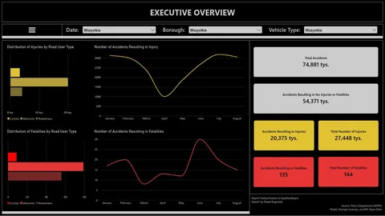
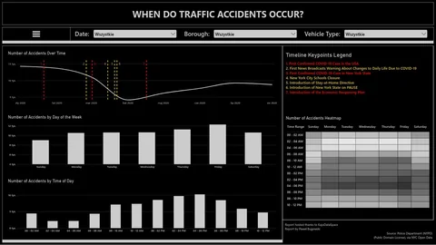
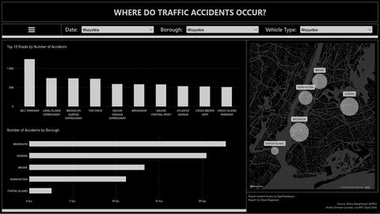
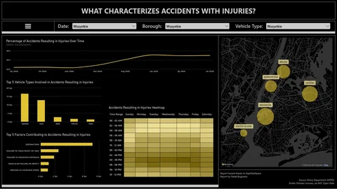
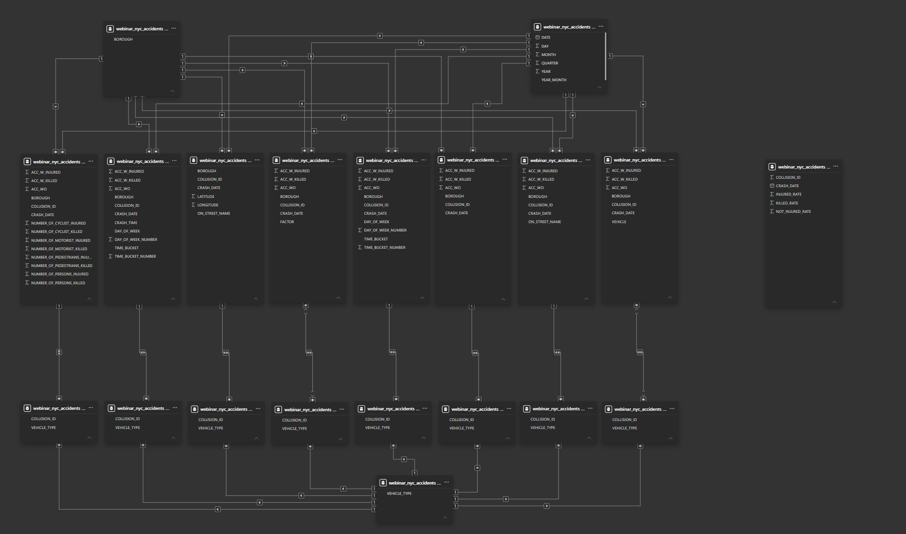
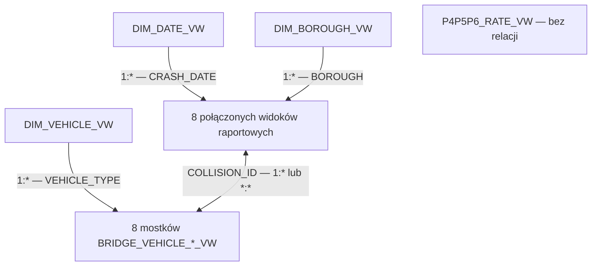

# Zdarzenia drogowe w Nowym Jorku w 2020 roku

## Od surowych danych do raportu o bezpieczeństwie ulic

Projekt analityczny łączący **MySQL, przetwarzanie danych przestrzennych i Power BI**. Na podstawie danych o zgłoszonych zdarzeniach drogowych w Nowym Jorku przedstawia ich skalę, skutki dla uczestników ruchu, rozkład w czasie oraz zróżnicowanie geograficzne.

Analizę przygotowałem, aby wesprzeć rozmowę o bezpieczeństwie ulic: wskazać miejsca i sytuacje wymagające dalszego zbadania, z uwzględnieniem zarówno częstotliwości zdarzeń, jak i liczby osób rannych i zabitych.

**[Otwórz interaktywny raport w Power BI](https://app.powerbi.com/view?r=eyJrIjoiOWIzYWE4NGYtZmI1OS00MWU1LThmYzktZDI4M2UwYmE3YmI0IiwidCI6ImE0ZmE1ZWNhLTdhM2YtNDRhYS04ZTI4LTc2MjBhMzk0NjEwZiJ9)**

> **Zakres danych:** 1 stycznia–29 sierpnia 2020, 74 881 zdarzeń. Mimo rocznika w nazwie projektu załączony zbiór nie obejmuje pełnego 2020 roku. Sierpień jest miesiącem niepełnym.

| Element | Zakres |
| --- | --- |
| Autor analizy i raportu | Paweł Bugowski |
| Obszar | Nowy Jork: Bronx, Brooklyn, Manhattan, Queens, Staten Island |
| Dane wejściowe | `NYC.csv`, 74 881 rekordów i 29 kolumn |
| Poziom szczegółowości danych | Jeden wiersz odpowiada jednemu zdarzeniu |
| Identyfikator zdarzenia | `COLLISION_ID` |
| Przygotowanie danych | 7 udokumentowanych skryptów MySQL |
| Warstwa SQL | 2 tabele oraz 20 widoków |
| Raport | 6 stron Power BI |
| Hosting raportu | KajoDataSpace, zgodnie ze stopką raportu |

## Spis treści

- [Cel i pytania analityczne](#cel-i-pytania-analityczne)
- [Dane i ich zakres](#dane-i-ich-zakres)
- [Najważniejsze wyniki](#najważniejsze-wyniki)
- [Zawartość repozytorium](#zawartość-repozytorium)
- [Przygotowanie danych w SQL](#przygotowanie-danych-w-sql)
- [Model danych i zasady agregacji](#model-danych-i-zasady-agregacji)
- [Raport Power BI](#raport-power-bi)
- [Jak odtworzyć projekt](#jak-odtworzyć-projekt)
- [Kontrola jakości i zapytania kontrolne](#kontrola-jakości-i-zapytania-kontrolne)
- [Źródła i autorstwo](#źródła-i-autorstwo)

## Cel i pytania analityczne

Mapa zdarzeń jest punktem wyjścia do analizy. Aby przygotować użyteczne rekomendacje dotyczące dalszej obserwacji ulic, trzeba zestawić liczbę zdarzeń z ich skutkami oraz uwzględnić czas i kontekst lokalizacji.

Projekt odpowiada na następujące pytania:

1. Ile zdarzeń odnotowano i jak często wiązały się one z obrażeniami lub śmiercią?
2. Jak rozkładają się liczby rannych i zabitych wśród pieszych, rowerzystów oraz osób podróżujących pojazdami?
3. W których miesiącach, dniach tygodnia i porach dnia występuje najwięcej zdarzeń?
4. Które dzielnice i nazwy ulic skupiają największą liczbę zgłoszeń?
5. Jak różnią się pojazdy i zgłoszone czynniki w zdarzeniach bez poszkodowanych, z rannymi oraz ze skutkiem śmiertelnym?
6. Jakie miejsca i sytuacje warto objąć dokładniejszą analizą przed planowaniem działań w terenie?

W dalszym opisie używam określenia **„zdarzenie”** dla wszystkich rekordów zbioru, także tych bez rannych i zabitych. Pozwala to zachować rozróżnienie między całym zbiorem kolizji a zdarzeniami powodującymi szkody osobowe.

## Dane i ich zakres

### Pochodzenie i jednostka obserwacji

Plik `NYC.csv` zawiera dane o zdarzeniach drogowych wykorzystane w projekcie. Stopka raportu wskazuje **Police Department (NYPD), via NYC Open Data**. Odpowiadający mu publiczny zbiór to [Motor Vehicle Collisions – Crashes](https://data.cityofnewyork.us/Public-Safety/Motor-Vehicle-Collisions-Crashes/h9gi-nx95).

Jednostką obserwacji jest zdarzenie, a nie osoba ani pojedynczy pojazd. Do jednego rekordu przypisano datę, czas, lokalizację, liczby poszkodowanych oraz maksymalnie pięć pól opisujących typy pojazdów i pięć pól opisujących zgłoszone czynniki.

W załączonym pliku występuje **74 881 różnych identyfikatorów `COLLISION_ID`**, bez brakujących identyfikatorów i bez ich duplikatów. Daty obejmują wszystkie 242 dni od 1 stycznia do 29 sierpnia 2020. Nie oznacza to automatycznie kompletności rejestru wszystkich zdarzeń drogowych w mieście.

Publiczny zbiór źródłowy jest aktualizowany. Wyniki tego projektu odnoszą się do konkretnego pliku `NYC.csv`, dlatego późniejszy eksport z NYC Open Data może zawierać inne liczby lub skorygowane rekordy.

### Słownik najważniejszych pól

Nagłówki CSV zawierają spacje, natomiast nazwy odpowiadających im kolumn SQL wykorzystują podkreślenia, z zachowaniem `COLLISION_ID`.

| Grupa | Pola w SQL | Znaczenie |
| --- | --- | --- |
| Identyfikacja | `COLLISION_ID` | Identyfikator zdarzenia |
| Czas | `CRASH_DATE`, `CRASH_TIME` | Data i godzina zdarzenia |
| Podział administracyjny | `BOROUGH`, `ZIP_CODE` | Dzielnica i kod pocztowy |
| Współrzędne | `LATITUDE`, `LONGITUDE`, `LOCATION` | Położenie zdarzenia; `LOCATION` w CSV jest tekstem WKT, np. `POINT (...)` |
| Ulice | `ON_STREET_NAME`, `CROSS_STREET_NAME`, `OFF_STREET_NAME` | Nazwa ulicy, ulicy przecinającej oraz opis lokalizacji poza ulicą |
| Poszkodowani ogółem | `NUMBER_OF_PERSONS_INJURED`, `NUMBER_OF_PERSONS_KILLED` | Liczba osób rannych i zabitych |
| Piesi | `NUMBER_OF_PEDESTRIANS_INJURED`, `NUMBER_OF_PEDESTRIANS_KILLED` | Ranni i zabici piesi |
| Rowerzyści | `NUMBER_OF_CYCLIST_INJURED`, `NUMBER_OF_CYCLIST_KILLED` | Ranni i zabici rowerzyści |
| Osoby podróżujące pojazdami | `NUMBER_OF_MOTORIST_INJURED`, `NUMBER_OF_MOTORIST_KILLED` | Ranni i zabici w kategorii `Motorists`, obejmującej więcej niż samych kierowców |
| Zgłoszone czynniki | `CONTRIBUTING_FACTOR_VEHICLE_1`–`5` | Czynniki przypisane do kolejnych pozycji pojazdów |
| Typy pojazdów | `VEHICLE_TYPE_CODE_1`–`5` | Typy pojazdów zapisane w kolejnych pozycjach |

Pięć pozycji pojazdów to struktura tego eksportu, a nie dowód, że w każdym zdarzeniu uczestniczyło pięć pojazdów. Puste pozycje mogą oznaczać brak kolejnego pojazdu lub brak informacji o jego typie.

### Jakość danych wejściowych

Poniższe wartości obliczono dla surowego CSV, **przed uzupełnieniem dzielnic za pomocą geometrii**.

| Kontrola | Liczba rekordów | Udział zbioru |
| --- | ---: | ---: |
| Brak `BOROUGH` | 25 741 | 34,38% |
| Brak pary współrzędnych | 5 946 | 7,94% |
| Współrzędne obecne, ale co najmniej jedna równa zero | 63 | 0,08% |
| Łącznie brak współrzędnych lub wartość zerowa | 6 009 | 8,02% |
| Brak `ON_STREET_NAME` | 19 437 | 25,96% |

Data, godzina, identyfikator i osiem pól liczby poszkodowanych są w tym pliku kompletne. Dla każdego rekordu suma rannych pieszych, rowerzystów i osób w kategorii `Motorists` odpowiada liczbie rannych ogółem. Analogiczna zgodność występuje dla zabitych.

Braki lokalizacji mają znaczenie dla interpretacji: zbiór zdarzeń prezentowanych na mapie może być mniejszy niż zbiór używany do obliczenia głównych KPI. Samo posiadanie niezerowych współrzędnych nie jest jeszcze pełną kontrolą poprawności położenia.

## Najważniejsze wyniki

Wartości poniżej obliczono bezpośrednio z `NYC.csv`, według definicji flag z SQL. Sześć podstawowych KPI jest zgodnych ze stroną przeglądu ogólnego w publicznym raporcie przy filtrach ustawionych na wszystkie wartości.

### Skala zdarzeń i ich skutki

| Wskaźnik | Wartość | Interpretacja |
| --- | ---: | --- |
| Wszystkie zdarzenia | **74 881** | Unikalne zdarzenia w analizowanym okresie |
| Bez zgłoszonych rannych i zabitych | **54 371** | 72,61% zdarzeń |
| Z rannymi, bez zabitych | **20 375** | 27,21% zdarzeń |
| Z co najmniej jedną osobą zabitą | **135** | 0,18% zdarzeń |
| Osoby ranne | **27 448** | Liczba osób, także rannych w zdarzeniach śmiertelnych |
| Osoby zabite | **144** | Liczba osób, a nie liczba zdarzeń śmiertelnych |

**135 zdarzeń śmiertelnych i 144 osoby zabite opisują dwie różne miary.** Tak samo 20 375 zdarzeń z rannymi bez zabitych nie jest równoważne 27 448 osobom rannym.

| Grupa uczestników | Ranni | Zabici |
| --- | ---: | ---: |
| Piesi | 4 099 | 56 |
| Rowerzyści | 3 273 | 9 |
| Motorists | 20 076 | 79 |
| **Łącznie** | **27 448** | **144** |

Piesi stanowią około **14,93% rannych**, ale **38,89% zabitych** w tym zbiorze. To uzasadnia osobne przyjrzenie się zdarzeniom z udziałem pieszych. Te udziały nie mierzą prawdopodobieństwa wypadku podczas podróży, ponieważ zbiór nie zawiera liczby pieszych, podróży ani pokonanych kilometrów.

### Rozkład w czasie

| Miesiąc 2020 | Liczba zdarzeń |
| --- | ---: |
| Styczeń | 14 287 |
| Luty | 13 684 |
| Marzec | 11 057 |
| Kwiecień | 4 116 |
| Maj | 6 149 |
| Czerwiec | 7 616 |
| Lipiec | 9 225 |
| Sierpień, do 29.08 | 8 747 |

Kwiecień ma najmniejszą liczbę zgłoszeń spośród miesięcy objętych analizą. W porównaniu ze styczniem liczba zdarzeń jest niższa o około **71,19%**. Raport przedstawia ten przebieg w kontekście wydarzeń związanych z COVID-19. Zbieżność w czasie nie wystarcza jednak do określenia wpływu poszczególnych ograniczeń na liczbę zdarzeń.

Najwięcej zdarzeń przypada na **piątki: 12 271**. Największą liczbę zgłoszeń spośród dwugodzinnych przedziałów ma **16:00–18:00: 10 193**. Są to sumy dla całego badanego okresu; przy szczegółowym porównywaniu dni tygodnia warto uwzględnić liczbę ich wystąpień w kalendarzu.

### Przykłady miejsc do dalszego zbadania

Poniższe przykłady zestawiają częstotliwość zdarzeń z ich skutkami. Obliczenia grupują rekordy według `ON_STREET_NAME` po usunięciu spacji na początku i końcu. Nie łączą różnych wariantów nazw i nie identyfikują pojedynczych skrzyżowań.

| Nazwa ulicy lub trasy | Zdarzenia | Ranni ogółem | Zabici ogółem | Ranni piesi | Pytanie do dalszej analizy |
| --- | ---: | ---: | ---: | ---: | --- |
| BELT PARKWAY | 1 241 | 689 | 1 | 3 | Na których odcinkach i w jakich godzinach skupiają się zdarzenia? |
| BROADWAY | 575 | 248 | 1 | 53 | Które lokalizacje odpowiadają za zdarzenia z rannymi pieszymi? |
| GRAND CENTRAL PKWY | 581 | 342 | 5 | 1 | Jakie okoliczności miały dwa zdarzenia, w których zginęło łącznie pięć osób? |

To przykłady do zawężenia analizy, nie ranking ryzyka. Ta sama nazwa może obejmować wiele odcinków, a czasem lokalizacje w różnych dzielnicach. Przed wizją lokalną należy przejść do współrzędnych, ulic przecinających i konkretnych `COLLISION_ID`.

## Zawartość repozytorium

Pliki SQL i CSV zachowują oryginalne nazwy i znajdują się w katalogu głównym repozytorium. Katalog `assets/` zawiera grafiki prezentujące raport na prywatnej stronie internetowej oraz zrzut modelu danych wykorzystany w dokumentacji.

| Plik | Zawartość |
| --- | --- |
| `NYC.csv` | Dane wejściowe użyte w analizie |
| `1. Database & Table.sql` | Baza `WEBINAR_NYC_ACCIDENTS` i tabela `accidents` |
| `2. Import of data.sql` | Import CSV, obsługa pustych wartości i czasu |
| `3.1. Normalization of data.sql` | Uzupełnienie braków technicznych oraz standaryzacja typów pojazdów i czynników |
| `3.2. Multipolygons.sql` | Granice pięciu dzielnic i przestrzenne uzupełnienie `BOROUGH` |
| `4.1. Creation of reporting views.sql` | Flagi skutków, przedziały godzinowe i 9 widoków raportowych |
| `4.2. Creation of dimension views.sql` | 3 widoki wymiarów: data, dzielnica, typ pojazdu |
| `4.3. Creation of bridges.sql` | 8 widoków mostkowych do filtrowania po typie pojazdu |
| `README.md` | Opis projektu, wyników, modelu i odtworzenia analizy |
| `SQL_STANDARD.md` | Zapis konwencji dokumentowania i refaktoryzacji na podstawie tego projektu |
| `assets/cover.webp`, `assets/cover-thumb.webp` | Okładka projektu i jej miniatura |
| `assets/gallery-01.webp`, `assets/gallery-01-thumb.webp` | Analiza czasu zdarzeń i jej miniatura |
| `assets/gallery-02.webp`, `assets/gallery-02-thumb.webp` | Analiza lokalizacji zdarzeń i jej miniatura |
| `assets/gallery-03.webp`, `assets/gallery-03-thumb.webp` | Analiza zdarzeń z rannymi i jej miniatura |
| `assets/data-model.png` | Zrzut relacji w modelu Power BI |

### Materiały graficzne na stronę internetową

Pełnowymiarowe pliki WebP mają rozdzielczość **1363 × 767 px**, a odpowiadające im miniatury **480 × 270 px**. Okładka przedstawia przegląd ogólny z głównymi KPI. Trzy kolejne grafiki pokazują analizę czasu, lokalizacji oraz zdarzeń z rannymi. Wersje `*-thumb.webp` służą do kart projektu i podglądów galerii, a pełne obrazy do prezentacji szczegółów raportu.

| Okładka | Czas zdarzeń | Lokalizacja zdarzeń | Zdarzenia z rannymi |
| --- | --- | --- | --- |
| [](assets/cover.webp) | [](assets/gallery-01.webp) | [](assets/gallery-02.webp) | [](assets/gallery-03.webp) |

Publiczny link umożliwia obejrzenie interaktywnego raportu, skrypty odtwarzają warstwę SQL, a `assets/data-model.png` dokumentuje układ relacji. Zestaw nie zawiera pliku `.pbix` ani `.pbit`; definicje miar DAX, konfiguracja interakcji i pełne formatowanie pozostają częścią pliku raportu.

## Przygotowanie danych w SQL

### 1. Utworzenie bazy i tabeli

Pierwszy skrypt tworzy bazę `WEBINAR_NYC_ACCIDENTS` z kodowaniem `utf8mb4` i porównywaniem tekstu `utf8mb4_unicode_ci`.

Tabela `accidents` zachowuje szeroki układ źródłowego CSV. Datę i godzinę przechowuje jako `DATE` i `TIME`, współrzędne jako `DECIMAL(10, 7)`, liczby poszkodowanych jako `INT`, a identyfikator jako `BIGINT`. Kod pocztowy pozostaje tekstem.

`COLLISION_ID` pełni rolę logicznego klucza zdarzenia. Oryginalny DDL nie deklaruje jednak dla niego `PRIMARY KEY` ani `UNIQUE`, dlatego unikalność należy kontrolować podczas importu.

### 2. Import i wstępne przygotowanie

Import wykorzystuje `LOAD DATA LOCAL INFILE`. Skrypt pomija nagłówek, odczytuje wartości rozdzielone przecinkami i obsługuje opcjonalne cudzysłowy. Dane trafiają najpierw do zmiennych użytkownika, a następnie do kolumn docelowych.

`NULLIF(..., '')` zamienia puste pola na `NULL`. Dla daty i czasu stosowany jest także `TRIM`. Czas konwertowany jest przez `STR_TO_DATE(..., '%H:%i:%s')`. Data w formacie `YYYY-MM-DD` jest przypisywana do kolumny `DATE` bez osobnego wywołania `STR_TO_DATE`.

### 3. Ujednolicenie wartości

Skrypt `3.1` najpierw zastępuje braki ustalonymi wartościami technicznymi, np. `NO BOROUGH`, `NO ZIP CODE`, `NO STREET NAME`, a brakujące współrzędne zerem. Następnie wykonuje reguły `CASE` osobno dla wszystkich pięciu pozycji pojazdów i czynników.

Przykładowe grupowania:

| Obszar | Przykład wartości wejściowej | Kategoria po standaryzacji |
| --- | --- | --- |
| Pojazdy | `Sedan` | `SEDAN` |
| Pojazdy | `Station Wagon/Sport Utility Vehicle` | `SUV` |
| Pojazdy | `Pick-up Truck` | `TRUCK` |
| Pojazdy | `Motorcycle` | `MOTORBIKE` |
| Czynniki | `Driver Inattention/Distraction` | `DISTRACTION` |
| Czynniki | `Unsafe Speed` | `DRIVING AT EXCESSIVE SPEED` |
| Czynniki | `Following Too Closely` | `FAILURE TO MAINTAIN DISTANCE` |
| Czynniki | `Unspecified` | `NO FACTOR` |

Reguły wykorzystują `LOWER`, `LIKE` i kolejność warunków w `CASE`. Pozwala to połączyć warianty opisów w kategorie przydatne na wykresach. Wartości niedopasowane otrzymują **`OTHER`**. Brak typu pojazdu po przejściu reguł trafia do `NO TYPE`, a brak czynnika do `NO FACTOR`.

„Normalization” w nazwie skryptu oznacza tu przede wszystkim **standaryzację wartości kategorii**. Nie jest to pełna normalizacja relacyjna tabeli do oddzielnych tabel zdarzeń, pojazdów i czynników. Szeroka tabela pozostaje podstawą, a przekształcenia do układu długiego realizują widoki.

### 4. Uzupełnienie dzielnic przez analizę przestrzenną

Skrypt `3.2` tworzy tabelę `borough_boundaries`. Zawiera ona nazwę dzielnicy oraz geometrię `MULTIPOLYGON` w układzie **WGS 84, SRID 4326**. Wieloczęściowe geometrie umożliwiają zapis granic dzielnic obejmujących także oddzielone fragmenty lądu i wyspy.

Przypisanie dzielnicy przebiega następująco:

1. Z `LONGITUDE` i `LATITUDE` powstaje punkt przestrzenny.
2. `ST_GeomFromText` interpretuje współrzędne w kolejności długość–szerokość dzięki `axis-order=long-lat`.
3. `ST_Contains` sprawdza zawieranie punktu w geometrii dzielnicy.
4. Aktualizacja obejmuje rekordy z `BOROUGH = 'NO BOROUGH'` i niezerowymi współrzędnymi.

Istniejące nazwy dzielnic nie są nadpisywane. Rekordy bez użytecznych współrzędnych albo bez dopasowania pozostają nierozstrzygnięte. Wynik tej operacji należy kontrolować, porównując liczbę `NO BOROUGH` przed i po wykonaniu skryptu. Niniejsza dokumentacja nie podaje niezweryfikowanej liczby uzupełnionych rekordów.

### 5. Flagi skutków i analiza czasu

Skrypt `4.1` dodaje trzy flagi:

| Flaga | Definicja w kodzie | Zastosowanie |
| --- | --- | --- |
| `ACC_WO` | Żadne z pól rannych ani zabitych nie jest większe od zera | Zdarzenia bez zgłoszonych poszkodowanych |
| `ACC_W_INJURED` | Co najmniej jedno pole rannych jest większe od zera i `NUMBER_OF_PERSONS_KILLED = 0` | Zdarzenia z rannymi bez zabitych według pola ogółem |
| `ACC_W_KILLED` | Co najmniej jedno pole zabitych jest większe od zera | Zdarzenia śmiertelne |

Warunki traktują `NULL` w polach liczbowych jak zero przez `COALESCE`. W załączonym CSV te pola nie mają braków i są wewnętrznie zgodne, więc flagi tworzą trzy rozłączne grupy obejmujące wszystkie zdarzenia. Dla innego wsadu tę własność trzeba ponownie sprawdzić: flaga rannych sprawdza zgony ogółem, a flaga śmiertelna także pola szczegółowe.

Pola `TIME_BUCKET` i `TIME_BUCKET_NUMBER` dzielą dobę na 12 przedziałów po dwie godziny. Granica początkowa jest włączona, a końcowa wyłączona, np. 16:00 należy do przedziału 16:00–18:00. Numer 1–12 umożliwia poprawne sortowanie etykiet w Power BI.

`DAYOFWEEK` i `DAYNAME` dostarczają numer i nazwę dnia tygodnia. W użytej numeracji MySQL niedziela ma numer 1. W `4.2` powstaje dodatkowo `CRASH_DATETIME`, łączące datę i czas.

### 6. Warstwa widoków

| Widok | Zawartość | Szczegółowość |
| --- | --- | --- |
| `P1_VW` | Flagi skutków i liczby rannych oraz zabitych | Jeden wiersz na zdarzenie |
| `P2_VW` | Data, czas, dzień tygodnia i przedział godzinowy | Jeden wiersz na zdarzenie |
| `P3_VW` | Współrzędne, nazwa ulicy, dzielnica i data | Jeden wiersz na zdarzenie |
| `P4P5P6_FACTOR_VW` | Pięć pól czynników połączonych w `FACTOR` | Pięć wierszy na zdarzenie |
| `P4P5P6_VEHICLE_VW` | Pięć pól pojazdów połączonych w `VEHICLE` | Pięć wierszy na zdarzenie |
| `P4P5P6_RATE_VW` | Miesięczne udziały trzech kategorii skutków | Jeden wiersz na zdarzenie z niepustą datą, z powtórzonym udziałem miesięcznym |
| `P4P5P6_MAP_VW` | Identyfikator, data, dzielnica i flagi skutków | Jeden wiersz na zdarzenie; bez współrzędnych |
| `P4P5P6_HEAT_VW` | Flagi skutków, dzień tygodnia i przedział godzinowy | Jeden wiersz na zdarzenie |
| `P4P5P6_STREET_VW` | Flagi skutków i nazwa ulicy | Jeden wiersz na zdarzenie |

Widoki czynników i pojazdów wykorzystują `UNION ALL`, więc zachowują powtórzenia i pozycje z kategorią braku danych. Dla tego zbioru każdy z nich powinien mieć **374 405 wierszy**, czyli pięć razy więcej niż tabela zdarzeń.

Widok udziałów wykorzystuje funkcje okienkowe z podziałem według roku i miesiąca. Przykładowo `INJURED_RATE` to miesięczna suma `ACC_W_INJURED` podzielona przez liczbę wszystkich zdarzeń w tym miesiącu.

## Model danych i zasady agregacji

### Warstwy modelu

Model Power BI składa się z **20 tabel opartych na widokach SQL**: trzech wymiarów, ośmiu widoków raportowych połączonych z wymiarami i mostkami, ośmiu mostków pojazdów oraz jednego odłączonego widoku udziałów miesięcznych. Jest to układ wielofaktowy ze wspólnymi wymiarami daty, dzielnicy i typu pojazdu.

Tabela `accidents` i tabela granic `borough_boundaries` należą do warstwy przygotowania danych w MySQL. Nie są pokazane jako osobne tabele w przedstawionym modelu Power BI.



Poniższy schemat podsumowuje układ widoczny na zrzucie. Nazwy widoków podano zgodnie ze skryptami SQL, dopasowując je do zestawów pól widocznych na diagramie. Strzałki oznaczają kierunki filtrowania. Relacje między widokami raportowymi a odpowiadającymi im mostkami są dwukierunkowe.



### Wymiary

| Wymiar | Klucz logiczny | Rola |
| --- | --- | --- |
| `DIM_DATE_VW` | `DATE` | Ciągły kalendarz od najmniejszej do największej daty `CRASH_DATETIME`; rok, kwartał, miesiąc, dzień i `YEAR_MONTH` |
| `DIM_BOROUGH_VW` | `BOROUGH` | Unikalne niepuste nazwy dzielnic |
| `DIM_VEHICLE_VW` | `VEHICLE_TYPE` | Unikalne typy z pięciu pozycji pojazdów, z wyłączeniem `NO TYPE` |

Kalendarz powstaje przez rekurencyjne CTE `WITH RECURSIVE`. Dla dołączonych danych obejmuje 242 dni. Wymiar dzielnic odrzuca `NULL`, ale może nadal zawierać `NO BOROUGH`, jeśli po uzupełnieniu przestrzennym pozostały nierozpoznane lokalizacje.

### Mostki pojazdów

Zdarzenie może zawierać kilka typów pojazdów, a jeden typ występuje w wielu zdarzeniach. Widoki mostkowe zamieniają pięć kolumn pojazdów na pary **`COLLISION_ID`–`VEHICLE_TYPE`** i wykluczają `NO TYPE`.

Powstają osobne mostki dla `P1`, `P2`, `P3` oraz komponentów `FACTOR`, `HEAT`, `MAP`, `STREET` i `VEHICLE` stron P4–P6. Wszystkie odczytują te same pięć kolumn źródłowych. Rozdzielenie nazw porządkuje ich zastosowanie w poszczególnych częściach modelu.

Ponieważ użyto `UNION ALL`, para zdarzenie–typ może się powtarzać. Jeśli w jednym zdarzeniu uczestniczyły dwa sedany, mostek zawiera dwie takie pozycje. Mostek nie przechowuje numeru pozycji pojazdu ani odrębnego identyfikatora pojazdu.

### Klucze, relacje i filtrowanie

Wymiary daty i dzielnicy są połączone relacjami **jeden-do-wielu (`1:*`)** z ośmioma widokami: `P1_VW`, `P2_VW`, `P3_VW`, `P4P5P6_FACTOR_VW`, `P4P5P6_HEAT_VW`, `P4P5P6_MAP_VW`, `P4P5P6_STREET_VW` oraz `P4P5P6_VEHICLE_VW`. Filtry przechodzą jednokierunkowo z wymiarów do tych widoków.

Wymiar `DIM_VEHICLE_VW` filtruje jednokierunkowo osiem mostków przez `VEHICLE_TYPE`, również w relacjach `1:*`. Każdy mostek łączy się następnie ze swoim widokiem raportowym przez `COLLISION_ID`, z filtrowaniem w obu kierunkach. Dzięki temu wybór typu pojazdu dociera przez mostek do rekordów zdarzeń używanych w danej części raportu.

| Widok raportowy | Odpowiadający mostek | Krotność: widok–mostek | Kierunek filtrowania |
| --- | --- | --- | --- |
| `P1_VW` | `BRIDGE_VEHICLE_P1_VW` | `1:*` | W obu kierunkach |
| `P2_VW` | `BRIDGE_VEHICLE_P2_VW` | `1:*` | W obu kierunkach |
| `P3_VW` | `BRIDGE_VEHICLE_P3_VW` | `1:*` | W obu kierunkach |
| `P4P5P6_FACTOR_VW` | `BRIDGE_VEHICLE_P4P5P6_FACTOR_VW` | `*:*` | W obu kierunkach |
| `P4P5P6_HEAT_VW` | `BRIDGE_VEHICLE_P4P5P6_HEAT_VW` | `1:*` | W obu kierunkach |
| `P4P5P6_MAP_VW` | `BRIDGE_VEHICLE_P4P5P6_MAP_VW` | `1:*` | W obu kierunkach |
| `P4P5P6_STREET_VW` | `BRIDGE_VEHICLE_P4P5P6_STREET_VW` | `1:*` | W obu kierunkach |
| `P4P5P6_VEHICLE_VW` | `BRIDGE_VEHICLE_P4P5P6_VEHICLE_VW` | `*:*` | W obu kierunkach |

Relacje wiele-do-wielu dla czynników i pojazdów wynikają z powtarzania `COLLISION_ID` po obu stronach: widoki rozwijają pięć pozycji źródłowych, a mostki przechowują typy pojazdów przypisane do zdarzeń. Pozostałe sześć widoków zachowuje jeden wiersz na zdarzenie i znajduje się po stronie `1` relacji z mostkiem.

### Odłączony widok udziałów miesięcznych

`P4P5P6_RATE_VW` jest widoczny po prawej stronie zrzutu **bez połączeń z innymi tabelami**. Zawiera `COLLISION_ID`, `CRASH_DATE`, `INJURED_RATE`, `KILLED_RATE` i `NOT_INJURED_RATE`. Nie jest połączony z wymiarami daty, dzielnicy ani pojazdu i nie ma własnego mostka.

Selekcja w tych wymiarach nie dociera więc do niego przez relacje modelu. Udziały zostały wcześniej obliczone w SQL dla całych miesięcy, co odpowiada oznaczeniu wykresów procentowych jako **Static Visualization**. Do osi czasu takiego wykresu dostępna jest data z samego widoku. Zrzut dokumentuje relacje, ale nie zawiera definicji miar DAX ani ustawień interakcji wizualizacji.

### Cztery zasady poprawnego liczenia

1. **Zdarzenia:** licz `DISTINCT COLLISION_ID`, jeżeli źródłem jest widok po rozwinięciu pozycji lub mostek. `COUNT(*)` oznacza tam liczbę pozycji, nie zdarzeń.
2. **Osoby:** sumuj pola liczby rannych i zabitych na poziomie jednego wiersza na zdarzenie. Nie sumuj ich po połączeniu, które zwielokrotniło rekordy.
3. **Pojazdy i czynniki:** rozróżniaj liczbę wystąpień kategorii od liczby zdarzeń zawierających kategorię. Suma po kategoriach może przekraczać liczbę zdarzeń, ponieważ jedno zdarzenie może należeć do kilku kategorii.
4. **Udziały miesięczne:** wartości z `P4P5P6_RATE_VW` są powtórzone w obrębie miesiąca. Dla jednego miesiąca można odczytać je przez `MAX`, `MIN` lub `AVG`, ale nie przez `SUM`. Udział dla szerszego okresu powinien wynikać z odpowiednich liczników i mianowników.

Wskaźniki w `P4P5P6_RATE_VW` zachowują mianownik obliczony w SQL dla całego miesiąca. Ich statyczny charakter wynika zarówno z tego sposobu obliczenia, jak i z odłączenia widoku od wymiarów modelu.

## Raport Power BI

Raport prowadzi od przeglądu skutków do analizy czasu i lokalizacji, a następnie do porównania trzech kategorii zdarzeń. Sześć stron obejmuje przegląd ogólny, czas, lokalizację oraz zdarzenia bez poszkodowanych, z rannymi i ze skutkiem śmiertelnym.

### Przegląd ogólny

Strona otwierająca pokazuje sześć KPI: wszystkie zdarzenia, zdarzenia bez poszkodowanych, zdarzenia z rannymi bez zabitych, liczbę rannych, zdarzenia śmiertelne i liczbę zabitych. Uzupełniają je wykresy rozkładu rannych i zabitych według grup uczestników oraz trend liczby zdarzeń z rannymi i ze skutkiem śmiertelnym.

Ta strona odpowiada na pytanie o skalę problemu i pozwala od razu oddzielić miary zdarzeń od miar osób. Głównym widokiem źródłowym jest `P1_VW`.

### Kiedy dochodzi do zdarzeń?

Strona przedstawia liczbę zdarzeń w czasie, według dni tygodnia i przedziałów godzinowych oraz heatmapę łączącą dzień tygodnia z porą dnia. Podstawą jest `P2_VW`.

Wykres czasowy uzupełniono oznaczeniami wydarzeń pandemicznych i legendą obejmującą m.in. pierwsze przypadki COVID-19, zamknięcie szkół, zalecenia pozostania w domu, New York State on PAUSE i plan ponownego otwierania gospodarki. Są one kontekstem narracji raportu. Ich daty i sposób przypisania nie są udokumentowane w dostarczonych skryptach SQL.

### Gdzie dochodzi do zdarzeń?

Strona zawiera ranking dziesięciu nazw ulic lub tras, wykres liczby zdarzeń według dzielnic oraz mapę. W podglądzie bez filtrów mapa prezentuje bąble dla dzielnic. Chociaż `P3_VW` udostępnia współrzędne pojedynczych zdarzeń, domyślnego widoku mapy nie należy interpretować jako osobnego punktu dla każdego zdarzenia.

Zestawienie wspiera wybór obszaru do dalszej analizy. Ranking po samej nazwie ulicy nie wskazuje jeszcze konkretnego skrzyżowania ani odcinka.

### Zdarzenia bez rannych i zabitych

Strona pokazuje miesięczny udział tej kategorii, pięć najczęstszych typów pojazdów, pięć zgłoszonych czynników, heatmapę i mapę dzielnic. Pozwala przyjrzeć się zdarzeniom, które stanowią największą część zbioru, ale nie mają zgłoszonych szkód osobowych.

### Zdarzenia z rannymi

Zachowuje ten sam układ co poprzednia strona, ułatwiając porównanie profilu zdarzeń. Zgodnie z flagą `ACC_W_INJURED` obejmuje zdarzenia z rannymi **bez zabitych**, a nie wszystkie zdarzenia, w których ktokolwiek odniósł obrażenia.

### Zdarzenia śmiertelne

Ostatnia strona koncentruje się na zdarzeniach z co najmniej jedną osobą zabitą. Pokazuje udział miesięczny, typy pojazdów, zgłoszone czynniki, heatmapę oraz mapę. W publicznym widoku bez filtrów najwyższą pozycję rankingu czynników zajmuje `DRIVING AT EXCESSIVE SPEED`. Jest to obserwacja o zgłoszonych czynnikach w tej kategorii, a nie samodzielny dowód przyczynowy.

### Filtry i warstwa wizualna

Na stronach raportu widoczne są selektory **Date (`YEAR_MONTH`), Borough (`BOROUGH`) i Vehicle Type (`VEHICLE_TYPE`)**. Umożliwiają wybór kontekstu analizy dla powiązanych wizualizacji. Wykresy udziałów na stronach P4–P6 są osobno oznaczone jako statyczne.

Raport wykorzystuje ciemne tło, jasne wykresy i wspólny układ nawigacji. Strona dotycząca skutków śmiertelnych wyróżnia dane czerwienią. Powtarzalny układ ostatnich trzech stron ułatwia porównanie czasu, geografii, pojazdów i czynników przy zmianie kategorii skutków.

Praktyczna ścieżka pracy z raportem to: sprawdzenie KPI, wybór miesiąca i dzielnicy, porównanie analizy czasu i lokalizacji, a następnie zestawienie kategorii skutków. Przed sformułowaniem rekomendacji terenowej warto wrócić do rekordów konkretnych zdarzeń.

## Jak odtworzyć projekt

### Wymagania

- MySQL 8.0 z obsługą użytych funkcji przestrzennych, funkcji okienkowych i rekurencyjnych CTE.
- Klient SQL umożliwiający wykonanie skryptów i import `LOAD DATA LOCAL INFILE`.
- Dostęp do `NYC.csv` oraz uprawnienia do utworzenia bazy, tabel, widoków i aktualizacji danych.
- Power BI Desktop i działające połączenie z MySQL, jeżeli celem jest zbudowanie własnego modelu raportowego.

### Przygotowanie środowiska

1. Pobierz pliki repozytorium i zachowaj niezmieniony CSV jako źródło.
2. W `2. Import of data.sql` zamień lokalną ścieżkę autora `C:/Users/pbugo/Desktop/Webinar/NYC.csv` na własną ścieżkę do pliku.
3. Sprawdź obsługę lokalnego importu po stronie serwera i klienta. Skrypt zawiera `SET GLOBAL local_infile = 1`, które wymaga odpowiednich uprawnień. Jeśli parametr jest już włączony, administrator może dostosować ten krok do środowiska.
4. W środowisku rozróżniającym wielkość liter w nazwach tabel ujednolić należy odwołania `ACCIDENTS` w dwóch widokach `UNION ALL` do nazwy tabeli `accidents`.
5. Wykonuj skrypty w nowej, przeznaczonej do tego projektu bazie i w podanej niżej kolejności.

### Kolejność wykonania

| Kolejność | Skrypt | Oczekiwany rezultat |
| --- | --- | --- |
| 1 | `1. Database & Table.sql` | Baza i pusta tabela `accidents` |
| 2 | `2. Import of data.sql` | 74 881 wierszy po jednorazowym imporcie |
| 3 | `3.1. Normalization of data.sql` | Ujednolicone kategorie i oznaczenia braków |
| 4 | `3.2. Multipolygons.sql` | Pięć geometrii dzielnic i próba uzupełnienia brakującego `BOROUGH` |
| 5 | `4.1. Creation of reporting views.sql` | Flagi skutków, przedziały czasu i widoki raportowe |
| 6 | `4.2. Creation of dimension views.sql` | `CRASH_DATETIME` oraz wymiary daty, dzielnicy i pojazdu |
| 7 | `4.3. Creation of bridges.sql` | Mostki pojazdów |

Jeżeli klient otwiera każdy plik w osobnej sesji, przed kolejnymi etapami wybierz bazę:

```sql
USE WEBINAR_NYC_ACCIDENTS;
```

**Skrypty są sekwencją przygotowania danych, a nie idempotentnymi migracjami.** Ponowne wykonanie importu dopisze rekordy, `ALTER TABLE ... ADD COLUMN` może zakończyć się błędem, a skrypt granic ponownie doda geometrie. Ponowne zastosowanie reguł normalizacji do już znormalizowanych kategorii może również zmienić wyniki. Pełne odtworzenie powinno zaczynać się od świeżego środowiska i oryginalnego CSV.

### Odtworzenie warstwy Power BI

Po wykonaniu SQL można połączyć Power BI z bazą i zaimportować 20 widoków. Należy sprawdzić typy kolumn, oznaczyć tabelę dat oraz ustawić sortowanie dni tygodnia i przedziałów godzinowych. Relacje należy odtworzyć według zrzutu i tabeli w sekcji modelu danych: wymiary daty i dzielnicy filtrują osiem widoków raportowych, wymiar pojazdu filtruje osiem mostków, a mostki łączą się dwukierunkowo z odpowiadającymi widokami. `P4P5P6_RATE_VW` pozostaje bez relacji.

Dla map trzeba wykluczyć brakujące i zerowe współrzędne, a dla analiz kategorii określić sposób obsługi `NO TYPE`, `NO FACTOR`, `OTHER` i `NO BOROUGH`. Widok `P4P5P6_MAP_VW` sam nie zawiera współrzędnych, więc mapa punktów wymaga ich pozyskania z innego widoku lub tabeli. Do mapowania dzielnic dostępne jest pole `BOROUGH`.

Te kroki umożliwiają zbudowanie raportu na tej samej warstwie danych. Nie stanowią automatycznego odtworzenia opublikowanego pliku Power BI, którego nie ma w zestawie.

## Kontrola jakości i zapytania kontrolne

Poniższe zapytania służą do weryfikacji po wykonaniu odpowiednich etapów. Wartości referencyjne pochodzą z profilowania załączonego CSV i odtworzenia definicji flag. W ramach przygotowania dokumentacji nie wykonano całego pipeline’u na serwerze MySQL.

### Liczba rekordów, unikalność i zakres dat

```sql
SELECT
    COUNT(*) AS ROW_COUNT,
    COUNT(DISTINCT COLLISION_ID) AS DISTINCT_COLLISION_COUNT,
    MIN(CRASH_DATE) AS FIRST_CRASH_DATE,
    MAX(CRASH_DATE) AS LAST_CRASH_DATE,
    SUM(COLLISION_ID IS NULL) AS MISSING_COLLISION_IDS
FROM accidents;
```

Oczekiwane wartości: `74 881`, `74 881`, `2020-01-01`, `2020-08-29`, `0`.

### Kontrola podstawowych KPI

```sql
SELECT
    SUM(ACC_WO) AS CRASHES_WITHOUT_CASUALTIES,
    SUM(ACC_W_INJURED) AS INJURY_CRASHES_WITHOUT_FATALITIES,
    SUM(ACC_W_KILLED) AS FATAL_CRASHES,
    SUM(NUMBER_OF_PERSONS_INJURED) AS PERSONS_INJURED,
    SUM(NUMBER_OF_PERSONS_KILLED) AS PERSONS_KILLED,
    SUM(
        ACC_WO IS NULL
        OR ACC_W_INJURED IS NULL
        OR ACC_W_KILLED IS NULL
        OR ACC_WO + ACC_W_INJURED + ACC_W_KILLED <> 1
    ) AS INVALID_SEVERITY_ASSIGNMENTS
FROM accidents;
```

Oczekiwane wartości: `54 371`, `20 375`, `135`, `27 448`, `144`, `0`.

### Kontrola widoków rozwiniętych i kalendarza

```sql
SELECT
    COUNT(*) AS POSITION_COUNT,
    COUNT(DISTINCT COLLISION_ID) AS CRASH_COUNT
FROM P4P5P6_VEHICLE_VW;

SELECT
    COUNT(*) AS POSITION_COUNT,
    COUNT(DISTINCT COLLISION_ID) AS CRASH_COUNT
FROM P4P5P6_FACTOR_VW;

SELECT COUNT(*) AS CALENDAR_DAYS
FROM DIM_DATE_VW;
```

Oczekiwane wartości dla obu widoków rozwiniętych: `374 405` pozycji i `74 881` zdarzeń. Kalendarz: `242` dni.

### Kontrola uzupełnienia dzielnic

```sql
SELECT
    BOROUGH,
    COUNT(*) AS CRASH_COUNT
FROM accidents
GROUP BY BOROUGH
ORDER BY CRASH_COUNT DESC;

SELECT
    BoroName,
    COUNT(*) AS BOUNDARY_COUNT
FROM borough_boundaries
GROUP BY BoroName;
```

Pierwsze zapytanie warto wykonać po `3.1` i ponownie po `3.2`. Przed dopasowaniem przestrzennym `NO BOROUGH` powinno liczyć 25 741 rekordów. Drugie zapytanie powinno zwrócić pięć dzielnic, po jednej geometrii każdej z nich.

## Źródła i autorstwo

- **Dane użyte do obliczeń:** plik `NYC.csv` znajdujący się w repozytorium.
- **Publiczny zbiór odpowiadający danym:** [NYPD / NYC Open Data — Motor Vehicle Collisions – Crashes](https://data.cityofnewyork.us/Public-Safety/Motor-Vehicle-Collisions-Crashes/h9gi-nx95).
- **Opis zbioru i aktualizacji:** [katalog Data.gov](https://catalog.data.gov/dataset/motor-vehicle-collisions-crashes).
- **Granice dzielnic użyte w projekcie:** geometrie WKT zapisane w `3.2. Multipolygons.sql`. Skrypt nie podaje ich źródłowego adresu ani daty wersji.
- **Dokumentacja funkcji przestrzennych:** [MySQL 8.0 — Spatial Relation Functions That Use Object Shapes](https://dev.mysql.com/doc/refman/8.0/en/spatial-relation-functions-object-shapes.html).
- **Model danych:** zrzut relacji Power BI zapisany w `assets/data-model.png`.
- **Grafiki raportu:** okładka, trzy obrazy galerii i cztery miniatury w katalogu `assets/`.
- **Autor projektu i raportu:** Paweł Bugowski.
- **Udostępnienie raportu:** KajoDataSpace, zgodnie z oznaczeniem w raporcie.
