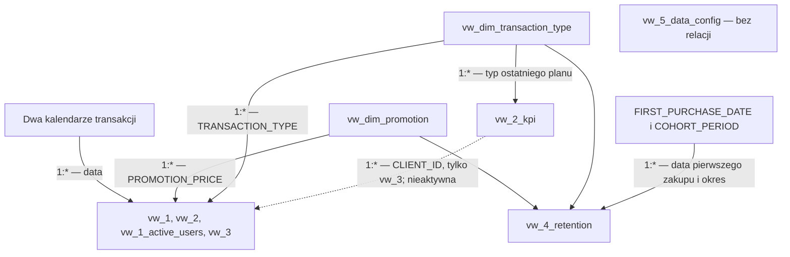

# KajoDataSpace — transakcje i aktywność klientów w latach 2023–2026

## Od danych transakcyjnych do analizy zakupów i retencji

Projekt analityczny łączący **MySQL, analizę historii zakupów i Power BI**. Na podstawie dat transakcji, identyfikatorów klientów i kwot przedstawia zmiany wartości wpłat, strukturę subskrypcji, aktywność nowych i powracających klientów oraz zachowanie kolejnych kohort.

Przygotowałem tę analizę, aby sprawdzić, jak rozwija się aktywność zakupowa i jaka część wpłat pochodzi z kolejnych transakcji tych samych osób. Zestawiłem liczbę zakupów z ich wartością, uwzględniając typy subskrypcji, kategorie cen oraz okresy zmian cen abonamentu miesięcznego.

**[Otwórz interaktywny raport w Power BI](https://app.powerbi.com/view?r=eyJrIjoiNGZjYmEwMDgtZGJhMS00ZGZjLWEyOWUtZDc3MmE0MmU0MzQ1IiwidCI6ImE0ZmE1ZWNhLTdhM2YtNDRhYS04ZTI4LTc2MjBhMzk0NjEwZiJ9)**

> **Zakres danych:** od 5 listopada 2023 do 31 marca 2026 r., łącznie 4 227 transakcji w 29 miesiącach kalendarzowych. Zbiór nie obejmuje czterech pełnych lat: dla 2023 r. dostępna jest końcówka roku, a dla 2026 r. — pierwszy kwartał.

| Element | Zakres |
| --- | --- |
| Autor analizy i raportu | Paweł Bugowski |
| Przedmiot analizy | Transakcje, rodzaje subskrypcji i aktywność zakupowa klientów |
| Dane wejściowe | `Raw Data/transactions.csv`, 4 227 rekordów i 3 kolumny |
| Jednostka obserwacji | Jeden wiersz oznacza jedną transakcję |
| Identyfikator klienta | `Klient` w CSV, `CLIENT_ID` w SQL |
| Identyfikator transakcji | `TRANSACTION_ID`, nadawany podczas importu |
| Przygotowanie danych | 8 udokumentowanych skryptów MySQL |
| Warstwa SQL | 1 tabela i 11 widoków |
| Raport | 5 stron Power BI |
| Udostępnienie raportu | KajoDataSpace, zgodnie ze stopką raportu |

## Spis treści

- [Cele i pytania analityczne](#cele-i-pytania-analityczne)
- [Dane i zakres analizy](#dane-i-zakres-analizy)
- [Najważniejsze wyniki](#najważniejsze-wyniki)
- [Zawartość repozytorium](#zawartość-repozytorium)
- [Przygotowanie danych w SQL](#przygotowanie-danych-w-sql)
- [Model danych i zasady agregacji](#model-danych-i-zasady-agregacji)
- [Raport Power BI](#raport-power-bi)
- [Jak odtworzyć projekt](#jak-odtworzyć-projekt)
- [Kontrola jakości danych i zapytania walidacyjne](#kontrola-jakości-danych-i-zapytania-walidacyjne)
- [Źródła i autor](#źródła-i-autor)

## Cele i pytania analityczne

Suma wpłat pokazuje skalę sprzedaży, ale nie wyjaśnia, co odpowiada za jej zmianę. Wyższy wynik może wynikać z większej liczby zakupów, wyższych cen, innej struktury subskrypcji albo powrotów wcześniejszych klientów. Dlatego analiza łączy perspektywę transakcji, klienta i czasu.

Projekt odpowiada na następujące pytania:

1. Ile transakcji zarejestrowano i jaką wartość wpłat wygenerowały?
2. Jak zmieniają się liczba zakupów, średnia wartość transakcji i przychód z abonamentów miesięcznych?
3. Jaki udział w zakupach mają subskrypcje miesięczne, półroczne i roczne?
4. Jak często kwota transakcji odpowiada zdefiniowanej cenie regularnej?
5. Kiedy pojawiają się nowi klienci i jaka część wpłat pochodzi z kolejnych zakupów?
6. Jak wygląda aktywność klientów w kolejnych miesiącach od pierwszej zaobserwowanej transakcji?
7. Jakie zmiany zakupowe występują w okresach podwyżek cen?

W tym dokumencie **„przychód” oznacza sumę zarejestrowanych wpłat**, zgodnie ze sposobem prezentacji w raporcie. Dane nie opisują księgowego rozpoznawania przychodów w kolejnych miesiącach obowiązywania abonamentu. **„Nowy klient” oznacza pierwszy zakup widoczny w zbiorze**, a nie potwierdzony pierwszy zakup w całej historii relacji z klientem.

## Dane i zakres analizy

### Pochodzenie i jednostka obserwacji

Plik `Raw Data/transactions.csv` zawiera dane wykorzystane w projekcie. Stopka raportu wskazuje **KajoData, za pośrednictwem KajoDataSpace** jako źródło danych.

Jednostką obserwacji jest transakcja, a nie klient ani miesiąc obowiązywania subskrypcji. Ten sam klient może pojawiać się wielokrotnie, ponieważ kolejne rekordy opisują jego następne zakupy. W zbiorze występuje **1 057 różnych identyfikatorów klientów**.

CSV zawiera znacznik czasu z częścią godzinową. Warstwa SQL przechowuje z niego wyłącznie datę, ponieważ analiza koncentruje się na dniach i miesiącach. Oryginalna wartość pozostaje dostępna w surowym pliku.

Wyniki odnoszą się do konkretnego pliku znajdującego się w repozytorium oraz do reguł przygotowania danych zapisanych w SQL. Inny zakres dat, kolejność wierszy lub zmienione kwoty mogą prowadzić do innych wyników.

### Definicje pól źródłowych

| Kolumna CSV | Kolumna SQL | Znaczenie |
| --- | --- | --- |
| `Data transakcji` | `TRANSACTION_DATE` | Data i czas w źródle; data bez godziny po imporcie do SQL |
| `Klient` | `CLIENT_ID` | Identyfikator łączący zakupy tej samej osoby |
| `Kwota` | `TRANSACTION_VALUE` | Wartość pojedynczej wpłaty |

Przykładowy znacznik czasu ma postać `2023-11-05T18:04:23.495000`. Kwoty w raporcie są prezentowane w złotych; CSV nie zawiera osobnej kolumny waluty.

Typ subskrypcji, przewidywany termin odnowienia i kategoria ceny nie są polami źródłowymi. Powstają na podstawie dat i kwot, zgodnie z opisanymi dalej warunkami SQL. W danych nie ma nazw produktów, historii ofert, identyfikatorów kampanii, kosztów ani powodów zakupu.

### Jakość danych wejściowych

Poniższe wartości dotyczą surowego CSV, **przed korektą kwoty jednej transakcji**.

| Kontrola | Liczba rekordów | Udział zbioru |
| --- | ---: | ---: |
| Brak daty transakcji | 0 | 0,00% |
| Brak identyfikatora klienta | 0 | 0,00% |
| Brak kwoty | 0 | 0,00% |
| Niepoprawny znacznik czasu przy odczycie formatu ISO | 0 | 0,00% |
| Kwota równa zero lub ujemna | 0 | 0,00% |
| Powtórzony cały wiersz CSV | 0 | 0,00% |

Wszystkie trzy pola są wypełnione. Brak identycznych wierszy nie oznacza, że każda osoba występuje tylko raz — kolejne zakupy są podstawą analizy historii klienta.

CSV nie zawiera identyfikatora transakcji. `TRANSACTION_ID` jest generowany przez bazę w kolejności importu. Z tego powodu odtworzenie przetwarzania wymaga zachowania oryginalnej kolejności wierszy, zwłaszcza przy korekcie wskazanego rekordu.

## Najważniejsze wyniki

Wartości poniżej zostały obliczone dla danych po przygotowaniu zgodnie ze skryptami SQL, w tym po korekcie transakcji nr 299. Liczebności oraz prezentowane statystyki kwot są zgodne z pełnym zakresem opublikowanego raportu. Karty sumy przychodów i maksymalnej kwoty stosują skróty odpowiednio do milionów i tysięcy, dlatego nie pokazują dokładności co do grosza.

### Skala transakcji i wartości wpłat

| Wskaźnik | Wartość | Interpretacja |
| --- | ---: | --- |
| Wszystkie transakcje | **4 227** | Zarejestrowane wpłaty w okresie analizy |
| Unikalni klienci | **1 057** | Różne identyfikatory `CLIENT_ID` |
| Miesiące obserwacji | **29** | Miesiące kalendarzowe zawierające transakcje |
| Łączny przychód | **1 042 416,27 zł** | Suma wpłat po korekcie |
| Średnia wartość transakcji | **246,61 zł** | Suma wpłat podzielona przez liczbę transakcji |
| Mediana wartości transakcji | **169,00 zł** | Środkowa kwota w uporządkowanym zbiorze |
| Minimalna wartość transakcji | **35,60 zł** | Najmniejsza wpłata |
| Maksymalna wartość transakcji | **2 089,05 zł** | Największa wpłata |
| Aktywni klienci | **393** | Klienci spełniający regułę przewidywanej daty odnowienia na 31 marca 2026 r. |

**Liczba transakcji i liczba klientów opisują różne wielkości.** Podobnie 393 aktywnych klientów nie oznacza liczby osób, które dokonały zakupu w ostatnim miesiącu. Wskaźnik uwzględnia przewidywany termin odnowienia wynikający z wcześniejszych wpłat i długości przypisanego planu.

| Rodzaj subskrypcji | Transakcje | Udział transakcji |
| --- | ---: | ---: |
| Miesięczna | 3 833 | 90,68% |
| Półroczna | 49 | 1,16% |
| Roczna | 345 | 8,16% |
| **Razem** | **4 227** | **100,00%** |

Przewaga planu miesięcznego dotyczy liczby zakupów. Nie oznacza takiego samego udziału w przychodzie ani w liczbie miesięcy opłaconego dostępu. Jedna transakcja roczna i jedna miesięczna mają różną wartość i różny zakładany okres obowiązywania.

### Zmiany w czasie

| Rok i dostępny zakres | Transakcje | Suma wpłat |
| --- | ---: | ---: |
| 2023, od 5 listopada | 132 | 32 430,77 zł |
| 2024, styczeń–grudzień | 1 187 | 238 495,14 zł |
| 2025, styczeń–grudzień | 2 239 | 579 573,31 zł |
| 2026, styczeń–marzec | 669 | 191 917,05 zł |

Wartości dla 2023 i 2026 r. odnoszą się do niepełnych lat. Do oceny dynamiki w całym okresie przydatne jest porównanie miesięczne, z rozdzieleniem liczby transakcji i ich średniej wartości.

| Miesiąc | Transakcje miesięcznego planu | Przychód z miesięcznego planu | Średnia kwota | Nowi klienci miesięcznego planu |
| --- | ---: | ---: | ---: | ---: |
| Sierpień 2024 | 60 | 5 336,86 zł | 88,95 zł | 0 |
| Wrzesień 2024 | 138 | 19 167,42 zł | 138,89 zł | 81 |
| Sierpień 2025 | 156 | 26 150,82 zł | 167,63 zł | 29 |
| Wrzesień 2025 | 198 | 34 943,04 zł | 176,48 zł | 53 |
| Marzec 2026 | 210 | 41 895,76 zł | 199,50 zł | 47 |

We wrześniu 2024 oraz we wrześniu 2025 wzrosły zarówno liczba zakupów miesięcznych, jak i ich średnia wartość względem poprzedniego miesiąca. Wzrost przychodów w tych porównaniach wiąże się więc z oboma składnikami.

Są to miesiące oznaczone w raporcie jako okresy podwyżek. Zbieżność czasowa nie rozstrzyga, czy zmianę wywołała komunikacja nowych cen, kampania, sezonowość czy inne czynniki. Dane miesięczne nie wskazują też, czy zakup nastąpił przed konkretną datą podwyżki.

### Kolejne zakupy i ceny niestandardowe

**595 klientów**, czyli **56,29% wszystkich klientów**, ma więcej niż jedną transakcję. Po pierwszych zakupach występuje **3 170 kolejnych transakcji**, generujących **539 973,29 zł**, czyli **51,80% sumy wpłat**. Pozostałe **502 442,98 zł** pochodzą z pierwszych zaobserwowanych zakupów.

To uzupełniający wynik obliczeń SQL, a nie osobna karta w raporcie. Pierwsza wpłata osoby, która później wróciła, pozostaje w kategorii pierwszych zakupów. Dzięki temu udział kolejnych wpłat nie obejmuje całej historii wszystkich klientów kupujących wielokrotnie.

Podział cen obejmuje **1 215 transakcji regularnych** i **3 012 niestandardowych**, czyli odpowiednio **28,74%** i **71,26%**. Druga kategoria jest w raporcie opisana jako promocyjna. Jej definicja obejmuje jednak wszystkie kwoty spoza wskazanych cen regularnych, również wyższe; nie jest niezależnym potwierdzeniem zastosowania rabatu.

## Zawartość repozytorium

Repozytorium obejmuje trzy katalogi: `SQL/` ze skryptami, `Assets/` z grafikami WebP oraz `Raw Data/` z surowymi danymi CSV. Plik `README.md` znajduje się w katalogu głównym.

| Plik | Zawartość |
| --- | --- |
| `Raw Data/transactions.csv` | Oryginalne dane wejściowe, przed korektą i wzbogaceniem w SQL |
| `SQL/1_Database_and_Table.sql` | Baza `KDS_Transactions` i tabela `transactions` |
| `SQL/2_Import_of_Data.sql` | Import CSV, odczyt dat i obsługa pustych wartości |
| `SQL/3_Preparation_of_Data.sql` | Typy subskrypcji, daty odnowień, korekta kwoty, kategorie cen i atrybuty dat |
| `SQL/4.1_Dimension_Views.sql` | 4 widoki wymiarów: typ subskrypcji, rok, miesiąc i flaga ceny |
| `SQL/4.2_Transaction_Activity_Views.sql` | 3 widoki agregacji i szczegółów aktywności |
| `SQL/4.3_Customer_History_Views.sql` | 2 widoki historii klienta i pierwszych zakupów |
| `SQL/4.4_Cohort_Retention_View.sql` | Szczegółowe dane wejściowe do analizy kohort |
| `SQL/4.5_Overall_Statistics_View.sql` | Globalne statystyki, aktywni klienci i mediana |
| `README.md` | Opis projektu, wyników, modelu i sposobu odtworzenia |
| `Assets/cover.webp`, `Assets/cover-thumb.webp` | Podgląd strony przeglądowej i miniatura |
| `Assets/gallery-01.webp`, `Assets/gallery-01-thumb.webp` | Przychody i struktura cen oraz miniatura |
| `Assets/gallery-02.webp`, `Assets/gallery-02-thumb.webp` | Nowi klienci i aktywność zakupowa oraz miniatura |
| `Assets/gallery-03.webp`, `Assets/gallery-03-thumb.webp` | Macierz retencji kohortowej i miniatura |

Publiczny link udostępnia interaktywny raport, a skrypty odtwarzają warstwę SQL. Schemat w części poświęconej modelowi pokazuje jego strukturę logiczną. Zestaw nie zawiera pliku `.pbix` ani `.pbit`; definicje miar DAX, ustawienia interakcji oraz pełne formatowanie pozostają częścią pliku raportu.

## Przygotowanie danych w SQL

### 1. Utworzenie bazy i tabeli

Pierwszy skrypt tworzy bazę `KDS_Transactions` z kodowaniem `utf8mb4` i regułą porównywania tekstu `utf8mb4_unicode_ci`.

Tabela `transactions` przechowuje dane źródłowe oraz atrybuty wyznaczane podczas przygotowania. Kwoty mają typ `DECIMAL(10,2)`, identyfikatory i numery okresów — `INT`, daty — `DATE`, a etykiety kategorii — `VARCHAR`.

`TRANSACTION_ID` jest kluczem głównym z `AUTO_INCREMENT`. Zapewnia unikalność technicznego identyfikatora w tabeli, ale nie zabezpiecza przed ponownym zaimportowaniem tego samego CSV: takie rekordy otrzymałyby kolejne identyfikatory.

### 2. Import i przygotowanie wartości

Import korzysta z `LOAD DATA LOCAL INFILE`. Skrypt pomija nagłówek, rozpoznaje przecinki jako separatory i dopuszcza wartości otoczone podwójnymi cudzysłowami. Trzy kolumny są najpierw odczytywane do zmiennych użytkownika, a następnie przypisywane do pól tabeli.

Wyrażenie `STR_TO_DATE(LEFT(TRIM(@TRANSACTION_DATE), 10), '%Y-%m-%d')` usuwa otaczające spacje, zachowuje część daty i przekształca ją do typu `DATE`. Część godzinowa nie trafia do tabeli. `NULLIF(..., '')` zamienia puste identyfikatory i kwoty na `NULL`.

Ścieżka `'Raw Data/transactions.csv'` jest względna wobec katalogu roboczego klienta MySQL. Nie jest automatycznie interpretowana względem katalogu, w którym zapisano skrypt.

### 3. Typy subskrypcji i przewidywane odnowienia

Skrypt przygotowania klasyfikuje kwoty przez `CASE`, a następnie używa `DATE_ADD` do wyznaczenia przewidywanego terminu kolejnego zakupu.

| Warunek | `TRANSACTION_TYPE` | `EXPECTED_RENEWAL_DATE` |
| --- | --- | --- |
| Kwota poniżej 260 zł | `MONTHLY` | Data transakcji + 1 miesiąc |
| Kwota powyżej 260 zł i poniżej 600 zł | `SEMI-ANNUAL` | Data transakcji + 6 miesięcy |
| Kwota powyżej 600 zł | `ANNUAL` | Data transakcji + 12 miesięcy |

Dokładne kwoty 260 i 600 zł pozostają poza warunkami. W dostarczonym CSV nie występują, dlatego wszystkie transakcje otrzymują typ subskrypcji. Przy innym źródle należałoby ponownie sprawdzić kompletność klasyfikacji.

Przesunięcia są wyrażone w miesiącach kalendarzowych, a nie w stałej liczbie dni. Otrzymana data jest terminem wynikającym z przyjętej długości planu — nie dowodem, że kolejny zakup rzeczywiście nastąpił.

### 4. Korekta kwoty i klasyfikacja cen

Transakcja `TRANSACTION_ID = 299` jest zmieniana z **198 zł na 99 zł**. Przy pierwszym imporcie oryginalnego pliku odpowiada to wpłacie klienta `140` z 24 marca 2024 r. Korekta znajduje się jawnie w SQL; CSV zachowuje kwotę źródłową.

Suma surowych wpłat wynosi **1 042 515,27 zł**. Po korekcie jest niższa o **99 zł** i wynosi **1 042 416,27 zł**. Obie kwoty tej transakcji należą do przedziału miesięcznego, więc wykonane wcześniej przypisanie planu i przewidywanej daty odnowienia pozostaje spójne.

Flaga `PROMOTION_PRICE` sprawdza zgodność kwoty z cenami przypisanymi do okresu:

| Okres transakcji | Ceny uznawane przez skrypt za regularne |
| --- | --- |
| Przed 10 września 2024 | 99, 495 i 990 zł |
| Od 10 września 2024 do 11 września 2025 włącznie | 199 i 1 799 zł |
| Od 12 września 2025 | 249 i 1 999 zł |

Wynik `NO` oznacza dopasowanie do listy, a `YES` — każdy pozostały przypadek. Warunek nie porównuje ceny regularnej z kwotą zapłaconą przez klienta. Na przykład transakcja 2 089,05 zł przy regularnej kwocie 1 999 zł również otrzymuje `YES`.

Na końcu przygotowania `YEAR` i `MONTH` uzupełniają rok oraz numer miesiąca transakcji. Kategorie i daty stanowią podstawę późniejszych agregacji.

### 5. Historia klienta i pierwszy zakup

`vw_2_kpi` łączy dwa CTE. `customer_value` grupuje transakcje według klienta i wyznacza liczbę zakupów, sumę wpłat oraz odstęp między pierwszą i ostatnią datą. `latest_transaction` numeruje zakupy od najnowszego, aby do podsumowania dołączyć typ ostatniej subskrypcji.

| Pole | Znaczenie |
| --- | --- |
| `TRANSACTION_COUNT` | Liczba zaobserwowanych transakcji klienta |
| `LTV` | Suma wpłat klienta w dostępnym zbiorze |
| `avg_LT` | Liczba dni między pierwszym i ostatnim zakupem |
| `transaction_type` | Typ ostatniej zaobserwowanej subskrypcji |

Mimo nazwy `avg_LT` jest odstępem między datami, nie średnią długością relacji. Klient z jednym zakupem ma wartość zero. `LTV` opisuje zaobserwowane wpłaty, bez prognozowania przyszłych zakupów i bez uwzględniania marży.

W `vw_3` funkcja `ROW_NUMBER()` numeruje transakcje rosnąco według daty, osobno dla każdego klienta. Pierwsza otrzymuje `NEW_CLIENT = 1`, pozostałe — `0`. Gdy daty są takie same, kolejność rozstrzyga `TRANSACTION_ID`, ponieważ tabela nie przechowuje godzin.

Numeracja obejmuje wszystkie typy subskrypcji. Ograniczenie wyników widoku do wybranego planu lub roku nie sprawia, że późniejsza transakcja staje się pierwszym zakupem klienta.

### 6. Dane do retencji i statystyki całego zbioru

`vw_4_retention` zachowuje unikalne kombinacje klienta, daty, typu subskrypcji i flagi ceny. Nie oblicza kohort ani procentów retencji. Dostarcza historię aktywności, na podstawie której można określić pierwsze zakupy oraz zakupy w kolejnych okresach.

`vw_5_data_config` zwraca jeden wiersz statystyk dla całej tabeli. CTE `last_date` określa ostatnią datę danych. `ACTIVE_CUSTOMERS` liczy klientów z co najmniej jedną przewidywaną datą odnowienia równą tej dacie lub późniejszą. Punktem odniesienia jest zatem **31 marca 2026 r.**, a nie bieżąca data systemowa.

Mediana korzysta z CTE `ranked_prices`, `ROW_NUMBER()` i `COUNT(*) OVER ()`. `FLOOR` i `CEIL` wskazują pozycje środkowe: tę samą pozycję dla nieparzystej liczby rekordów albo dwie sąsiednie pozycje dla parzystej. `AVG` zwraca wartość środkową lub średnią z dwóch środkowych kwot.

### 7. Warstwa widoków

| Widok | Zawartość | Poziom szczegółowości |
| --- | --- | --- |
| `vw_1` | Liczba transakcji i suma wpłat | Data × typ subskrypcji × flaga ceny |
| `vw_1_active_users` | Identyfikatory klientów i kontekst zakupów | Unikalna kombinacja klienta, daty, typu i ceny |
| `vw_2` | Liczniki klientów, transakcji i przychodów | Data × typ subskrypcji × flaga ceny |
| `vw_2_kpi` | Liczba zakupów, `LTV`, `avg_LT` i ostatni plan | Jeden wiersz na klienta |
| `vw_3` | Transakcje z flagą pierwszego zakupu | Jeden wiersz na transakcję |
| `vw_4_retention` | Szczegóły aktywności do analizy kohort | Unikalna kombinacja klienta, daty, typu i ceny |
| `vw_5_data_config` | Statystyki całej tabeli | Jeden wiersz na cały zbiór |

Do tej warstwy dochodzą cztery wymiary: `vw_dim_transaction_type`, `vw_dim_date_year`, `vw_dim_date_month` i `vw_dim_promotion`.

W dostarczonych danych `vw_1` i `vw_2` zawierają po **1 444 wiersze**, a `vw_2_kpi` — **1 057 wierszy**. `vw_3`, `vw_1_active_users` i `vw_4_retention` mają po **4 227 wierszy**. Dwa ostatnie widoki używają `DISTINCT`; równość ich liczebności z tabelą źródłową jest cechą tego zbioru, a nie gwarancją dla każdego kolejnego importu.

## Model danych i zasady agregacji

### Warstwy modelu

Przedstawiony model Power BI obejmuje **13 tabel**: siedem tabel opartych na widokach analitycznych, dwa kalendarze, wymiary typu subskrypcji i ceny oraz dwie tabele pomocnicze kohort. Łączy kilka poziomów szczegółowości ze wspólnymi wymiarami.

Tabela `transactions` należy do warstwy przygotowania danych w MySQL. Nie występuje jako odrębna tabela w przedstawionym modelu. Nie wszystkie obiekty modelu mają też własną definicję w dołączonych skryptach: SQL tworzy osobne wymiary roku i miesiąca, natomiast model używa dwóch kalendarzy i dodatkowych pól obliczeniowych.

Schemat grupuje dwa kalendarze, cztery widoki o wspólnych wymiarach oraz dwie tabele pomocnicze kohort. Pokazuje główne powiązania logiczne poszczególnych obszarów, nie pełną listę relacji między każdą parą tabel. Strzałki oznaczają kierunek filtrowania, a linia przerywana — relację nieaktywną.



### Wymiary

| Element | Klucz lub główne pola | Rola |
| --- | --- | --- |
| Kalendarz dat transakcji `vw_dim_transaction_date` | `TRANSACTION_DATE` | Powiązanie zakupów z datą |
| Drugi kalendarz z atrybutami czasu | `TRANSACTION_DATE`, `YEAR`, `MONTH_NUMBER`, `MONTH_NAME` | Hierarchia czasu i porządkowanie miesięcy |
| `vw_dim_transaction_type` | `TRANSACTION_TYPE`, `TRANSACTION_TYPE_ORDER` | Wybór i kolejność typów subskrypcji |
| `vw_dim_promotion` | `PROMOTION_PRICE` | Wybór regularnej lub niestandardowej kategorii ceny |
| `FIRST_PURCHASE_DATE` | `FIRST_PURCHASE_DATE` | Grupowanie aktywności według daty pierwszego zakupu |
| `COHORT_PERIOD` | `COHORT_PERIOD` | Kolejność okresów od pierwszej transakcji |

W SQL `vw_dim_date_year` i `vw_dim_date_month` zawierają wyłącznie lata i miesiące obecne w danych. Nie generują ciągłego kalendarza. Nazwa miesiąca zwracana przez `MONTHNAME` zależy od ustawienia języka sesji MySQL; numer miesiąca umożliwia jej chronologiczne sortowanie.

Pole `TRANSACTION_TYPE_ORDER`, pole `Price Type` w tabeli transakcji oraz kalendarze i pola kohortowe należą do dodatkowej warstwy modelu. Nie należy utożsamiać ich z kolumnami tworzonymi przez dostarczone definicje widoków.

### Klucze, relacje i filtrowanie

Kalendarze, wymiar typu i wymiar ceny organizują analizę widoków `vw_1`, `vw_2`, `vw_1_active_users` i `vw_3`. Filtry prowadzą od strony „jeden” wymiaru do strony „wiele” danych szczegółowych lub agregatów.

`vw_2_kpi` zachowuje unikalność `client_id`. Łączy się z transakcjami `vw_3` po identyfikatorze klienta, ale **relacja ta jest nieaktywna**. Samo jej istnienie nie powoduje domyślnej propagacji filtrów; wykorzystanie jej w obliczeniu wymaga odpowiednio zdefiniowanej miary.

| Połączenie | Kardynalność | Znaczenie |
| --- | --- | --- |
| Wymiary daty, typu i ceny → odpowiednie widoki aktywności | `1:*` | Filtrowanie transakcji i agregatów |
| `vw_dim_transaction_type` → `vw_2_kpi` | `1:*` | Typ ostatniego zaobserwowanego planu klienta |
| `vw_2_kpi` → `vw_3` po kliencie | `1:*`, nieaktywna | Możliwość powiązania podsumowania klienta z jego transakcjami |
| `FIRST_PURCHASE_DATE` → `vw_4_retention` | `1:*` | Pierwsza data zakupu przypisana do aktywności klienta |
| `COHORT_PERIOD` → `vw_4_retention` | `1:*` | Okres aktywności liczony od pierwszego zakupu |
| `vw_5_data_config` | Brak relacji | Globalne statystyki |

Wybór typu w `vw_2_kpi` dotyczy ostatniej subskrypcji klienta. W tabelach transakcyjnych typ opisuje konkretny zakup. Te dwa zastosowania tej samej kategorii nie oznaczają tej samej populacji rekordów.

### Model kohortowy

`vw_4_retention` w SQL udostępnia identyfikator klienta, datę transakcji, typ subskrypcji i flagę ceny. Model rozszerza te dane o pierwszą datę zakupu, okres kohorty i atrybuty dat. Procenty retencji oraz formatowanie macierzy są obliczane w warstwie raportu.

Kohorta wynika z miesiąca pierwszej zaobserwowanej transakcji, ustalonej na podstawie wszystkich planów. Okres jest różnicą miesięcy kalendarzowych, a nie liczbą pełnych trzydziestodniowych przedziałów.

W opublikowanej macierzy:

- okres `0` pokazuje liczbę klientów kupujących plan miesięczny w początkowym miesiącu kohorty;
- późniejsze komórki pokazują liczbę klientów z zakupem miesięcznym w danym okresie, podzieloną przez liczebność miesięczną z okresu `0`;
- klient zaczynający od innego planu może pojawić się w późniejszym liczniku zakupów miesięcznych swojej kohorty.

Filtrowanie źródła do planu miesięcznego przed ustaleniem pierwszych dat zmieniłoby przypisania kohortowe. Tak określona miara opisuje miesięczną aktywność zakupową, nie nieprzerwane utrzymywanie dostępu. Powrót po przerwie może podnieść późniejszy wynik, a puste komórki mogą oznaczać zarówno brak zakupów, jak i okres poza dostępną historią kohorty.

### Odłączona tabela statystyk

`vw_5_data_config` pozostaje **bez relacji z pozostałymi tabelami**. Zawiera jeden wiersz podsumowujący pełny zbiór, bez dat transakcji ani identyfikatorów klientów umożliwiających ponowne filtrowanie rekordów źródłowych.

Wybór daty, typu lub ceny w wymiarach nie dociera do niej przez relacje. Obliczenie mediany, liczby aktywnych klientów czy średniej dla wybranego fragmentu danych wymaga osobnej miary opartej na odpowiednich szczegółach. Filtrowanie gotowego, globalnego agregatu nie odtwarza takiego obliczenia.

### Pięć zasad poprawnej agregacji

1. **Transakcje:** `COUNT(*)` w `transactions` lub `vw_3` liczy zakupy. W `vw_1` i `vw_2` należy sumować `NUMBER_OF_TRANSACTIONS`, ponieważ wiersz oznacza grupę, a nie transakcję.
2. **Klienci:** `ACTIVE_USERS` jest licznikiem unikalnych klientów wewnątrz jednej daty, typu i kategorii ceny. Sumowanie go po miesiącu może policzyć tę samą osobę wielokrotnie. Miesięczna liczba unikalnych klientów wymaga `COUNT(DISTINCT CLIENT_ID)` na danych szczegółowych.
3. **Przychód i średnia:** sumuj `TOTAL_REVENUE`, a średnią wyliczaj jako łączny przychód podzielony przez łączną liczbę transakcji. Średnia z dziennych średnich bez wag może dać inny wynik.
4. **Nowi i powracający:** zachowaj przypisanie pierwszego zakupu z pełnej historii klienta. Flaga `NEW_CLIENT = 0` identyfikuje kolejne transakcje, nie wszystkie wpłaty osób, które kiedykolwiek wróciły.
5. **Retencja:** zachowaj zgodność kohorty, okresu oraz mianownika. Porównuj kohorty na tym samym etapie obserwacji; młodsza kohorta nie ma jeszcze tylu okresów co starsza.

Wartości wykresu liczby klientów w raporcie odpowiadają sumie dziennych liczników `ACTIVE_USERS`; w tym zbiorze są również równe liczbie transakcji danego typu. Na przykład w marcu 2024 miesięczny plan pokazuje **57**, podczas gdy klientów było **54**. Zastosowanie miesięcznego liczenia unikalnych osób zmieniłoby serię w 17 z 29 miesięcy. Zgodność z opublikowanym wykresem i definicja unikalnego klienta miesięcznego to dwa różne kryteria.

## Raport Power BI

Raport prowadzi od ogólnej skali transakcji przez ceny i aktywność klientów do retencji oraz globalnych statystyk. Pięć stron obejmuje przegląd, przychody i kategorie cen, nowych klientów, kohorty oraz podsumowanie wskaźników.

### Przegląd transakcji i przychodów

Strona otwierająca pokazuje liczbę transakcji, klientów i sumę wpłat oraz strukturę subskrypcji. Dwa wykresy przedstawiają minimalną i maksymalną cenę abonamentu miesięcznego oraz miesięczne przychody z tego planu.

Oznaczenia zmian cen wskazują przejście z 99 do 199 zł we wrześniu 2024 oraz ze 199 do 249 zł we wrześniu 2025. Odpowiada to wzrostom około **101%** i **25%**. Są to punkty odniesienia w analizie, a nie informacja, że każda wpłata od danej daty ma identyczną kwotę.

Widok `vw_1` dostarcza agregaty przychodów, natomiast szczegóły transakcji w `vw_3` pozwalają obliczyć zakres cen. Linia trendu i znaczniki podwyżek są elementami konfiguracji wizualizacji.

### Przychody i kategorie cen

Wykres kolumnowy porównuje przychody z subskrypcji miesięcznych i rocznych. Plany półroczne pozostają w danych i globalnych KPI, ale nie występują jako seria na tym wykresie. Suma widocznych dwóch serii nie jest zatem pełną sumą wpłat wszystkich planów.

Drugi wykres przedstawia miesięczne udziały transakcji regularnych i oznaczonych jako promocyjne. Procenty są oparte na liczbie transakcji, a nie na wartości przychodów. Podstawą obu wizualizacji są agregaty `vw_1` i reguły klasyfikacji ceny opisane w SQL.

### Nowi klienci i aktywność zakupowa

Wykres łączony zestawia liczbę nowych klientów planu miesięcznego ze średnią wartością transakcji tego planu. Drugi pokazuje szeregi aktywności dla subskrypcji miesięcznych i rocznych, z oznaczeniami zmian cen.

We wrześniu 2024 odnotowano 81 nowych klientów z pierwszym zakupem miesięcznym, a we wrześniu 2025 — 53. „Nowy” odnosi się do flagi pierwszej transakcji w `vw_3`; wybranie innego okresu nie zmienia wcześniejszej historii klienta. Liczniki na drugim wykresie należy odczytywać zgodnie z zasadami agregacji `ACTIVE_USERS`.

### Retencja kohortowa

Macierz obejmuje **27 widocznych kohort** i okresy od **0 do 28**. Wiersze odnoszą się do miesięcy pierwszych zakupów, a kolumny do kolejnych miesięcy aktywności. Formatowanie kolorami ułatwia porównanie wartości w obrębie tej samej długości obserwacji.

Kohorta listopada 2023 zaczyna się od **52 klientów**. W kolejnym miesiącu wartość wynosi **75%**, a w okresie 28 — **21%**. W lipcu i sierpniu 2024 nie występują nowi klienci spełniający warunek początkowego zakupu miesięcznego, dlatego te miesiące nie tworzą widocznych wierszy macierzy.

Nie wszystkie puste pola mają to samo znaczenie. W starszej kohorcie brak wartości może oznaczać brak zarejestrowanych zakupów, a na końcu młodszej — brak możliwości obserwacji przyszłego okresu. Wzrost wartości po wcześniejszym spadku jest możliwy przy powrocie klientów do zakupów.

### Statystyki całego zbioru

Ostatnia strona pokazuje okres obserwacji, minimum, maksimum, średnią i medianę kwot, liczbę klientów i aktywnych klientów, strukturę planów oraz liczniki kategorii cen.

Jej źródłem jest `vw_5_data_config`. Strona opisuje pełny zbiór, a nie bieżącą populację klientów w dniu odczytu. Przy interpretacji 71% transakcji promocyjnych należy zachować definicję ceny niestandardowej, a przy aktywnych klientach — datę odniesienia i regułę odnowień.

### Filtry i forma wizualna

Strony analizy czasu zawierają fragmentator **Date** z hierarchią roku i miesiąca, a strona retencji — fragmentator **Cohort**. Wybór kontekstu dotyczy powiązanych danych; tabela globalnych statystyk pozostaje odłączona.

Raport wykorzystuje ciemne tło, limonkowe akcenty, jednolity układ nawigacji oraz kolory odróżniające serie. Czerwone wyróżnienia kierują uwagę na okresy zmian cen. Zestawienie kart, wykresów liniowych i kolumnowych oraz macierzy pozwala przejść od skali zjawiska do szczegółów historii klientów.

Praktyczna kolejność analizy to przegląd KPI, wybór okresu, porównanie liczby zakupów i ich wartości, a następnie sprawdzenie nowych klientów i retencji kohort. Wnioski o skuteczności promocji wymagają dodatkowych informacji o ofertach, kampaniach i kosztach; same daty i kwoty nie wystarczają do przypisania przyczyny zmiany.

## Jak odtworzyć projekt

### Wymagania

- MySQL 8.0 lub nowszy, obsługujący CTE i funkcje okna użyte w skryptach.
- Klient SQL umożliwiający wykonanie skryptów i import przez `LOAD DATA LOCAL INFILE`.
- Plik `Raw Data/transactions.csv` oraz uprawnienia do tworzenia bazy, tabel i widoków oraz aktualizowania danych.
- Power BI Desktop i działające połączenie z MySQL, jeśli celem jest zbudowanie modelu raportowego.

### Przygotowanie środowiska

1. Pobierz pliki repozytorium, zachowując oryginalny CSV i jego kolejność wierszy.
2. Sprawdź ścieżkę w `SQL/2_Import_of_Data.sql`. Klient musi rozpoznawać `'Raw Data/transactions.csv'` względem swojego katalogu roboczego; w razie potrzeby podaj pełną ścieżkę do pliku.
3. Upewnij się, że import lokalnych plików jest obsługiwany przez serwer i klienta. Instrukcja `SET GLOBAL local_infile = 1` wymaga odpowiednich uprawnień po stronie serwera.
4. Przygotuj nową bazę dla projektu i wykonaj import tylko raz do pustej tabeli.
5. Uruchom kolejne skrypty według poniższej kolejności i porównaj wyniki z wartościami kontrolnymi.

### Kolejność wykonania

| Kolejność | Skrypt w katalogu `SQL/` | Oczekiwany rezultat |
| --- | --- | --- |
| 1 | `1_Database_and_Table.sql` | Baza i pusta tabela `transactions` |
| 2 | `2_Import_of_Data.sql` | 4 227 rekordów z poprawnie odczytanymi datami |
| 3 | `3_Preparation_of_Data.sql` | Typy subskrypcji, odnowienia, korekta kwoty, ceny i atrybuty dat |
| 4 | `4.1_Dimension_Views.sql` | 4 widoki wymiarów |
| 5 | `4.2_Transaction_Activity_Views.sql` | `vw_1`, `vw_1_active_users`, `vw_2` |
| 6 | `4.3_Customer_History_Views.sql` | `vw_2_kpi`, `vw_3` |
| 7 | `4.4_Cohort_Retention_View.sql` | `vw_4_retention` |
| 8 | `4.5_Overall_Statistics_View.sql` | `vw_5_data_config` |

Każdy skrypt wybiera bazę `KDS_Transactions`, więc może być wykonywany w osobnej karcie klienta. Przy ręcznych zapytaniach wybierz ją poleceniem:

```sql
USE KDS_Transactions;
```

**Skrypty tworzą sekwencję przygotowania danych, a nie zestaw migracji bezpiecznych do dowolnego powtarzania.** Ponowny import dopisuje rekordy z nowymi identyfikatorami, a korekta wskazuje konkretny identyfikator nadany przy pierwszym imporcie. Definicje widoków używają `CREATE OR REPLACE VIEW`, ale pełne odtworzenie danych powinno rozpoczynać się od nowego środowiska i oryginalnego CSV.

### Odtworzenie warstwy Power BI

Po wykonaniu SQL połącz Power BI z bazą i zaimportuj widoki analityczne oraz wymiary potrzebne w modelu. Sprawdź typy dat, kwot i identyfikatorów. Utwórz kalendarze, hierarchię czasu i sortowanie nazw miesięcy oraz typów subskrypcji.

Odtwórz relacje zgodnie z opisem modelu: wymiary filtrują odpowiednie dane, relacja klienta między `vw_2_kpi` a `vw_3` pozostaje nieaktywna, a `vw_5_data_config` — odłączona. Część kohortową uzupełnij o pierwszą datę zakupu, okres kohorty, tabele pomocnicze oraz miary.

Do odtworzenia opublikowanych wartości zachowaj definicje pierwszego zakupu, sumowanych liczników aktywności, kategorii cen i retencji. Zastąpienie miesięcznych liczników wykresu liczbą unikalnych osób jest zmianą definicji wskaźnika, nawet jeśli lepiej odpowiada innemu celowi analitycznemu.

Te kroki pozwalają zbudować raport na tej samej warstwie danych. Nie odtwarzają automatycznie pliku Power BI, definicji wszystkich miar ani ustawień interakcji i formatowania, których nie zawiera repozytorium.

## Kontrola jakości danych i zapytania walidacyjne

Poniższe zapytania służą kontroli po wykonaniu odpowiednich etapów. Wartości referencyjne wynikają z profilowania dołączonego CSV oraz odtworzenia reguł i agregacji SQL. Weryfikacja obliczeń nie była pełnym uruchomieniem importu i całego procesu na natywnym serwerze MySQL.

### Liczba rekordów, identyfikatory i zakres dat

```sql
SELECT
    COUNT(*) AS ROW_COUNT,
    COUNT(DISTINCT TRANSACTION_ID) AS DISTINCT_TRANSACTION_COUNT,
    COUNT(DISTINCT CLIENT_ID) AS CUSTOMER_COUNT,
    MIN(TRANSACTION_DATE) AS FIRST_TRANSACTION_DATE,
    MAX(TRANSACTION_DATE) AS LAST_TRANSACTION_DATE,
    COUNT(*) - COUNT(TRANSACTION_DATE) AS MISSING_DATES
FROM transactions;
```

Oczekiwane wartości: `4227`, `4227`, `1057`, `2023-11-05`, `2026-03-31`, `0`.

### Kompletność klasyfikacji i kontrola kwoty po korekcie

```sql
SELECT
    TRANSACTION_TYPE,
    COUNT(*) AS TRANSACTION_COUNT,
    SUM(TRANSACTION_VALUE) AS TOTAL_REVENUE
FROM transactions
GROUP BY TRANSACTION_TYPE;

SELECT
    TRANSACTION_ID,
    CLIENT_ID,
    TRANSACTION_DATE,
    TRANSACTION_VALUE
FROM transactions
WHERE TRANSACTION_ID = 299;

SELECT
    SUM(TRANSACTION_VALUE) AS TOTAL_REVENUE,
    SUM(TRANSACTION_TYPE IS NULL) AS MISSING_SUBSCRIPTION_TYPES,
    SUM(EXPECTED_RENEWAL_DATE IS NULL) AS MISSING_RENEWAL_DATES
FROM transactions;
```

Oczekiwane liczebności typów: `MONTHLY = 3833`, `SEMI-ANNUAL = 49`, `ANNUAL = 345`. Rekord korekty powinien wskazywać klienta `140`, datę `2024-03-24` i kwotę `99.00`. Suma po korekcie: `1042416.27`, brakujące typy i daty odnowień: `0`.

### Globalne KPI

```sql
SELECT
    TOTAL_MONTHS,
    TOTAL_CUSTOMERS,
    ACTIVE_CUSTOMERS,
    STANDARD,
    DISCOUNTED,
    MIN_PRICE,
    MAX_PRICE,
    ROUND(AVG_PRICE, 2) AS AVG_PRICE,
    MEDIAN_PRICE,
    TOTAL_REVENUE
FROM vw_5_data_config;
```

Oczekiwane wartości: `29`, `1057`, `393`, `1215`, `3012`, `35.60`, `2089.05`, `246.61`, `169.00`, `1042416.27`.

### Historia klientów i pierwsze transakcje

```sql
SELECT
    COUNT(*) AS CUSTOMER_ROWS,
    COUNT(DISTINCT client_id) AS DISTINCT_CUSTOMERS,
    SUM(TRANSACTION_COUNT > 1) AS REPEAT_CUSTOMERS
FROM vw_2_kpi;

SELECT
    COUNT(*) AS TRANSACTIONS,
    SUM(NEW_CLIENT) AS FIRST_PURCHASES,
    SUM(NEW_CLIENT = 0) AS SUBSEQUENT_PURCHASES
FROM vw_3;

SELECT
    CLIENT_ID,
    SUM(NEW_CLIENT) AS FIRST_PURCHASE_FLAGS
FROM vw_3
GROUP BY CLIENT_ID
HAVING SUM(NEW_CLIENT) <> 1;
```

Pierwsze zapytanie powinno zwrócić `1057`, `1057`, `595`, a drugie: `4227`, `1057`, `3170`. Trzecie powinno zwrócić pusty zbiór — sprawdza osobno dla każdego klienta, czy przypisano mu dokładnie jedną flagę pierwszego zakupu.

### Udział wpłat z kolejnych zakupów

```sql
SELECT
    SUM(CASE WHEN NEW_CLIENT = 0 THEN TRANSACTION_VALUE ELSE 0 END)
        AS SUBSEQUENT_PURCHASE_REVENUE,
    ROUND(
        100.0 * SUM(CASE WHEN NEW_CLIENT = 0 THEN TRANSACTION_VALUE ELSE 0 END)
        / NULLIF(SUM(TRANSACTION_VALUE), 0),
        2
    ) AS SUBSEQUENT_PURCHASE_REVENUE_PERCENT
FROM vw_3;
```

Oczekiwany wynik: `539973.29` i `51.80`. Mianownik obejmuje wszystkie wpłaty, a licznik wyłącznie transakcje oznaczone jako kolejne.

### Dzienne liczniki a unikalni klienci w miesiącu

```sql
SELECT
    SUM(ACTIVE_USERS) AS SUM_OF_DAILY_CUSTOMER_COUNTS
FROM vw_2
WHERE TRANSACTION_TYPE = 'MONTHLY'
  AND TRANSACTION_DATE >= '2024-03-01'
  AND TRANSACTION_DATE < '2024-04-01';

SELECT
    COUNT(DISTINCT CLIENT_ID) AS DISTINCT_MONTHLY_CUSTOMERS
FROM vw_1_active_users
WHERE TRANSACTION_TYPE = 'MONTHLY'
  AND TRANSACTION_DATE >= '2024-03-01'
  AND TRANSACTION_DATE < '2024-04-01';
```

Wyniki to odpowiednio **57** i **54**. Różnica nie oznacza utraty rekordów podczas transformacji; wynika z liczenia tej samej osoby w różnych grupach dziennych.

## Źródła i autor

- **Dane użyte w obliczeniach:** plik [`Raw Data/transactions.csv`](Raw%20Data/transactions.csv) dołączony do repozytorium.
- **Pochodzenie danych:** KajoData, materiały udostępnione w ramach KajoDataSpace, zgodnie z informacją w raporcie.
- **Przygotowanie danych:** osiem udokumentowanych skryptów w katalogu [`SQL/`](SQL/).
- **Raport interaktywny:** [KajoDataSpace — transakcje i aktywność klientów](https://app.powerbi.com/view?r=eyJrIjoiNGZjYmEwMDgtZGJhMS00ZGZjLWEyOWUtZDc3MmE0MmU0MzQ1IiwidCI6ImE0ZmE1ZWNhLTdhM2YtNDRhYS04ZTI4LTc2MjBhMzk0NjEwZiJ9).
- **Grafiki raportu:** podgląd strony głównej, trzy podglądy pozostałych analiz i cztery miniatury w katalogu [`Assets/`](Assets/).
- **Autor projektu i raportu:** Paweł Bugowski.
- **Udostępnienie raportu:** KajoDataSpace, zgodnie ze stopką raportu.
