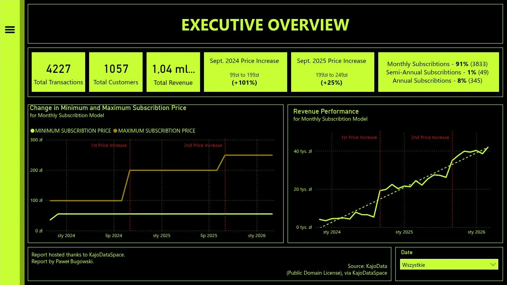
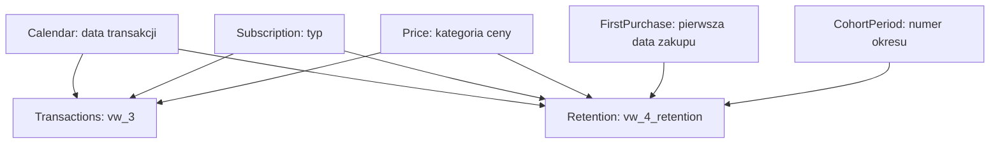

# KajoDataSpace — analiza transakcji, klientów i retencji

Projekt analityczny przedstawiający aktywność kupujących na podstawie historii transakcji z lat 2023–2026. Łączy przygotowanie danych w **MySQL**, analizę powracających klientów i kohort zakupowych oraz interaktywny raport w **Power BI**.

Punktem wyjścia są trzy informacje: moment transakcji, identyfikator klienta i kwota. SQL przekształca je w historię zakupów, przypisuje reguły cenowe i typy subskrypcji oraz przygotowuje dane do analizy przychodów i powrotów klientów. Raport pokazuje te wyniki w kontekście zmian cen we wrześniu 2024 i 2025 roku.

**Autor raportu:** Paweł Bugowski. **Źródło danych:** KajoData, za pośrednictwem KajoDataSpace.

**[Otwórz interaktywny raport Power BI](https://app.powerbi.com/view?r=eyJrIjoiNGZjYmEwMDgtZGJhMS00ZGZjLWEyOWUtZDc3MmE0MmU0MzQ1IiwidCI6ImE0ZmE1ZWNhLTdhM2YtNDRhYS04ZTI4LTc2MjBhMzk0NjEwZiJ9)**



## Cel analizy

Analiza odpowiada na pytania o skalę zakupów, strukturę wpłat i częstotliwość powrotów:

- Jak zmieniają się liczba transakcji, liczba kupujących i suma wpłat?
- W jakim stopniu wzrost wpłat wynika ze zmiany liczby zakupów, a w jakim ze zmiany ich średniej wartości?
- Jaką część wpłat stanowią kolejne zakupy tych samych klientów?
- Jak różnią się zakupy miesięczne, półroczne i roczne?
- Jak często występują kwoty zgodne z historycznym cennikiem?
- Jaka część klientów z poszczególnych kohort kupuje ponownie w kolejnych miesiącach?

W projekcie słowo „przychód” oznacza **sumę zarejestrowanych kwot transakcji**. Dane nie zawierają informacji o VAT, kosztach, zwrotach ani zasadach rozliczania przychodów w czasie. Wskaźnik nie jest więc miarą zysku ani przychodem księgowym rozłożonym na okres subskrypcji.

## Najważniejsze wyniki

Zakres obserwacji obejmuje **5 listopada 2023 – 31 marca 2026**, czyli 29 miesięcy kalendarzowych. Wyniki poniżej dotyczą całego zbioru po zastosowaniu korekty zachowanej w oryginalnym SQL.

| Wskaźnik | Wartość |
| --- | ---: |
| Transakcje | 4227 |
| Unikalni klienci | 1057 |
| Suma wpłat | 1 042 416,27 zł |
| Średnia wartość transakcji | 246,61 zł |
| Mediana wartości transakcji | 169,00 zł |
| Najniższa wartość transakcji | 35,60 zł |
| Najwyższa wartość transakcji | 2089,05 zł |
| Transakcje miesięczne | 3833 |
| Transakcje półroczne | 49 |
| Transakcje roczne | 345 |
| Transakcje zgodne z historycznym cennikiem | 1215 |
| Pozostałe transakcje, oznaczone w raporcie jako promocyjne | 3012 |
| Klienci aktywni według przewidywanego terminu odnowienia na końcu obserwacji | 393 |

Raport live potwierdza liczności i statystyki cenowe; sumę wpłat przedstawia w zaokrągleniu jako około 1,04 mln zł. Dokładna kwota w tabeli wynika z ponownego przeliczenia CSV zgodnie z regułami SQL.

### Powracający klienci i ich wpłaty

Uzupełniona historia zakupów pozwala rozdzielić pierwszą zaobserwowaną transakcję każdego klienta od jego kolejnych zakupów. Są to dodatkowe wyniki obliczone z danych, a nie osobne karty istniejącego raportu.

| Miara | Wynik |
| --- | ---: |
| Klienci z co najmniej dwiema transakcjami | 595 |
| Udział takich klientów w całej bazie | 56,29% |
| Wpłaty z pierwszych zaobserwowanych transakcji | 502 442,98 zł |
| Wpłaty z kolejnych transakcji | 539 973,29 zł |
| Udział kolejnych transakcji w sumie wpłat | **51,80%** |

Do wpłat powracających klientów zaliczana jest dopiero druga i każda następna transakcja danej osoby. Pierwsza transakcja klienta, który później wrócił, pozostaje w kategorii pierwszych zakupów. „Pierwszy” oznacza tutaj pierwszy zakup widoczny w dostarczonym zbiorze.

### Zmiany aktywności i cen

W miesięcznym modelu subskrypcji we wrześniu 2024 r. odnotowano 81 nowych klientów, a we wrześniu 2025 r. — 53. W obu miesiącach zmieniał się cennik. Zestawienie zakupów miesięcznych pokazuje równocześnie zmianę liczby transakcji i ich średniej wartości:

| Miesiąc | Transakcje miesięczne | Średnia kwota | Suma wpłat za model miesięczny |
| --- | ---: | ---: | ---: |
| Sierpień 2024 | 60 | 88,95 zł | 5336,86 zł |
| Wrzesień 2024 | 138 | 138,89 zł | 19 167,42 zł |
| Sierpień 2025 | 156 | 167,63 zł | 26 150,82 zł |
| Wrzesień 2025 | 198 | 176,48 zł | 34 943,04 zł |
| Marzec 2026 | 210 | 199,50 zł | 41 895,76 zł |

Wzrost sumy wpłat w tych porównaniach towarzyszy zarówno większej liczbie transakcji, jak i wyższej średniej kwocie. Sama zbieżność dat nie rozstrzyga, czy zakupy przyspieszyła zapowiedź podwyżki, promocja, pozyskanie nowych odbiorców czy inne działania.

3012 transakcji, czyli **71,26%**, otrzymuje etykietę ceny promocyjnej. To wynik reguły dopasowania kwot do cennika, opisanej poniżej. Ocena skuteczności promocji wymagałaby dodatkowo danych o kampaniach, warunkach rabatów i kosztach.

## Dane źródłowe

Plik [`Raw Data/transactions.csv`](Raw%20Data/transactions.csv) zawiera 4227 wierszy danych i trzy kolumny. Oryginalna zawartość CSV została zachowana bez zmian.

| Kolumna w CSV | Znaczenie | Przykład | Typ po przetworzeniu |
| --- | --- | --- | --- |
| `Data transakcji` | Data i czas z dokładnością do mikrosekund | `2023-11-05T18:04:23.495000` | `DATETIME(6)` |
| `Klient` | Identyfikator klienta | `1` | `INT UNSIGNED` |
| `Kwota` | Kwota transakcji | `35.6` | `DECIMAL(12,2)` |

Separator pól to przecinek, separatorem dziesiętnym jest kropka. Pierwszy wiersz zawiera nagłówki. Znacznik czasu nie ma informacji o strefie czasowej; przetwarzanie zachowuje jego zapis bez przesunięć czasowych.

Jeden wiersz oznacza jedną zarejestrowaną transakcję. CSV nie zawiera identyfikatora transakcji z systemu źródłowego, dlatego import nadaje techniczny numer wiersza. Nie znaleziono identycznych rekordów według kombinacji czasu, klienta i kwoty. Dane nie są automatycznie deduplikowane.

| Rok | Liczba transakcji | Suma wpłat po korekcie | Zakres w zbiorze |
| --- | ---: | ---: | --- |
| 2023 | 132 | 32 430,77 zł | Od 5 listopada |
| 2024 | 1187 | 238 495,14 zł | Styczeń–grudzień |
| 2025 | 2239 | 579 573,31 zł | Styczeń–grudzień |
| 2026 | 669 | 191 917,05 zł | Styczeń–marzec |

Roczne sumy dla 2023 i 2026 obejmują niepełne lata. Nie należy zestawiać ich bezpośrednio z pełnymi latami jako rocznej dynamiki sprzedaży.

## Zawartość repozytorium

| Ścieżka | Zawartość |
| --- | --- |
| `README.md` | Opis danych, wyników, SQL, modelu i odtworzenia wizualizacji |
| `Raw Data/transactions.csv` | Oryginalne dane wejściowe |
| `SQL/1. Database & Tables.sql` | Baza, tabela surowa i tabela transakcji |
| `SQL/2. Import of data.sql` | Import CSV do warstwy surowej |
| `SQL/3.1. Normalization of data.sql` | Walidacja, konwersja typów, korekta i reguły biznesowe |
| `SQL/3.2. Customer history.sql` | Kolejność zakupów i historia klientów |
| `SQL/4.1. Creation of reporting views.sql` | Widoki raportowe i statystyki kontrolne |
| `SQL/4.2. Creation of dimension views.sql` | Kalendarz i pozostałe wymiary |
| `SQL/4.3. Creation of cohort views.sql` | Szczegółowe dane kohort i macierz retencji |
| `SQL/5. Validation.sql` | Kontrole danych i porównanie całej macierzy z raportem |
| `SQL/Original/123.sql` | Niezmieniona, zachowana część pierwotnego skryptu, jako materiał referencyjny |
| `Assets/` | Okładka, trzy obrazy raportu i ich miniatury w formacie WebP |

Archiwalnego `SQL/Original/123.sql` nie należy uruchamiać w opisanym procesie. Zawiera pierwotną ścieżkę lokalną, poprzedni import i definicje zastąpione przez uporządkowane etapy. Wszystkie wykonywalne etapy znajdują się bezpośrednio w `SQL/`.

## Przetwarzanie w SQL

### Warstwa surowa i import

`transactions_raw` przechowuje wartości tekstowe oraz numer wiersza. Oddzielenie importu od obliczeń ułatwia sprawdzenie źródła przed aktualizacją danych raportowych.

Import rozpoznaje trzy kolumny CSV i usuwa końcowy znak `CR`, jeśli plik zapisano z zakończeniami wierszy Windows. Właściwa konwersja czasu korzysta z formatu **`%Y-%m-%dT%H:%i:%s.%f`**. Zastępuje to zapis `%m/%d/%Y` z zachowanego skryptu, który nie odpowiada przesłanemu plikowi.

### Normalizacja i ślad korekty

Etap `3.1` sprawdza strukturę danych, konwertuje wartości, wylicza pola biznesowe i zastępuje zawartość tabeli `transactions` w transakcji. Błąd przed zatwierdzeniem pozostawia wcześniejszą tabelę raportową bez zmian. Ponowne wykonanie nie kumuluje tej samej korekty.

Oryginalny skrypt zawierał polecenie ustawiające kwotę wiersza `299` na `99`. W przesłanym CSV odpowiada mu:

| Pole | Wartość |
| --- | --- |
| Klient | `140` |
| Czas transakcji | `2024-03-24T13:14:25.756000` |
| Kwota źródłowa | 198,00 zł |
| Kwota po korekcie | 99,00 zł |

Regułę zachowano dla odtworzenia obliczeń autora, ale **nie ma materiału źródłowego wyjaśniającego jej uzasadnienie biznesowe**. Kwota 198 zł sama w sobie nie jest ekstremum tego zbioru. Nowy skrypt wyszukuje rekord po czasie, kliencie i oryginalnej kwocie. Wymaga dokładnie jednego dopasowania.

`ORIGINAL_TRANSACTION_VALUE` przechowuje pierwotną wartość, `TRANSACTION_VALUE` — wartość używaną w analizie, a `CORRECTION_APPLIED` wskazuje zmieniony rekord. Suma źródłowa wynosi **1 042 515,27 zł**; po korekcie jest niższa o 99 zł.

### Typy subskrypcji

W źródle nie ma kolumny określającej produkt. Typ subskrypcji jest **wnioskowany z kwoty** według reguły zachowanej w SQL:

| Warunek | `TRANSACTION_TYPE` | Przewidywany termin odnowienia |
| --- | --- | --- |
| Kwota poniżej 260 zł | `MONTHLY` | Data transakcji + 1 miesiąc |
| Kwota powyżej 260 zł i poniżej 600 zł | `SEMI-ANNUAL` | Data transakcji + 6 miesięcy |
| Kwota powyżej 600 zł | `ANNUAL` | Data transakcji + 12 miesięcy |
| Dokładnie 260 lub 600 zł | `NULL` | `NULL` |

Kwoty graniczne nie występują w dostarczonych danych. Pozostawiono ich jawny brak klasyfikacji zamiast zmieniać reguły autora. Skrypt walidacji wykrywa takie przypadki przy innym zestawie wejściowym.

Odnowienie wyznacza się przez dodanie miesięcy kalendarzowych, a nie stałej liczby dni. Nie uwzględnia ono anulowania subskrypcji, zwrotów ani nakładania się zakupionych okresów.

### Historyczne ceny standardowe

| Data transakcji | Kwoty uznawane za standardowe |
| --- | --- |
| Przed 10 września 2024 | 99, 495, 990 zł |
| Od 10 września 2024 do 11 września 2025 włącznie | 199, 1799 zł |
| Od 12 września 2025 | 249, 1999 zł |

Kwota zgodna z listą dla danej daty otrzymuje `PROMOTION_PRICE = 'NO'`. Każda inna otrzymuje `'YES'`. W Power BI odpowiadają im etykiety `REGULAR PRICE` i `DISCOUNTED PRICE`.

Reguła nie sprawdza kodu rabatowego ani rzeczywistego cennika produktu. Cena wyższa od pozycji na liście również może otrzymać etykietę promocyjną. Dlatego udział 71,26% należy odczytywać jako udział kwot **niezgodnych z przyjętą listą cen standardowych**.

### Historia klienta

`vw_transaction_history` porządkuje wszystkie zakupy klienta po czasie transakcji i technicznym ID. Funkcje okienkowe wyliczają numer zakupu, pierwszą zaobserwowaną datę oraz poprzednią datę zakupu.

| Pole | Znaczenie |
| --- | --- |
| `PURCHASE_NUMBER` | Kolejny numer transakcji klienta |
| `NEW_CLIENT` | `1` wyłącznie dla pierwszej zaobserwowanej transakcji |
| `FIRST_PURCHASE_DATE` | Najwcześniejsza data zakupu w całej dostępnej historii |
| `PREVIOUS_PURCHASE_DATE` | Data poprzedniej transakcji tego klienta |
| `DAYS_SINCE_PREVIOUS_PURCHASE` | Różnica dni; `NULL` dla pierwszej transakcji |
| `COHORT_MONTH` | Pierwszy dzień miesiąca pierwszego zakupu |
| `COHORT_PERIOD` | Różnica miesięcy kalendarzowych względem pierwszego zakupu |

Historia powstaje przed filtrowaniem w Power BI. Wybranie innego roku nie zmienia powracającego klienta w nowego. Kilka zakupów jednego dnia zachowuje własną kolejność; odstęp liczony w dniach może wynosić zero.

## Widoki raportowe i poziom szczegółowości

| Widok | Jeden wiersz oznacza | Zastosowanie |
| --- | --- | --- |
| `vw_1` | Datę × typ subskrypcji × kategorię ceny | Sumy wpłat, liczby transakcji, minima i maksima |
| `vw_2` | Datę × typ subskrypcji × kategorię ceny | Liczbę kupujących w tej konkretnej grupie oraz sumy transakcyjne |
| `vw_1_active_customers` | Unikalną kombinację klienta, daty, typu i kategorii ceny | Liczenie kupujących przez `DISTINCTCOUNT` |
| `vw_3` | Transakcję z historią klienta | Główny fakt dla interaktywnych miar |
| `vw_2_customer_value` | Klienta | Sumę wpłat klienta, liczbę zakupów, obserwowany czas relacji i średni odstęp między zakupami |
| `vw_5_data_config_2` | Cały zbiór | Statystyki kontrolne niezależne od filtrów raportu |
| `vw_4_cohort_date` | Klienta | Pierwszą datę zakupu |
| `vw_4_retention` | Unikalną kombinację klienta, daty, typu i kategorii ceny z przypisaną kohortą | Dynamiczną analizę kohort |
| `vw_4_monthly_cohort_retention` | Miesiąc kohorty × okres 0–28 | Gotową macierz dla całego zbioru i porównanie z raportem |

Liczba klientów nie jest addytywna. Suma dziennych `ACTIVE_USERS` może wielokrotnie policzyć tę samą osobę. W miarach miesięcznych i rocznych należy używać `DISTINCTCOUNT` na danych szczegółowych. Średnią cenę wylicza się z sumy kwot podzielonej przez liczbę transakcji, zamiast uśredniać średnie poszczególnych grup.

`LTV` w `vw_2_customer_value` jest sumą **zaobserwowanych wpłat klienta**. Nie jest prognozą przyszłych zakupów. Typ subskrypcji w tym widoku pochodzi z ostatniej transakcji, natomiast w `vw_3` opisuje każdy zakup osobno.

## Model danych Power BI

Na dostarczonym modelu widoczne są widoki `vw_1`, `vw_2`, szczegółowy widok klientów, `vw_3`, widok wartości klienta, tabela statystyk oraz widok retencji. Korzystają z wymiarów daty, kategorii ceny i typu subskrypcji. Retencja ma dodatkowo wymiary `FIRST_PURCHASE_DATE` i `COHORT_PERIOD`. Tabela statystyk pozostaje odłączona, a relacja pomiędzy wartością klienta a `vw_3` jest nieaktywna.

Część nazw na obrazie jest ucięta. Dla tych obiektów przyjęto opisowe nazwy `vw_1_active_customers`, `vw_2_customer_value` i `vw_4_retention`. Nie oznaczają one potwierdzenia pełnych nazw utraconych widoków. Zachowano nazwy dostępne w oryginalnym SQL i jednoznacznie widoczne na modelu.

Poniżej przedstawiono **odtworzony model do uruchomienia z tym repozytorium**. Wykorzystuje wspólne wymiary, szczegółowy fakt transakcji oraz osobny fakt retencji. W tabeli po schemacie podano dokładne klucze. Strzałki pokazują filtrowanie od strony `1` do strony `*`.



### Nazwy tabel i relacje do odtworzenia

Po imporcie można nadać tabelom poniższe krótkie nazwy. Używają ich miary DAX zamieszczone dalej.

| Nazwa w Power BI | Widok SQL |
| --- | --- |
| `Transactions` | `vw_3` |
| `Calendar` | `vw_dim_transaction_date_2` |
| `Subscription` | `vw_dim_transaction_type` |
| `Price` | `vw_dim_promotion` |
| `Retention` | `vw_4_retention` |
| `FirstPurchase` | `vw_dim_first_purchase_date` |
| `CohortPeriod` | `vw_dim_cohort_period` |
| `Snapshot` | `vw_5_data_config_2` |

| Strona `1` | Strona `*` | Klucz po obu stronach | Kierunek |
| --- | --- | --- | --- |
| `Calendar` | `Transactions` | `TRANSACTION_DATE` | Jednokierunkowy |
| `Subscription` | `Transactions` | `TRANSACTION_TYPE` | Jednokierunkowy |
| `Price` | `Transactions` | `PROMOTION_PRICE` | Jednokierunkowy |
| `Calendar` | `Retention` | `TRANSACTION_DATE` | Jednokierunkowy |
| `Subscription` | `Retention` | `TRANSACTION_TYPE` | Jednokierunkowy |
| `Price` | `Retention` | `PROMOTION_PRICE` | Jednokierunkowy |
| `FirstPurchase` | `Retention` | `FIRST_PURCHASE_DATE` | Jednokierunkowy |
| `CohortPeriod` | `Retention` | `COHORT_PERIOD` | Jednokierunkowy |

`Snapshot` pozostaje bez relacji. Opcjonalne `vw_1`, `vw_2` i `vw_1_active_customers` mogą otrzymać te same trzy relacje wymiarów co `Transactions`. Nie należy łączyć ich ze sobą ani z faktem transakcji.

Na pierwotnym obrazie są dwa wymiary daty. Repozytorium zachowuje oba interfejsy: `vw_dim_transaction_date` i `vw_dim_transaction_date_2`. W opisanej konfiguracji wspólnym kalendarzem jest `date_2`; drugi widok nie jest potrzebny do miar poniżej. To jawne uproszczenie odtworzonego modelu.

Opcjonalny `vw_2_customer_value` ma jeden wiersz na klienta. Jeśli potrzebna jest relacja do `Transactions`, kluczem jest `CLIENT_ID`, a relacja pozostaje **nieaktywna**, zgodnie z obrazem modelu. Nie należy włączać jej automatycznie obok aktywnych ścieżek filtrowania typu subskrypcji.

Kalendarz obejmuje wszystkie 878 dni między pierwszą i ostatnią transakcją. `MONTH_NAME` należy sortować według `MONTH_NUMBER`, `YEAR_MONTH` według `YEAR_MONTH_SORT`, a typy subskrypcji według `TRANSACTION_TYPE_ORDER`. Zbudowana hierarchia czasu powinna zawierać rok i miesiąc. Sam miesiąc bez roku połączyłby listopad z różnych lat.

## Retencja kohortowa

Kohorta powstaje według miesiąca **pierwszego zakupu dowolnego typu**. Dopiero liczenie klientów w poszczególnych okresach ogranicza się do transakcji `MONTHLY`.

Okres `0` to miesiąc pierwszego zakupu, okres `1` to następny miesiąc kalendarzowy itd. Zakup 31 stycznia i następny 1 lutego znajdują się w dwóch kolejnych okresach, mimo że dzieli je jeden dzień.

W macierzy:

- kolumna `0` przedstawia liczbę klientów kohorty z zakupem miesięcznym w okresie początkowym;
- kolumny `1–28` pokazują liczbę klientów tej kohorty z zakupem miesięcznym w danym okresie, podzieloną przez liczbę z okresu `0`;
- jeden klient jest liczony tylko raz w danej komórce, niezależnie od liczby transakcji;
- powrót po przerwie ponownie zwiększa wynik, więc retencja nie musi stale maleć.

**Szczegół konieczny do zgodności z raportem:** klient rozpoczynający historię od innego typu subskrypcji może wejść do licznika, jeśli później kupi model miesięczny. Mianownik nadal opisuje miesięczne zakupy w okresie `0`. Jest to rekonstrukcja definicji prezentowanej w raporcie, a nie retencja zamkniętej grupy osób rozpoczynających wyłącznie od modelu miesięcznego. W innych danych taka definicja mogłaby przekroczyć 100%.

Przykładowo kohorta z listopada 2023 r. ma w okresie `0` 52 klientów. W kolejnym miesiącu kupuje 39 klientów tej kohorty, co daje 75%. W okresie `28` jest to 11 klientów, czyli po zaokrągleniu 21%. Ograniczenie wszystkich kolejnych okresów wyłącznie do osób zaczynających od planu miesięcznego dałoby inne wyniki.

Widok zbiorczy rozróżnia **brak zakupu w już zaobserwowanym miesiącu** od **miesiąca wykraczającego poza dane**. `RETENTION_RATE` wynosi odpowiednio `0` lub `NULL`. Dodatkowe `DISPLAY_RETENTION_RATE` pozostawia oba przypadki puste, aby odwzorować wygląd oryginalnej macierzy. Przykład: grudzień 2023, okres 12 to zaobserwowane zero; marzec 2026, okres 1 jest jeszcze nieobserwowany.

## Raport Power BI

Raport prowadzi od głównych wskaźników do cen, aktywności klientów i wzorców powrotu. Publiczna wersja zawiera pięć stron, w tym stronę statystyk i komentarzy, której nie obejmują trzy dostarczone obrazy galerii.

### Przegląd działalności

Pierwsza strona pokazuje liczbę transakcji, klientów i sumę wpłat oraz strukturę typów subskrypcji. Wykresy modelu miesięcznego przedstawiają minimalną i maksymalną kwotę oraz przebieg wpłat. Oznaczenia zmian ceny 99 → 199 zł i 199 → 249 zł pomagają odczytać wykresy na wspólnej osi czasu.

Karty ogólne dotyczą całego zbioru, natomiast opisane wykresy są ograniczone do modelu miesięcznego. Różnica zakresu jest istotna przy porównywaniu sum.

### Przychody i kategorie cen

Wykres skumulowany porównuje wpłaty z planów miesięcznych i rocznych. W pokazanej konfiguracji pomija plan półroczny. Drugi wykres przedstawia udział **liczby transakcji** z ceną standardową i pozostałą w kolejnych miesiącach, a nie udział ich wartości.

### Aktywność i pozyskiwanie klientów

Połączony wykres zestawia nowych klientów z przeciętną kwotą transakcji miesięcznej. Osobny wykres pokazuje kupujących według typu subskrypcji. Liczba kupujących w miesiącu oznacza klientów z zakupem w tym miesiącu; nie jest to liczba wszystkich osób mających ważną subskrypcję.

### Powroty kolejnych kohort

Macierz przedstawia miesięczne kohorty, ich wielkość początkową i kolejne okresy zakupowe. Fragmentator dotyczy miesiąca pierwszego zakupu. Formatowanie warunkowe pozwala porównać przebieg powrotów, ale młodsze kohorty mają krótszy okres obserwacji.

### Statystyki i interpretacja

Ostatnia strona pokazuje m.in. minimum, maksimum, średnią i medianę transakcji, liczbę aktywnych klientów oraz podział transakcji według typu subskrypcji i ceny. W modelu odpowiada jej odłączony widok `vw_5_data_config_2`.

Komentarze raportu wskazują tematy do sprawdzenia: udział transakcji poza cennikiem, zachowanie klientów przy zmianach cen i przewagę modelu miesięcznego. Wnioski o przyczynach zakupów lub wpływie promocji na marżę wymagają dodatkowych danych; obecny zbiór pozwala opisać zaobserwowane zachowania.

## Odtworzenie projektu

### 1. Uruchomienie SQL

Skrypty przygotowano dla **MySQL 8.0+**. Wykorzystują funkcje okienkowe, CTE, `REGEXP_LIKE`, procedurę składowaną i `LOAD DATA LOCAL INFILE`. Potrzebne są uprawnienia do utworzenia bazy, tabel, widoków i procedury oraz importu lokalnego pliku.

Otwórz klienta `mysql` z katalogu głównego repozytorium:

```bash
mysql --local-infile=1 --default-character-set=utf8mb4 -u YOUR_USER -p
```

Serwer również musi zezwalać na `local_infile`. Skrypt nie zmienia globalnych ustawień serwera. Przed importem można odczytać konfigurację:

```sql
SHOW VARIABLES LIKE 'local_infile';
```

Następnie wykonaj pliki w kolejności:

```sql
SOURCE SQL/1. Database & Tables.sql
SOURCE SQL/2. Import of data.sql
SOURCE SQL/3.1. Normalization of data.sql
SOURCE SQL/3.2. Customer history.sql
SOURCE SQL/4.1. Creation of reporting views.sql
SOURCE SQL/4.2. Creation of dimension views.sql
SOURCE SQL/4.3. Creation of cohort views.sql
SOURCE SQL/5. Validation.sql
```

To polecenia klienta `mysql`; każdą linię należy wykonać osobno. W MySQL Workbench można zamiast tego otwierać i uruchamiać kolejne pliki. W takim przypadku dostosuj ścieżkę CSV w etapie `2`. `DELIMITER` w etapie `3.1` wymaga klienta obsługującego definicje procedur.

Po imporcie sprawdź `SHOW WARNINGS` oraz liczbę 4227 wierszy. Jeśli wystąpią ostrzeżenia importu, usuń ich przyczynę przed normalizacją. Etap `2` zastępuje tabelę surową; etap `3.1` zastępuje przetworzoną migawkę. Skrypty tworzą nowe obiekty w `KDS_Transactions`; nie są automatyczną migracją już istniejącej bazy z innym schematem.

### 2. Podłączenie Power BI

W Power BI Desktop połącz się z bazą `KDS_Transactions` i zaimportuj widoki wymienione w tabeli nazw modelu. Utwórz relacje zgodnie z opisem, ustaw typy dat i sortowanie kolumn. Nie importuj pomocniczego `vw_numbers` ani tabeli surowej.

Kalendarz można oznaczyć jako tabelę dat, wskazując `TRANSACTION_DATE`; opis konfiguracji znajduje się w [dokumentacji Microsoft](https://learn.microsoft.com/en-us/power-bi/transform-model/desktop-date-tables). Kalendarz tego projektu obejmuje zakres obserwacji. Nie implementowano dodatkowych obliczeń wymagających pełnych lat kalendarzowych.

Poniższe miary są **odtworzonym zestawem startowym**, dopasowanym do jawnych nazw tabel. Nie są eksportem oryginalnych formuł DAX. Każdą definicję należy dodać jako osobną miarę.

```dax
Total Transactions = COUNTROWS(Transactions)

Total Customers = DISTINCTCOUNT(Transactions[CLIENT_ID])

Total Revenue = SUM(Transactions[TRANSACTION_VALUE])

Average Transaction Value = DIVIDE([Total Revenue], [Total Transactions])

Median Transaction Value = MEDIAN(Transactions[TRANSACTION_VALUE])

Minimum Transaction Value = MIN(Transactions[TRANSACTION_VALUE])

Maximum Transaction Value = MAX(Transactions[TRANSACTION_VALUE])

New Customers = SUM(Transactions[NEW_CLIENT])

Returning Revenue =
    CALCULATE(
        [Total Revenue],
        KEEPFILTERS(Transactions[NEW_CLIENT] = 0)
    )

Returning Revenue Share = DIVIDE([Returning Revenue], [Total Revenue])

Price Transaction Share =
    DIVIDE(
        [Total Transactions],
        CALCULATE([Total Transactions], REMOVEFILTERS(Price))
    )

Active Customers at Snapshot = MAX(Snapshot[ACTIVE_CUSTOMERS])
```

Ostatnia miara pozostaje stała względem fragmentatorów, ponieważ `Snapshot` jest odłączony. Pozostałe miary działają na szczegółowym fakcie i reagują na jego wymiary. Dla udziału cen używaj legendy `Price[PRICE_TYPE]`.

### 3. Miary macierzy kohort

Na stronie kohort ustaw filtr `Subscription[TRANSACTION_TYPE] = MONTHLY` i pozostaw obie kategorie cen. Wiersze macierzy pochodzą z `FirstPurchase[YEAR_MONTH]`, a kolumny z `CohortPeriod[COHORT_PERIOD]`. Miary celowo usuwają filtr daty transakcji, aby fragmentator dat z innych stron nie ucinał historii kohorty. Fragmentator kohort ma korzystać z `FirstPurchase`.

```dax
Cohort Customers =
    CALCULATE(
        DISTINCTCOUNT(Retention[CLIENT_ID]),
        REMOVEFILTERS(Calendar),
        KEEPFILTERS(Subscription[TRANSACTION_TYPE] = "MONTHLY")
    )

Cohort Size =
    CALCULATE(
        [Cohort Customers],
        REMOVEFILTERS(CohortPeriod),
        Retention[COHORT_PERIOD] = 0
    )

Cohort Retention = DIVIDE([Cohort Customers], [Cohort Size])

Cohort Cell =
    VAR PeriodNumber = SELECTEDVALUE(CohortPeriod[COHORT_PERIOD])
    RETURN
        IF(
            NOT HASONEVALUE(FirstPurchase[YEAR_MONTH])
                || NOT HASONEVALUE(CohortPeriod[COHORT_PERIOD]),
            BLANK(),
            IF(
                PeriodNumber = 0,
                FORMAT([Cohort Size], "0"),
                IF(
                    ISBLANK([Cohort Retention]),
                    BLANK(),
                    FORMAT([Cohort Retention], "0%")
                )
            )
        )
```

`Cohort Cell` daje liczbę klientów w kolumnie `0` i procent w dalszych kolumnach. Formatowanie warunkowe oprzyj na numerycznej mierze `Cohort Retention`, nie na tekście komórki. Wyłącz sumy częściowe i końcowe. Do porównania bez DAX służy `vw_4_monthly_cohort_retention`; jego wartości są policzone dla całego zbioru i nie należy traktować ich jako dynamicznych wskaźników po dowolnym filtrowaniu.

### 4. Dobór pól do wizualizacji

| Wizualizacja | Oś / grupowanie | Miara | Filtr |
| --- | --- | --- | --- |
| Karty główne | — | Transakcje, klienci, wpłaty | Cały zbiór lub wybrana data |
| Minimum i maksimum ceny | `Calendar[YEAR_MONTH]` | Minimum / maksimum transakcji | `MONTHLY` |
| Wpłaty za model miesięczny | `Calendar[YEAR_MONTH]` | `Total Revenue` | `MONTHLY` |
| Wpłaty według modelu | Miesiąc, legenda typu | `Total Revenue` | `MONTHLY`, `ANNUAL` |
| Udział cen | Miesiąc, legenda `Price[PRICE_TYPE]` | `Total Transactions` na wykresie 100% lub `Price Transaction Share` | Wszystkie typy |
| Nowi klienci i średnia kwota | Miesiąc | `New Customers`, `Average Transaction Value` | `MONTHLY` |
| Kupujący według modelu | Miesiąc, legenda typu | `Total Customers` | `MONTHLY`, `ANNUAL` |
| Macierz kohort | Kohorta × okres | `Cohort Cell` | `MONTHLY` |

Dokładne ustawienia motywu, interakcji, linii trendu, zakładek i oryginalnych miar nie są częścią zachowanego SQL. Repozytorium zawiera dane i obliczenia potrzebne do odtworzenia analiz; nie zawiera pliku `.pbix` ani automatycznie zbudowanej kopii interfejsu raportu.

## Zakres rekonstrukcji i weryfikacja

Zachowane źródła obejmują CSV, fragment SQL, obraz modelu, obrazy raportu oraz publiczny raport. Pozwoliły zachować reguły cenowe, klasyfikację subskrypcji i widok statystyk, a także odtworzyć brakującą historię klientów, agregacje i retencję.

| Element | Podstawa |
| --- | --- |
| Progi kwot, terminy odnowienia, listy cen, korekta kwoty | Zachowany SQL |
| `vw_5_data_config_2`, wymiary typu i ceny, pierwsza data zakupu | Zachowany SQL; uzupełniona dokumentacja i pola pomocnicze |
| `vw_1`, `vw_2`, `vw_3`, szczegółowi klienci i retencja | Odtworzenie na podstawie modelu, danych i wyników raportu |
| Pełny kalendarz, sortowanie, ślad korekty, kontrola importu | Uzupełnienia zapewniające czytelne i powtarzalne przetwarzanie |
| `vw_2_customer_value` | Jawna definicja wartości i historii klienta; pierwotna formuła `avg_LT` nie była dostępna |
| Miary DAX w README | Nowe definicje do odtworzenia opisanej konfiguracji |

Weryfikacja z 24 października 2026 r. objęła:

- przeliczenie wszystkich 4227 transakcji i porównanie pól pochodnych z niezależnym obliczeniem;
- zgodność liczby klientów, typów subskrypcji, kategorii cen, aktywnych klientów, średniej i mediany z raportem live;
- uzgodnienie sum źródłowych i przetworzonych oraz pojedynczej korekty;
- zgodność **783 komórek macierzy**, czyli 27 kohort × 29 okresów, z wartościami i pustymi polami raportu live;
- unikalność kluczy wymiarów oraz uzgodnienie agregatów z faktami szczegółowymi.

Logikę obliczeń wykonano w środowisku SQLite z adapterami funkcji dat MySQL i porównano z niezależnym przeliczeniem w Pythonie. **Nie wykonano importu, procedury ani pełnego przebiegu skryptów na natywnym serwerze MySQL; miary DAX nie były uruchamiane w Power BI Desktop.** Do sprawdzenia środowiska docelowego służy etap `5. Validation.sql`, zawierający wartości oczekiwane i pełną macierz referencyjną. Zgodność wyświetlanych procentów nie oznacza odzyskania pierwotnego kodu DAX.

