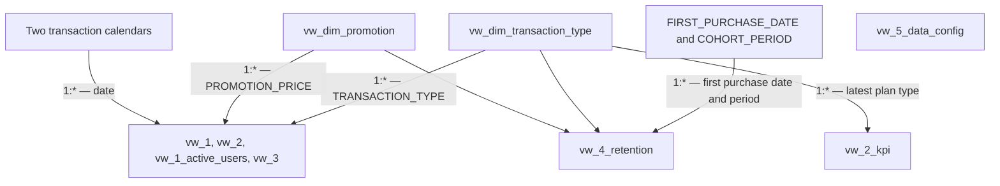

# KajoDataSpace — Transactions and Customer Activity in 2023–2026

## From Transaction Data to Purchase and Retention Analysis

An analytics project combining **MySQL, purchase history analysis, and Power BI**. Using transaction dates, customer identifiers, and amounts, it examines changes in payments, the subscription mix, new and returning customer activity, and the behavior of successive cohorts.

I prepared this analysis to understand how purchasing activity develops and what share of payments comes from subsequent purchases by the same customers. I compared purchase counts with their value, taking into account subscription types, price categories, and periods of changes to monthly subscription prices.

**[Open the interactive Power BI report](https://app.powerbi.com/view?r=eyJrIjoiNGZjYmEwMDgtZGJhMS00ZGZjLWEyOWUtZDc3MmE0MmU0MzQ1IiwidCI6ImE0ZmE1ZWNhLTdhM2YtNDRhYS04ZTI4LTc2MjBhMzk0NjEwZiJ9)**

> **Data coverage:** November 5, 2023–March 31, 2026, comprising 4,227 transactions across 29 calendar months. The dataset does not cover four complete years: it includes the final part of 2023 and the first quarter of 2026.

| Item | Scope |
| --- | --- |
| Analysis and report author | Paweł Bugowski |
| Subject of analysis | Transactions, subscription types, and customer purchasing activity |
| Input data | `Raw Data/transactions.csv`, 4,227 records and 3 columns |
| Data grain | One row represents one transaction |
| Customer identifier | `Klient` in the CSV, `CLIENT_ID` in SQL |
| Transaction identifier | `TRANSACTION_ID`, assigned during import |
| Data preparation | 8 documented MySQL scripts |
| SQL layer | 1 table and 11 views |
| Report | 5 Power BI pages |
| Report hosting | KajoDataSpace, as credited in the report footer |

## Table of Contents

- [Objectives and Analytical Questions](#objectives-and-analytical-questions)
- [Data and Coverage](#data-and-coverage)
- [Key Findings](#key-findings)
- [Repository Contents](#repository-contents)
- [Data Preparation in SQL](#data-preparation-in-sql)
- [Data Model and Aggregation Rules](#data-model-and-aggregation-rules)
- [Power BI Report](#power-bi-report)
- [How to Reproduce the Project](#how-to-reproduce-the-project)
- [Data Quality Checks and Validation Queries](#data-quality-checks-and-validation-queries)
- [Sources and Credits](#sources-and-credits)

## Objectives and Analytical Questions

Total payments show the scale of sales, but do not explain what drives changes. A higher total may result from more purchases, higher prices, a different subscription mix, or returning customers. The analysis therefore combines transaction, customer, and time perspectives.

The project addresses the following questions:

1. How many transactions were recorded, and what total payment value did they generate?
2. How do purchase counts, average transaction value, and monthly subscription revenue change over time?
3. What shares of purchases come from monthly, semi-annual, and annual subscriptions?
4. How often does a transaction amount match a defined regular price?
5. When do new customers appear, and what share of payments comes from subsequent purchases?
6. How does customer activity develop in the months following the first observed transaction?
7. What changes in purchasing activity occur during periods of price increases?

Throughout this document, **“revenue” means the sum of recorded payments**, consistent with the report. The data does not describe accounting revenue recognition over the months covered by a subscription. **“New customer” refers to the first purchase visible in the dataset**, rather than a confirmed first purchase across the customer's entire history.

## Data and Coverage

### Origin and Unit of Observation

The `Raw Data/transactions.csv` file contains the data used in this project. The report footer credits **KajoData, via KajoDataSpace** as the source.

The unit of observation is a transaction, rather than a customer or a month of subscription coverage. A customer may appear multiple times because successive records describe subsequent purchases. The dataset contains **1,057 distinct customer identifiers**.

The CSV contains timestamps with a time component. The SQL layer retains only the date because the analysis focuses on days and months. The original timestamp remains available in the raw file.

The findings refer to the specific file included in the repository and the preparation rules defined in SQL. A different date range, row order, or set of amounts may produce different results.

### Source Field Definitions

| CSV Column | SQL Column | Meaning |
| --- | --- | --- |
| `Data transakcji` | `TRANSACTION_DATE` | Date and time in the source; date without time after SQL import |
| `Klient` | `CLIENT_ID` | Identifier linking purchases by the same customer |
| `Kwota` | `TRANSACTION_VALUE` | Amount of an individual payment |

An example timestamp is `2023-11-05T18:04:23.495000`. Amounts in the report are presented in Polish zloty (PLN); the CSV does not contain a separate currency column.

Subscription type, expected renewal date, and price category are not source fields. They are derived from dates and amounts using the SQL conditions described below. The data does not include product names, offer history, campaign identifiers, costs, or reasons for purchase.

### Input Data Quality

The following figures refer to the raw CSV, **before the amount of one transaction is corrected**.

| Check | Number of Records | Share of Dataset |
| --- | ---: | ---: |
| Missing transaction date | 0 | 0.00% |
| Missing customer identifier | 0 | 0.00% |
| Missing amount | 0 | 0.00% |
| Invalid timestamp when parsed as ISO format | 0 | 0.00% |
| Zero or negative amount | 0 | 0.00% |
| Duplicate complete CSV row | 0 | 0.00% |

All three fields are populated. The absence of identical rows does not mean that each customer appears only once: subsequent purchases form the basis of customer history analysis.

The CSV has no transaction identifier. The database generates `TRANSACTION_ID` in import order. Reproducing the processing therefore requires the original row order to be preserved, particularly for the correction applied to a specific record.

## Key Findings

The figures below were calculated after preparing the data according to the SQL scripts, including the correction to transaction 299. Counts and displayed transaction value statistics match the full scope of the published report. The total revenue and maximum amount cards use abbreviations for millions and thousands, respectively, so they do not display the exact amounts to two decimal places.

### Transaction Volume and Payment Values

| Metric | Value | Interpretation |
| --- | ---: | --- |
| All transactions | **4,227** | Recorded payments during the analysis period |
| Unique customers | **1,057** | Distinct `CLIENT_ID` values |
| Observation months | **29** | Calendar months containing transactions |
| Total revenue | **PLN 1,042,416.27** | Sum of payments after the correction |
| Average transaction value | **PLN 246.61** | Total payments divided by transaction count |
| Median transaction value | **PLN 169.00** | Middle amount in the ordered dataset |
| Minimum transaction value | **PLN 35.60** | Smallest payment |
| Maximum transaction value | **PLN 2,089.05** | Largest payment |
| Active customers | **393** | Customers meeting the expected renewal date rule as of March 31, 2026 |

**Transaction count and customer count measure different things.** Similarly, 393 active customers is not the number of people who purchased in the final month. This metric uses expected renewal dates derived from earlier payments and the duration of the assigned plan.

| Subscription Type | Transactions | Share of Transactions |
| --- | ---: | ---: |
| Monthly | 3,833 | 90.68% |
| Semi-annual | 49 | 1.16% |
| Annual | 345 | 8.16% |
| **Total** | **4,227** | **100.00%** |

The dominance of the monthly plan refers to purchase counts. It does not imply the same share of revenue or months of paid access. An annual transaction and a monthly transaction have different values and different assumed coverage periods.

### Changes Over Time

| Year and Available Coverage | Transactions | Total Payments |
| --- | ---: | ---: |
| 2023, from November 5 | 132 | PLN 32,430.77 |
| 2024, January–December | 1,187 | PLN 238,495.14 |
| 2025, January–December | 2,239 | PLN 579,573.31 |
| 2026, January–March | 669 | PLN 191,917.05 |

The figures for 2023 and 2026 cover partial years. Monthly comparisons, separating transaction counts from average transaction values, help assess changes across the full observation period.

| Month | Monthly Plan Transactions | Monthly Plan Revenue | Average Amount | New Monthly Plan Customers |
| --- | ---: | ---: | ---: | ---: |
| August 2024 | 60 | PLN 5,336.86 | PLN 88.95 | 0 |
| September 2024 | 138 | PLN 19,167.42 | PLN 138.89 | 81 |
| August 2025 | 156 | PLN 26,150.82 | PLN 167.63 | 29 |
| September 2025 | 198 | PLN 34,943.04 | PLN 176.48 | 53 |
| March 2026 | 210 | PLN 41,895.76 | PLN 199.50 | 47 |

In both September 2024 and September 2025, monthly plan purchase counts and average transaction values increased relative to the preceding month. Revenue growth in these comparisons therefore reflects both components.

These months are marked in the report as periods of price increases. Coinciding timing does not establish whether the change resulted from price announcements, a campaign, seasonality, or other factors. Monthly data also does not show whether a purchase occurred before the specific date of a price increase.

### Subsequent Purchases and Non-Standard Prices

**595 customers**, or **56.29% of all customers**, have more than one transaction. After first purchases, there are **3,170 subsequent transactions**, generating **PLN 539,973.29**, or **51.80% of total payments**. The remaining **PLN 502,442.98** comes from first observed purchases.

This is a supplementary SQL calculation, rather than a separate report card. The first payment by a customer who later returns remains in the first-purchase category. The share of subsequent payments therefore does not include the entire history of every repeat customer.

The price split consists of **1,215 regular-price transactions** and **3,012 non-standard-price transactions**, representing **28.74%** and **71.26%**, respectively. The latter category is described as promotional in the report. Its definition, however, includes all amounts outside the specified regular prices, including higher amounts; it is not independent confirmation that a discount was applied.

## Repository Contents

The repository is organized into three directories: `SQL/` for scripts, `Assets/` for WebP images, and `Raw Data/` for raw CSV data. The `README.md` file is located in the repository root.

| File | Contents |
| --- | --- |
| `Raw Data/transactions.csv` | Original input data, before SQL corrections and enrichment |
| `SQL/1_Database_and_Table.sql` | The `KDS_Transactions` database and `transactions` table |
| `SQL/2_Import_of_Data.sql` | CSV import, date parsing, and handling of empty values |
| `SQL/3_Preparation_of_Data.sql` | Subscription types, renewal dates, amount correction, price categories, and date attributes |
| `SQL/4.1_Dimension_Views.sql` | 4 dimension views: subscription type, year, month, and price flag |
| `SQL/4.2_Transaction_Activity_Views.sql` | 3 views containing aggregates and activity detail |
| `SQL/4.3_Customer_History_Views.sql` | 2 views for customer history and first purchases |
| `SQL/4.4_Cohort_Retention_View.sql` | Detailed input records for cohort analysis |
| `SQL/4.5_Overall_Statistics_View.sql` | Overall statistics, active customers, and median calculation |
| `README.md` | Project, findings, model, and reproduction documentation |
| `Assets/cover.webp`, `Assets/cover-thumb.webp` | Overview page preview and thumbnail |
| `Assets/gallery-01.webp`, `Assets/gallery-01-thumb.webp` | Revenue and price mix analysis and thumbnail |
| `Assets/gallery-02.webp`, `Assets/gallery-02-thumb.webp` | New customers and purchasing activity and thumbnail |
| `Assets/gallery-03.webp`, `Assets/gallery-03-thumb.webp` | Cohort retention matrix and thumbnail |

The public link provides access to the interactive report, and the scripts reproduce the SQL layer. The diagram in the data model section shows its logical structure. The files do not include a `.pbix` or `.pbit`; DAX measure definitions, interaction settings, and full formatting remain part of the report file.

## Data Preparation in SQL

### 1. Creating the Database and Table

The first script creates the `KDS_Transactions` database with `utf8mb4` encoding and the `utf8mb4_unicode_ci` collation.

The `transactions` table stores the source data and attributes derived during preparation. Amounts use `DECIMAL(10,2)`, identifiers and numeric period attributes use `INT`, dates use `DATE`, and category labels use `VARCHAR`.

`TRANSACTION_ID` is a primary key with `AUTO_INCREMENT`. It guarantees a unique technical identifier within the table, but does not prevent the same CSV from being imported again: those records would receive new identifiers.

### 2. Import and Value Preparation

The import uses `LOAD DATA LOCAL INFILE`. The script skips the header, recognizes commas as separators, and allows values enclosed in double quotes. The three columns are first read into user-defined variables and then assigned to table fields.

The expression `STR_TO_DATE(LEFT(TRIM(@TRANSACTION_DATE), 10), '%Y-%m-%d')` removes surrounding spaces, retains the date component, and converts it to `DATE`. The time component is not stored in the table. `NULLIF(..., '')` converts empty identifiers and amounts to `NULL`.

The path `'Raw Data/transactions.csv'` is relative to the MySQL client's working directory. It is not automatically resolved relative to the directory containing the script.

### 3. Subscription Types and Expected Renewals

The preparation script classifies amounts using `CASE`, then uses `DATE_ADD` to determine the expected next purchase date.

| Condition | `TRANSACTION_TYPE` | `EXPECTED_RENEWAL_DATE` |
| --- | --- | --- |
| Amount below PLN 260 | `MONTHLY` | Transaction date + 1 month |
| Amount above PLN 260 and below PLN 600 | `SEMI-ANNUAL` | Transaction date + 6 months |
| Amount above PLN 600 | `ANNUAL` | Transaction date + 12 months |

Amounts exactly equal to PLN 260 or PLN 600 fall outside these conditions. Neither occurs in the supplied CSV, so every transaction receives a subscription type. Classification completeness should be checked again for a different source dataset.

The offsets are expressed in calendar months, rather than a fixed number of days. The resulting date follows the assumed plan duration; it is not evidence that a subsequent purchase actually occurred.

### 4. Amount Correction and Price Classification

Transaction `TRANSACTION_ID = 299` is changed from **PLN 198 to PLN 99**. On the first import of the original file, this corresponds to a payment by customer `140` on March 24, 2024. The correction is explicit in SQL; the CSV retains the source amount.

Raw payments total **PLN 1,042,515.27**. The correction reduces this by **PLN 99** to **PLN 1,042,416.27**. Both amounts for this transaction fall within the monthly category, so the preceding plan and expected renewal assignments remain consistent.

The `PROMOTION_PRICE` flag checks whether an amount matches the prices assigned to its period:

| Transaction Period | Prices Classified as Regular by the Script |
| --- | --- |
| Before September 10, 2024 | PLN 99, 495, and 990 |
| September 10, 2024–September 11, 2025, inclusive | PLN 199 and 1,799 |
| From September 12, 2025 | PLN 249 and 1,999 |

`NO` means that the amount matches the list, while `YES` covers every other case. The condition does not compare the amount paid with the regular price to determine whether it is lower. For example, a transaction of PLN 2,089.05 when the regular amount is PLN 1,999 also receives `YES`.

At the end of preparation, `YEAR` and `MONTH` populate the transaction year and month number. These categories and dates form the basis for subsequent aggregations.

### 5. Customer History and First Purchases

`vw_2_kpi` combines two CTEs. `customer_value` groups transactions by customer and calculates purchase count, total payments, and the interval between the first and last dates. `latest_transaction` numbers purchases from the most recent, allowing the latest subscription type to be attached to the summary.

| Field | Meaning |
| --- | --- |
| `TRANSACTION_COUNT` | Number of observed transactions by the customer |
| `LTV` | Total customer payments in the available dataset |
| `avg_LT` | Days between the first and last purchase |
| `transaction_type` | Latest observed subscription type |

Despite its name, `avg_LT` is an interval between dates, not an average customer lifetime. A customer with one purchase has a value of zero. `LTV` describes observed payments without forecasting future purchases or accounting for profit margins.

In `vw_3`, `ROW_NUMBER()` numbers transactions in ascending date order for each customer. The first receives `NEW_CLIENT = 1`; the others receive `0`. When dates are equal, `TRANSACTION_ID` breaks the tie because the table does not retain transaction times.

The sequence covers all subscription types. Restricting the view's results to a particular plan or year does not turn a later transaction into the customer's first purchase.

### 6. Retention Input Data and Overall Statistics

`vw_4_retention` retains unique combinations of customer, date, subscription type, and price flag. It does not calculate cohorts or retention percentages. It provides the activity history needed to identify first purchases and purchases in subsequent periods.

`vw_5_data_config` returns a single row of statistics for the entire table. The `last_date` CTE identifies the latest date in the data. `ACTIVE_CUSTOMERS` counts customers with at least one expected renewal date on or after that date. The reference point is therefore **March 31, 2026**, rather than the current system date.

The median calculation uses the `ranked_prices` CTE, `ROW_NUMBER()`, and `COUNT(*) OVER ()`. `FLOOR` and `CEIL` identify the middle positions: the same position for an odd row count, or two adjacent positions for an even row count. `AVG` returns the middle value or the mean of the two central amounts.

### 7. The View Layer

| View | Contents | Grain |
| --- | --- | --- |
| `vw_1` | Transaction count and total payments | Date × subscription type × price flag |
| `vw_1_active_users` | Customer identifiers and purchase context | Unique combination of customer, date, type, and price flag |
| `vw_2` | Customer, transaction, and revenue aggregates | Date × subscription type × price flag |
| `vw_2_kpi` | Purchase count, `LTV`, `avg_LT`, and latest plan | One row per customer |
| `vw_3` | Transactions with a first-purchase flag | One row per transaction |
| `vw_4_retention` | Activity detail for cohort analysis | Unique combination of customer, date, type, and price flag |
| `vw_5_data_config` | Statistics for the entire table | One row for the complete dataset |

Four dimensions complement this layer: `vw_dim_transaction_type`, `vw_dim_date_year`, `vw_dim_date_month`, and `vw_dim_promotion`.

For the supplied data, `vw_1` and `vw_2` each contain **1,444 rows**, while `vw_2_kpi` contains **1,057 rows**. `vw_3`, `vw_1_active_users`, and `vw_4_retention` each contain **4,227 rows**. The latter two use `DISTINCT`; their row counts matching the source table is a property of this dataset, not a guarantee for every subsequent import.

## Data Model and Aggregation Rules

### Model Layers

The presented Power BI model contains **13 tables**: seven based on analytical views, two calendars, subscription type and price dimensions, and two cohort helper tables. It combines several data grains with shared dimensions.

The `transactions` table belongs to the MySQL data preparation layer. It does not appear as a separate table in the presented model. Not every model object has its own definition in the supplied scripts: SQL creates separate year and month dimensions, while the model uses two calendars and additional calculated fields.

The diagram groups the two calendars, four views with shared dimensions, and two cohort helper tables. It shows the main logical connections between these areas, rather than a complete list of relationships between every pair of tables. Arrows indicate filter direction.



### Dimensions

| Component | Key or Main Fields | Role |
| --- | --- | --- |
| Transaction date calendar `vw_dim_transaction_date` | `TRANSACTION_DATE` | Linking purchases to dates |
| Second calendar with time attributes | `TRANSACTION_DATE`, `YEAR`, `MONTH_NUMBER`, `MONTH_NAME` | Time hierarchy and chronological month ordering |
| `vw_dim_transaction_type` | `TRANSACTION_TYPE`, `TRANSACTION_TYPE_ORDER` | Subscription type selection and ordering |
| `vw_dim_promotion` | `PROMOTION_PRICE` | Regular or non-standard price category selection |
| `FIRST_PURCHASE_DATE` | `FIRST_PURCHASE_DATE` | Grouping activity by first purchase date |
| `COHORT_PERIOD` | `COHORT_PERIOD` | Ordering periods since the first transaction |

In SQL, `vw_dim_date_year` and `vw_dim_date_month` contain only years and months present in the data. They do not generate a continuous calendar. Month names returned by `MONTHNAME` depend on the MySQL session language; the month number enables chronological sorting.

The `TRANSACTION_TYPE_ORDER` field, the `Price Type` field in the transaction table, and the calendars and cohort fields belong to the additional model layer. They should not be confused with columns created by the supplied view definitions.

### Keys, Relationships, and Filtering

The calendars, subscription type dimension, and price dimension organize analysis of `vw_1`, `vw_2`, `vw_1_active_users`, and `vw_3`. Filters propagate from the “one” side of a dimension to the “many” side containing detail or aggregates.

`vw_2_kpi` retains one row per `client_id`, providing customer-level summaries.

| Connection | Cardinality | Meaning |
| --- | --- | --- |
| Date, type, and price dimensions → corresponding activity views | `1:*` | Filtering transactions and aggregates |
| `vw_dim_transaction_type` → `vw_2_kpi` | `1:*` | Customer's latest observed plan type |
| `FIRST_PURCHASE_DATE` → `vw_4_retention` | `1:*` | First purchase date assigned to customer activity |
| `COHORT_PERIOD` → `vw_4_retention` | `1:*` | Activity period measured from the first purchase |
| `vw_5_data_config` | No relationships | Overall statistics |

A subscription type selection in `vw_2_kpi` refers to the customer's latest subscription. In transaction tables, the type describes an individual purchase. These two uses of the same category do not represent the same population of records.

### Cohort Model

In SQL, `vw_4_retention` provides customer identifier, transaction date, subscription type, and price flag. The model extends this data with first purchase date, cohort period, and date attributes. Retention percentages and matrix formatting are calculated in the report layer.

A cohort is determined by the month of the first observed transaction across all plans. The period is a difference in calendar months, rather than a count of complete thirty-day intervals.

In the published matrix:

- period `0` shows the number of customers purchasing the monthly plan in the cohort's initial month;
- later cells show the number of customers making a monthly plan purchase in that period, divided by the monthly customer count in period `0`;
- a customer who started on another plan may contribute to a later monthly purchase count within their cohort.

Filtering the source to monthly subscriptions before establishing first purchase dates would change cohort assignments. This measure describes monthly purchasing activity, rather than uninterrupted access. A return after a gap may increase a later value, and blank cells may indicate either no purchases or a period beyond the cohort's available history.

### Disconnected Statistics Table

`vw_5_data_config` remains **disconnected from the other tables**. It contains one row summarizing the complete dataset, without transaction dates or customer identifiers that could be used to filter the underlying records again.

Selections of date, type, or price in the dimensions do not reach this table through relationships. Calculating the median, active customer count, or average for a subset requires a separate measure based on the appropriate detail. Filtering a completed overall aggregate does not reproduce that calculation.

### Five Rules for Correct Aggregation

1. **Transactions:** `COUNT(*)` in `transactions` or `vw_3` counts purchases. In `vw_1` and `vw_2`, sum `NUMBER_OF_TRANSACTIONS`, because a row represents a group rather than a transaction.
2. **Customers:** `ACTIVE_USERS` counts distinct customers within a single date, type, and price category. Summing it over a month can count the same person more than once. Monthly unique customer counts require `COUNT(DISTINCT CLIENT_ID)` on detailed data.
3. **Revenue and averages:** sum `TOTAL_REVENUE` and calculate the average as total revenue divided by total transaction count. An unweighted average of daily averages may produce a different result.
4. **New and returning customers:** preserve first-purchase assignments from the customer's full observed history. `NEW_CLIENT = 0` identifies subsequent transactions, rather than all payments by anyone who has ever returned.
5. **Retention:** keep the cohort, period, and denominator definitions consistent. Compare cohorts at the same observation stage; a newer cohort has not yet accumulated as many periods as an older one.

The report's customer count chart matches the sum of daily `ACTIVE_USERS` counts; in this dataset, those values also equal the transaction counts for each type. For example, the monthly plan shows **57** in March 2024, while there were **54** distinct customers. Using monthly distinct customer counts would change the series in 17 of the 29 months. Matching the published chart and measuring unique monthly customers are two different criteria.

## Power BI Report

The report moves from overall transaction volume through prices and customer activity to retention and overall statistics. Its five pages cover the overview, revenue and price categories, new customers, cohorts, and a summary of metrics.

### Transaction and Revenue Overview

The opening page shows transaction count, customer count, total payments, and the subscription mix. Two charts present the minimum and maximum monthly subscription prices and monthly revenue from that plan.

Price change markers indicate an increase from PLN 99 to PLN 199 in September 2024 and from PLN 199 to PLN 249 in September 2025. These correspond to increases of approximately **101%** and **25%**. They provide reference points for the analysis, rather than indicating that every payment from those dates has the same amount.

`vw_1` supplies revenue aggregates, while transaction detail in `vw_3` supports price range calculations. The trendline and price increase markers are part of the visualization configuration.

### Revenue and Price Categories

The column chart compares revenue from monthly and annual subscriptions. Semi-annual plans remain in the data and overall KPIs, but do not appear as a series in this chart. The sum of the two visible series therefore does not represent total payments across all plans.

The second chart shows monthly shares of regular-price transactions and transactions labeled as promotional. Percentages are based on transaction counts, rather than revenue. Both visualizations use `vw_1` aggregates and the price classification rules defined in SQL.

### New Customers and Purchasing Activity

The combination chart compares new monthly plan customers with the average transaction value for that plan. The second chart shows activity series for monthly and annual subscriptions, with price change markers.

September 2024 recorded 81 new customers whose first purchase was a monthly subscription, while September 2025 recorded 53. “New” refers to the first-transaction flag in `vw_3`; selecting a different period does not alter a customer's earlier history. Counts in the second chart should be interpreted according to the aggregation rules for `ACTIVE_USERS`.

### Cohort Retention

The matrix contains **27 visible cohorts** and periods from **0 to 28**. Rows represent first-purchase months, while columns represent subsequent months of activity. Color formatting helps compare values at the same observation stage.

The November 2023 cohort starts with **52 customers**. The following month's value is **75%**, while period 28 shows **21%**. July and August 2024 contain no new customers meeting the initial monthly purchase condition, so those months do not form visible matrix rows.

Not all blank cells have the same meaning. In an older cohort, a missing value may indicate no recorded purchases; at the end of a newer cohort, it may reflect a period that cannot yet be observed. Values can increase after an earlier decline when customers return to purchasing.

### Overall Dataset Statistics

The final page shows the observation period, minimum, maximum, average and median amounts, total and active customers, the subscription mix, and price category counts.

Its source is `vw_5_data_config`. The page describes the complete dataset, rather than the current customer population on the day it is viewed. The 71% share of promotional transactions should be interpreted using the non-standard-price definition, while active customers should be interpreted using the reference date and renewal rules.

### Filters and Visual Design

The time analysis pages include a **Date** slicer with a year and month hierarchy, while the retention page includes a **Cohort** slicer. Context selections apply to related data; the overall statistics table remains disconnected.

The report uses a dark background, lime accents, consistent navigation, and colors that distinguish series. Red highlights draw attention to periods of price changes. Cards, line and column charts, and a cohort matrix allow readers to move from the overall scale to details of customer history.

A practical workflow is to review the KPIs, select a period, compare purchase counts and values, then examine new customers and cohort retention. Conclusions about promotional effectiveness require additional information about offers, campaigns, and costs; dates and amounts alone cannot establish the cause of a change.

## How to Reproduce the Project

### Requirements

- MySQL 8.0 or later, supporting the CTEs and window functions used in the scripts.
- An SQL client that can execute the scripts and import data through `LOAD DATA LOCAL INFILE`.
- The `Raw Data/transactions.csv` file and permissions to create a database, tables, and views, and to update data.
- Power BI Desktop and a working MySQL connection if the goal is to build a reporting model.

### Environment Setup

1. Download the repository files, preserving the original CSV and its row order.
2. Check the path in `SQL/2_Import_of_Data.sql`. The client must resolve `'Raw Data/transactions.csv'` relative to its working directory; use the full file path if necessary.
3. Confirm that local file loading is supported by both the server and the client. `SET GLOBAL local_infile = 1` requires appropriate server permissions.
4. Prepare a new database for the project and import the data once into an empty table.
5. Execute the remaining scripts in the order below and compare the results with the reference values.

### Execution Order

| Order | Script in `SQL/` | Expected Result |
| --- | --- | --- |
| 1 | `1_Database_and_Table.sql` | Database and empty `transactions` table |
| 2 | `2_Import_of_Data.sql` | 4,227 records with correctly parsed dates |
| 3 | `3_Preparation_of_Data.sql` | Subscription types, renewals, amount correction, prices, and date attributes |
| 4 | `4.1_Dimension_Views.sql` | 4 dimension views |
| 5 | `4.2_Transaction_Activity_Views.sql` | `vw_1`, `vw_1_active_users`, `vw_2` |
| 6 | `4.3_Customer_History_Views.sql` | `vw_2_kpi`, `vw_3` |
| 7 | `4.4_Cohort_Retention_View.sql` | `vw_4_retention` |
| 8 | `4.5_Overall_Statistics_View.sql` | `vw_5_data_config` |

Each script selects the `KDS_Transactions` database, so it can be run in a separate client tab. For manual queries, select it with:

```sql
USE KDS_Transactions;
```

**The scripts form a data preparation sequence, rather than migrations that can be rerun arbitrarily without consequences.** Reimporting appends records with new identifiers, while the correction targets a specific identifier assigned during the first import. View definitions use `CREATE OR REPLACE VIEW`, but a full rebuild should start with a fresh environment and the original CSV.

### Rebuilding the Power BI Layer

After running the SQL scripts, connect Power BI to the database and import the analytical views and dimensions required by the model. Check date, amount, and identifier types. Create the calendars, time hierarchy, and sorting for month names and subscription types.

Recreate the relationships according to the model description: dimensions filter the corresponding data, while `vw_5_data_config` remains disconnected. Add first purchase date, cohort period, helper tables, and measures to the cohort analysis layer.

To reproduce the published values, preserve the definitions of first purchase, summed activity counts, price categories, and retention. Replacing the chart's monthly counts with unique customer counts changes the metric definition, even if it better serves a different analytical purpose.

These steps allow a report to be built on the same data layer. They do not automatically recreate the Power BI file, all measure definitions, or interaction and formatting settings, which are not included in the repository.

## Data Quality Checks and Validation Queries

The following queries provide checks after the relevant stages have been completed. Reference values come from profiling the included CSV and reproducing the SQL rules and aggregations. Calculation validation did not constitute a complete execution of the import and pipeline on a native MySQL server.

### Record Counts, Identifiers, and Date Range

```sql
SELECT
    COUNT(*) AS ROW_COUNT,
    COUNT(DISTINCT TRANSACTION_ID) AS DISTINCT_TRANSACTION_COUNT,
    COUNT(DISTINCT CLIENT_ID) AS CUSTOMER_COUNT,
    MIN(TRANSACTION_DATE) AS FIRST_TRANSACTION_DATE,
    MAX(TRANSACTION_DATE) AS LAST_TRANSACTION_DATE,
    COUNT(*) - COUNT(TRANSACTION_DATE) AS MISSING_DATES
FROM transactions;
```

Expected values: `4227`, `4227`, `1057`, `2023-11-05`, `2026-03-31`, `0`.

### Classification Completeness and Corrected Amount

```sql
SELECT
    TRANSACTION_TYPE,
    COUNT(*) AS TRANSACTION_COUNT,
    SUM(TRANSACTION_VALUE) AS TOTAL_REVENUE
FROM transactions
GROUP BY TRANSACTION_TYPE;

SELECT
    TRANSACTION_ID,
    CLIENT_ID,
    TRANSACTION_DATE,
    TRANSACTION_VALUE
FROM transactions
WHERE TRANSACTION_ID = 299;

SELECT
    SUM(TRANSACTION_VALUE) AS TOTAL_REVENUE,
    SUM(TRANSACTION_TYPE IS NULL) AS MISSING_SUBSCRIPTION_TYPES,
    SUM(EXPECTED_RENEWAL_DATE IS NULL) AS MISSING_RENEWAL_DATES
FROM transactions;
```

Expected type counts: `MONTHLY = 3833`, `SEMI-ANNUAL = 49`, `ANNUAL = 345`. The corrected record should identify customer `140`, date `2024-03-24`, and amount `99.00`. Total after correction: `1042416.27`; missing types and renewal dates: `0`.

### Overall KPI Validation

```sql
SELECT
    TOTAL_MONTHS,
    TOTAL_CUSTOMERS,
    ACTIVE_CUSTOMERS,
    STANDARD,
    DISCOUNTED,
    MIN_PRICE,
    MAX_PRICE,
    ROUND(AVG_PRICE, 2) AS AVG_PRICE,
    MEDIAN_PRICE,
    TOTAL_REVENUE
FROM vw_5_data_config;
```

Expected values: `29`, `1057`, `393`, `1215`, `3012`, `35.60`, `2089.05`, `246.61`, `169.00`, `1042416.27`.

### Customer History and First Transactions

```sql
SELECT
    COUNT(*) AS CUSTOMER_ROWS,
    COUNT(DISTINCT client_id) AS DISTINCT_CUSTOMERS,
    SUM(TRANSACTION_COUNT > 1) AS REPEAT_CUSTOMERS
FROM vw_2_kpi;

SELECT
    COUNT(*) AS TRANSACTIONS,
    SUM(NEW_CLIENT) AS FIRST_PURCHASES,
    SUM(NEW_CLIENT = 0) AS SUBSEQUENT_PURCHASES
FROM vw_3;

SELECT
    CLIENT_ID,
    SUM(NEW_CLIENT) AS FIRST_PURCHASE_FLAGS
FROM vw_3
GROUP BY CLIENT_ID
HAVING SUM(NEW_CLIENT) <> 1;
```

The first query should return `1057`, `1057`, `595`, and the second: `4227`, `1057`, `3170`. The third should return an empty result set: it checks separately for each customer that exactly one first-purchase flag has been assigned.

### Share of Payments from Subsequent Purchases

```sql
SELECT
    SUM(CASE WHEN NEW_CLIENT = 0 THEN TRANSACTION_VALUE ELSE 0 END)
        AS SUBSEQUENT_PURCHASE_REVENUE,
    ROUND(
        100.0 * SUM(CASE WHEN NEW_CLIENT = 0 THEN TRANSACTION_VALUE ELSE 0 END)
        / NULLIF(SUM(TRANSACTION_VALUE), 0),
        2
    ) AS SUBSEQUENT_PURCHASE_REVENUE_PERCENT
FROM vw_3;
```

Expected result: `539973.29` and `51.80`. The denominator includes all payments, while the numerator includes only transactions flagged as subsequent purchases.

### Daily Counts Versus Unique Monthly Customers

```sql
SELECT
    SUM(ACTIVE_USERS) AS SUM_OF_DAILY_CUSTOMER_COUNTS
FROM vw_2
WHERE TRANSACTION_TYPE = 'MONTHLY'
  AND TRANSACTION_DATE >= '2024-03-01'
  AND TRANSACTION_DATE < '2024-04-01';

SELECT
    COUNT(DISTINCT CLIENT_ID) AS DISTINCT_MONTHLY_CUSTOMERS
FROM vw_1_active_users
WHERE TRANSACTION_TYPE = 'MONTHLY'
  AND TRANSACTION_DATE >= '2024-03-01'
  AND TRANSACTION_DATE < '2024-04-01';
```

The results are **57** and **54**, respectively. The difference does not indicate records lost during transformation; it arises from counting the same person in different daily groups.

## Sources and Credits

- **Data used in the calculations:** the [`Raw Data/transactions.csv`](Raw%20Data/transactions.csv) file included in the repository.
- **Data origin:** KajoData, materials provided through KajoDataSpace, as credited in the report.
- **Data preparation:** eight documented scripts in the [`SQL/`](SQL/) directory.
- **Interactive report:** [KajoDataSpace — Transactions and Customer Activity](https://app.powerbi.com/view?r=eyJrIjoiNGZjYmEwMDgtZGJhMS00ZGZjLWEyOWUtZDc3MmE0MmU0MzQ1IiwidCI6ImE0ZmE1ZWNhLTdhM2YtNDRhYS04ZTI4LTc2MjBhMzk0NjEwZiJ9).
- **Report images:** an overview page preview, three previews of other analyses, and four thumbnails in the [`Assets/`](Assets/) directory.
- **Project and report author:** Paweł Bugowski.
- **Report hosting:** KajoDataSpace, as credited in the report footer.
