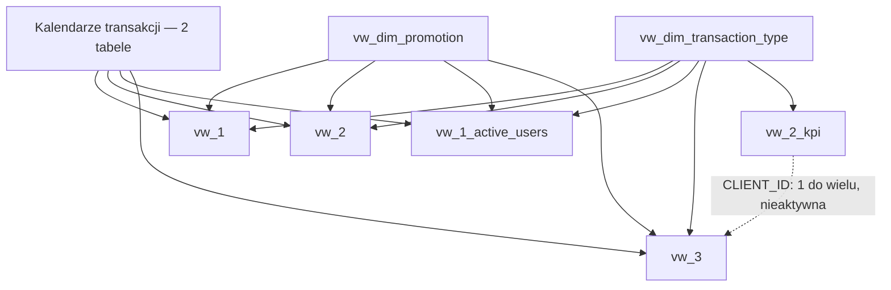
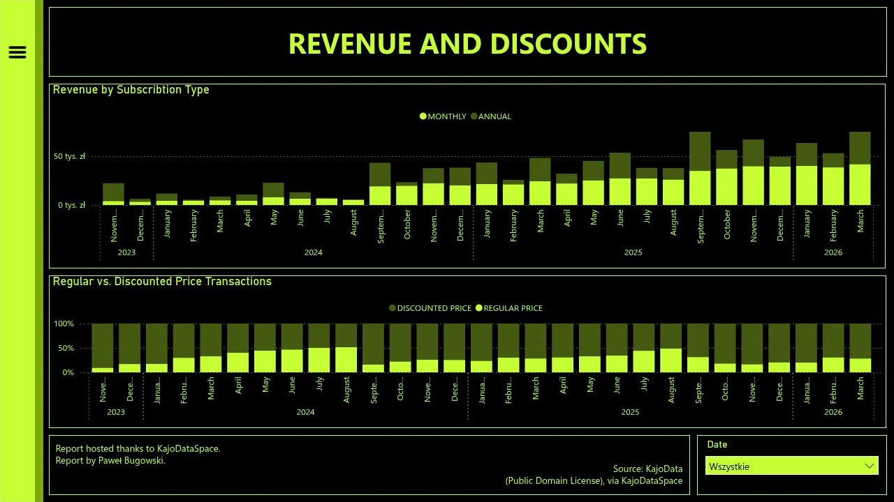
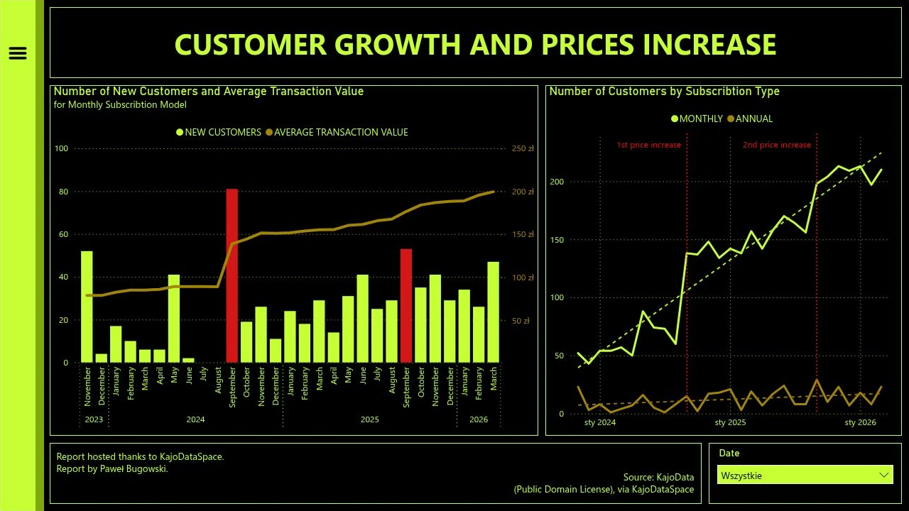
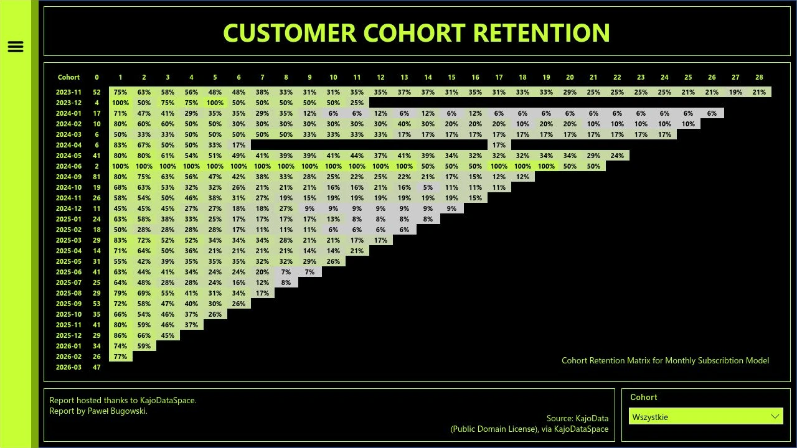

# KajoDataSpace — analiza transakcji i aktywności klientów

Projekt analityczny łączący **MySQL** i **Power BI**, poświęcony zakupom subskrypcji w latach 2023–2026. Punktem wyjścia jest zbiór zawierający trzy kolumny: datę transakcji, identyfikator klienta i kwotę. Na tej podstawie powstają historia zakupów, klasyfikacja subskrypcji, statystyki przychodów oraz analiza aktywności kolejnych kohort klientów.

Analiza odpowiada na pytania o to, jak zmieniają się liczba i wartość zakupów, kiedy pojawiają się nowi klienci oraz jaką część wpłat stanowią kolejne zakupy tych samych osób. Osobny obszar stanowi porównanie zachowań zakupowych w okresach zmian cen.

**[Otwórz interaktywny raport w Power BI](https://app.powerbi.com/view?r=eyJrIjoiNGZjYmEwMDgtZGJhMS00ZGZjLWEyOWUtZDc3MmE0MmU0MzQ1IiwidCI6ImE0ZmE1ZWNhLTdhM2YtNDRhYS04ZTI4LTc2MjBhMzk0NjEwZiJ9)**


## Najważniejsze wyniki

Zbiór obejmuje **4 227 transakcji**, **1 057 klientów** i **29 miesięcy z zarejestrowanymi wpłatami**. Po zastosowaniu korekty opisanej w skryptach SQL suma wpłat wynosi **1 042 416,27 zł**.

| Wskaźnik | Wartość dla całego zbioru |
|---|---:|
| Pierwsza zarejestrowana transakcja | 5 listopada 2023 |
| Ostatnia zarejestrowana transakcja | 31 marca 2026 |
| Liczba transakcji | 4 227 |
| Liczba unikalnych klientów | 1 057 |
| Klienci aktywni według przewidywanej daty odnowienia | 393 |
| Łączna wartość transakcji | 1 042 416,27 zł |
| Średnia wartość transakcji | 246,61 zł |
| Mediana wartości transakcji | 169,00 zł |
| Minimalna wartość transakcji | 35,60 zł |
| Maksymalna wartość transakcji | 2 089,05 zł |

Liczba aktywnych klientów jest obliczana **na 31 marca 2026 r.**, czyli ostatnią datę w danych. Nie jest to liczba aktywnych klientów na dzień otwarcia repozytorium lub raportu.

Subskrypcje miesięczne odpowiadają za **90,68% transakcji**. Jednocześnie **595 klientów** ma więcej niż jedną zarejestrowaną transakcję. Uzupełniające obliczenie na danych SQL pokazuje, że zakupy po pierwszej transakcji klienta wygenerowały **539 973,29 zł**, czyli **51,80% wszystkich wpłat**. Ten wynik opisuje kolejne zakupy w dostępnej historii; nie jest osobną kartą w opublikowanym raporcie.

## Zawartość repozytorium

| Lokalizacja | Zawartość |
|---|---|
| `Raw Data/` | Oryginalny plik `transactions.csv`, zachowany przed transformacjami SQL |
| `SQL/` | Osiem skryptów: utworzenie bazy, import, przygotowanie danych i definicje widoków |
| `Assets/` | Podglądy raportu w formacie WebP oraz ich miniatury |
| `README.md` | Opis danych, przetwarzania, modelu i raportu oraz kolejności uruchamiania skryptów |

Źródło danych znajduje się pod ścieżką [`Raw Data/transactions.csv`](Raw%20Data/transactions.csv), zgodną ze skryptem importującym.

## Dane źródłowe

Dane pochodzą z materiałów **KajoData**, udostępnionych w ramach **KajoDataSpace**. Plik CSV zawiera jeden rekord na transakcję.

| Kolumna CSV | Znaczenie | Przykład |
|---|---|---|
| `Data transakcji` | Znacznik czasu wykonania transakcji | `2023-11-05T18:04:23.495000` |
| `Klient` | Identyfikator pozwalający połączyć zakupy tej samej osoby | `1` |
| `Kwota` | Wartość pojedynczej wpłaty | `35.6` |

Kwoty są prezentowane w złotych, zgodnie z raportem. W pliku nie występuje osobna kolumna waluty. Wszystkie trzy kolumny są wypełnione, a zbiór nie zawiera identycznych wierszy powtórzonych w całości. Kolejne transakcje jednego klienta są częścią historii jego aktywności, dlatego nie są usuwane jako duplikaty.

Zakres nie obejmuje czterech pełnych lat: dla 2023 r. dostępne są dane od 5 listopada, a dla 2026 r. — do końca marca. Porównania roczne należy odczytywać z uwzględnieniem tych granic.

CSV nie zawiera nazw produktów, identyfikatorów kampanii, informacji o naliczonych rabatach, kosztach ani powodach zakupu. Typ subskrypcji i kategoria ceny są **wyznaczane na podstawie reguł SQL**, a nie odczytywane z dodatkowych pól źródłowych. Suma wpłat jest w projekcie nazywana przychodem; dane nie opisują księgowego rozpoznawania przychodów w czasie.

## Przetwarzanie danych w SQL

### Baza i tabela transakcji

Skrypty tworzą bazę `KDS_Transactions` oraz tabelę `transactions`. Dane źródłowe są uzupełniane o identyfikator transakcji i atrybuty analityczne.

| Kolumna tabeli | Typ | Rola |
|---|---|---|
| `TRANSACTION_ID` | `INT`, klucz główny, `AUTO_INCREMENT` | Identyfikator nadawany podczas importu |
| `TRANSACTION_DATE` | `DATE` | Data transakcji bez części godzinowej |
| `CLIENT_ID` | `INT` | Identyfikator klienta |
| `TRANSACTION_VALUE` | `DECIMAL(10,2)` | Kwota z dokładnością do dwóch miejsc po przecinku |
| `TRANSACTION_TYPE` | `VARCHAR(20)` | Wyznaczony rodzaj subskrypcji |
| `EXPECTED_RENEWAL_DATE` | `DATE` | Przewidywana data kolejnego zakupu |
| `PROMOTION_PRICE` | `VARCHAR(3)` | Flaga ceny regularnej lub niestandardowej |
| `TRANSACTION_YEAR` | `INT` | Rok transakcji |
| `TRANSACTION_MONTH_NUMBER` | `INT` | Numer miesiąca transakcji |

### Import i przygotowanie dat

Import wykorzystuje `LOAD DATA LOCAL INFILE`. Skrypt pomija nagłówek CSV, odczytuje kolumny do zmiennych i przypisuje je do pól tabeli po konwersji.

```sql
TRANSACTION_DATE = STR_TO_DATE(
    LEFT(TRIM(@TRANSACTION_DATE), 10),
    '%Y-%m-%d'
)
```

`TRIM` usuwa otaczające spacje, `LEFT` zachowuje datę z początku znacznika czasu, a `STR_TO_DATE` przekształca tekst do wartości daty. Godzina pozostaje w oryginalnym CSV, ale nie jest przechowywana w tabeli analitycznej. Puste identyfikatory i kwoty są zamieniane na `NULL` przez `NULLIF`.

### Klasyfikacja subskrypcji

Typ subskrypcji wynika z kwoty transakcji. Ta sama klasyfikacja służy do wyznaczenia przewidywanego terminu odnowienia.

| Warunek dotyczący kwoty | `TRANSACTION_TYPE` | Przesunięcie daty |
|---|---|---|
| Poniżej 260 zł | `MONTHLY` | 1 miesiąc kalendarzowy |
| Powyżej 260 zł i poniżej 600 zł | `SEMI-ANNUAL` | 6 miesięcy kalendarzowych |
| Powyżej 600 zł | `ANNUAL` | 12 miesięcy kalendarzowych |

Dokładne wartości 260 i 600 zł nie są objęte powyższymi warunkami; w dostarczonym zbiorze nie występują. `DATE_ADD` oblicza termin odnowienia na podstawie daty zakupu i długości przypisanego planu. Jest to termin oczekiwany, a nie potwierdzenie kolejnej wpłaty.

| Rodzaj subskrypcji | Liczba transakcji | Udział |
|---|---:|---:|
| Miesięczna | 3 833 | 90,68% |
| Półroczna | 49 | 1,16% |
| Roczna | 345 | 8,16% |

### Jawna korekta jednej transakcji

Skrypt przygotowujący dane zmienia wartość transakcji `TRANSACTION_ID = 299` z **198 zł na 99 zł**. Przy pierwszym imporcie oryginalnego CSV jest to wpłata klienta `140` z 24 marca 2024 r.

Korekta jest wykonywana w bazie. Surowy plik zachowuje kwotę źródłową. Suma przed korektą wynosi **1 042 515,27 zł**, a po niej **1 042 416,27 zł**. Wyniki opisane w tym README odnoszą się do danych po korekcie.

Przypisanie korekty do identyfikatora wymaga zachowania kolejności rekordów oraz importu do nowej, pustej tabeli. Zmiana kolejności CSV lub ponowne dopisanie danych może zmienić znaczenie identyfikatora `299`.

### Ceny regularne i niestandardowe

`PROMOTION_PRICE` porównuje kwotę z listą cen przypisaną do daty transakcji.

| Okres | Kwoty klasyfikowane jako regularne |
|---|---|
| Przed 10 września 2024 | 99, 495 i 990 zł |
| Od 10 września 2024 do 11 września 2025 włącznie | 199 i 1 799 zł |
| Od 12 września 2025 | 249 i 1 999 zł |

Kwoty zgodne z listą otrzymują `NO`, pozostałe — `YES`. Podział daje **1 215 transakcji regularnych** i **3 012 niestandardowych**. W raporcie druga grupa jest prezentowana jako transakcje promocyjne, z udziałem około **71%**.

Reguła sprawdza zgodność z cennikiem, a nie to, czy kwota jest od niego niższa. Przykładowo wpłata 2 089,05 zł przy cenie regularnej 1 999 zł również trafia do grupy `YES`. Tak należy interpretować użyte w raporcie określenie „discounted”.

### Historia zakupów i definicje wskaźników

`ROW_NUMBER()` numeruje zakupy osobno dla każdego klienta. Porządek rosnący identyfikuje pierwszy zakup, a malejący — ostatni. Przy tej samej dacie kolejność rozstrzyga `TRANSACTION_ID`.

| Pole | Definicja w SQL |
|---|---|
| `NEW_CLIENT` | `1` przy pierwszej zaobserwowanej transakcji klienta, `0` przy kolejnych |
| `TRANSACTION_COUNT` | Liczba transakcji klienta w dostępnym zbiorze |
| `LTV` | Suma wszystkich zaobserwowanych wpłat klienta |
| `avg_LT` | Liczba dni między pierwszą i ostatnią zaobserwowaną transakcją |
| `transaction_type` w `vw_2_kpi` | Rodzaj subskrypcji z ostatniej transakcji klienta |
| `ACTIVE_CUSTOMERS` | Liczba klientów z co najmniej jedną przewidywaną datą odnowienia nie wcześniejszą niż ostatnia data danych |

`LTV` nie jest prognozą przyszłej wartości klienta. Pomimo nazwy `avg_LT` opisuje odstęp między datami, a nie średnią z wielu okresów. Dla klienta z jedną transakcją wynosi zero. „Nowy klient” oznacza pierwszy zakup widoczny w zbiorze, niekoniecznie pierwszy zakup w całej historii tej osoby.

## Organizacja skryptów i widoków

Każdy plik zawiera opis swojego zakresu oraz komentarze przy istotnych operacjach. Numeracja określa kolejność wykonania.

| Skrypt | Zakres |
|---|---|
| [1_Database_and_Table.sql](SQL/1_Database_and_Table.sql) | Utworzenie bazy, tabeli i typów danych |
| [2_Import_of_Data.sql](SQL/2_Import_of_Data.sql) | Wczytanie CSV i konwersja wartości |
| [3_Preparation_of_Data.sql](SQL/3_Preparation_of_Data.sql) | Typy subskrypcji, daty odnowień, korekta kwoty i kategorie cen |
| [4.1_Dimension_Views.sql](SQL/4.1_Dimension_Views.sql) | Wymiary typu subskrypcji, roku, miesiąca i kategorii ceny |
| [4.2_Transaction_Activity_Views.sql](SQL/4.2_Transaction_Activity_Views.sql) | Przychody, liczba transakcji i szczegóły aktywności klientów |
| [4.3_Customer_History_Views.sql](SQL/4.3_Customer_History_Views.sql) | Podsumowania klientów i identyfikacja pierwszych zakupów |
| [4.4_Cohort_Retention_View.sql](SQL/4.4_Cohort_Retention_View.sql) | Szczegółowe dane wejściowe do analizy kohort |
| [4.5_Overall_Statistics_View.sql](SQL/4.5_Overall_Statistics_View.sql) | Statystyki całego zbioru, w tym mediana i aktywni klienci |

### Poziom szczegółowości danych

Widoki mają różne jednostki obserwacji. Rozróżnienie ich jest niezbędne przy agregowaniu wyników.

| Widok | Jeden wiersz oznacza | Główne zastosowanie |
|---|---|---|
| `vw_1` | Datę × typ subskrypcji × kategorię ceny | Liczba transakcji i suma wpłat |
| `vw_1_active_users` | Unikalne połączenie klienta, daty, typu i ceny | Liczenie klientów w wybranym zakresie |
| `vw_2` | Datę × typ subskrypcji × kategorię ceny | Dzienne liczniki klientów, transakcji i przychodów |
| `vw_2_kpi` | Klienta | Wartość i długość obserwowanej historii zakupów |
| `vw_3` | Transakcję | Pierwszy zakup, kwoty i zakres cen |
| `vw_4_retention` | Unikalne połączenie klienta, daty, typu i ceny | Aktywność klientów potrzebna do obliczenia retencji |
| `vw_5_data_config` | Cały zbiór | Globalne KPI |

Cztery dodatkowe widoki wymiarów to `vw_dim_transaction_type`, `vw_dim_date_year`, `vw_dim_date_month` i `vw_dim_promotion`. Łącznie skrypty tworzą **11 widoków SQL**.

`ACTIVE_USERS` w `vw_2` liczy unikalnych klientów w obrębie jednej daty, typu subskrypcji i kategorii ceny. Suma takich liczników dla miesiąca może uwzględnić tę samą osobę wielokrotnie. Dla abonamentów miesięcznych w marcu 2024 wynosi ona **57**, podczas gdy liczba unikalnych klientów w całym miesiącu to **54**. Wartości wykresu liczby klientów w opublikowanym raporcie odpowiadają pierwszej z tych agregacji.

Średnią wartość transakcji w dłuższym okresie należy wyliczać jako sumę wpłat podzieloną przez liczbę transakcji, zamiast uśredniać dzienne średnie bez uwzględnienia ich wag.

## Model danych w Power BI

Model łączy kilka tabel o różnej szczegółowości ze wspólnymi wymiarami daty, rodzaju subskrypcji i kategorii ceny. Osobne elementy obsługują historię klienta, analizę kohort i globalne statystyki.

Poniższy schemat przedstawia główną część modelu. Dwa kalendarze są zgrupowane w jednym węźle dla czytelności; nie oznacza to jednej fizycznej tabeli. Pominięto prefiks bazy `kds_transactions`, a część kohortową opisano osobno poniżej. Relacje wymiarów z tabelami szczegółowymi mają postać **jeden do wielu**.



### Wymiary i historia klienta

W modelu występuje kalendarz `vw_dim_transaction_date` z polem daty oraz drugi kalendarz zawierający datę, rok, numer miesiąca i nazwę miesiąca. Atrybuty te umożliwiają budowanie hierarchii czasu i sortowanie nazw miesięcy według ich numerów.

`vw_dim_promotion` udostępnia flagę kategorii ceny. `vw_dim_transaction_type` zawiera typ subskrypcji oraz pole `TRANSACTION_TYPE_ORDER`, wykorzystywane do ustalenia kolejności kategorii.

`vw_2_kpi` ma jeden rekord na klienta i jest połączony z `vw_3` relacją po identyfikatorze klienta. **Relacja ta jest nieaktywna**. Nie należy traktować jej jako domyślnej ścieżki propagacji filtrów; wykorzystanie jej w obliczeniu wymaga odpowiedniej definicji miary.

### Część kohortowa

`vw_4_retention` współpracuje z wymiarami czasu, typu subskrypcji i kategorii ceny oraz z dwiema tabelami pomocniczymi:

| Tabela pomocnicza | Klucz relacji z `vw_4_retention` | Rola |
|---|---|---|
| `FIRST_PURCHASE_DATE` | `FIRST_PURCHASE_DATE` | Grupowanie klientów według daty pierwszej zaobserwowanej transakcji |
| `COHORT_PERIOD` | `COHORT_PERIOD` | Porządkowanie kolejnych okresów od pierwszego zakupu |

Obie relacje prowadzą od strony „jeden” tabeli pomocniczej do strony „wiele” danych aktywności. W części kohortowej model zawiera również pola pierwszej daty zakupu, okresu kohorty i atrybutów miesiąca.

`vw_5_data_config` jest oddzielną tabelą z jednym wierszem globalnych statystyk. W przedstawionym modelu pozostaje **bez relacji** z pozostałymi tabelami.

### Podział obliczeń między SQL a model

SQL tworzy tabelę transakcji, przygotowuje dane i definiuje opisane widoki. Model uzupełnia tę warstwę o kalendarze, pola obliczeniowe, tabele pomocnicze i miary potrzebne do wizualizacji.

| Element | Miejsce przygotowania |
|---|---|
| Typ subskrypcji, flaga ceny, data odnowienia | SQL |
| Pierwsza transakcja klienta oznaczona przez `NEW_CLIENT` | SQL |
| Podsumowania klientów i globalne statystyki | SQL |
| Widoki roku i miesiąca `vw_dim_date_year`, `vw_dim_date_month` | SQL |
| Dwa kalendarze wykorzystywane w modelu raportu | Warstwa modelu; ich pełnych definicji nie zawierają dołączone skrypty SQL |
| `TRANSACTION_TYPE_ORDER` i `Price Type` | Pola dodatkowe w modelu |
| `FIRST_PURCHASE_DATE`, `COHORT_PERIOD` i pomocnicze tabele kohort | Warstwa modelu |
| Miary retencji i formatowanie macierzy | Warstwa modelu i wizualizacji |

Widoki roku i miesiąca z SQL nie są tym samym co dwa kalendarze widoczne w modelu raportu. Uruchomienie skryptów odtwarza warstwę bazy danych; zbudowanie identycznego raportu wymaga również konfiguracji modelu i jego obliczeń.

## Raport interaktywny

Raport składa się z pięciu stron. Nawigacja prowadzi od ogólnego obrazu sprzedaży przez ceny i aktywność klientów do retencji oraz zbiorczych statystyk. Fragmentatory daty pozwalają zawężać analizę czasu, a część kohortowa ma filtr kohorty. Globalne KPI z odłączonej tabeli statystyk opisują cały zbiór.

### Przegląd transakcji i przychodów

Pierwsza strona łączy liczbę transakcji, liczbę klientów i sumę wpłat z informacją o strukturze subskrypcji. Dwa wykresy pokazują:

- zmianę minimalnej i maksymalnej ceny abonamentu miesięcznego;
- miesięczne przychody z tego rodzaju subskrypcji.

Oznaczenia podwyżek wskazują przejścia z 99 do 199 zł we wrześniu 2024 oraz z 199 do 249 zł we wrześniu 2025. Wzrosty wynoszą w przybliżeniu **101%** i **25%**. Pokazane kwoty są punktami odniesienia dla analizy cen; nie każda transakcja w danym okresie ma taką wartość.

### Przychody i struktura cen

Skumulowany wykres kolumnowy porównuje przychody z abonamentów miesięcznych i rocznych. Subskrypcje półroczne są obecne w danych i globalnych statystykach, ale nie stanowią serii na tym wykresie. Z tego powodu suma jego dwóch serii nie jest pełnym przychodem ze wszystkich planów.

Drugi wykres pokazuje miesięczny udział transakcji regularnych i oznaczonych jako promocyjne. Podstawą udziałów jest liczba transakcji, nie ich wartość.



### Nowi klienci i aktywność zakupowa

Wykres łączony zestawia liczbę nowych klientów abonamentu miesięcznego ze średnią wartością transakcji tego planu. Druga wizualizacja przedstawia miesięczne liczniki aktywności dla planów miesięcznych i rocznych.

Pierwszy zakup jest wyznaczany na podstawie pełnej historii klienta, przed wyborem planu i okresu analizy. Klient wracający do zakupów nie staje się ponownie „nowy” tylko dlatego, że zmieniono filtr daty.

We wrześniu 2024 odnotowano **81 nowych klientów** z pierwszą transakcją miesięczną, a we wrześniu 2025 — **53**. To wzrosty w miesiącach zmian cen. Same szeregi miesięczne nie rozstrzygają, czy zakupy były skutkiem komunikacji podwyżki ani czy nastąpiły przed jej konkretną datą.



### Retencja kohortowa

Macierz przedstawia aktywność zakupową klientów w kolejnych miesiącach od pierwszej zaobserwowanej transakcji. Wiersz oznacza kohortę pierwszego zakupu, a kolumna — odległość w miesiącach kalendarzowych od tego momentu.

- **Okres 0** pokazuje liczbę klientów kupujących plan miesięczny w początkowym miesiącu kohorty.
- **Kolejne okresy** pokazują procent: liczba klientów z zakupem miesięcznym w danym okresie podzielona przez liczebność miesięczną z okresu 0.
- **Puste pola** mogą oznaczać brak zakupów albo okres, który nie mieści się jeszcze w dostępnej historii kohorty.

Datę pierwszego zakupu ustala się z uwzględnieniem wszystkich typów subskrypcji. Dopiero liczniki prezentowane w macierzy dotyczą planu miesięcznego. Osoba zaczynająca od innego planu może więc wejść do późniejszego licznika aktywności miesięcznej w swojej kohorcie.

Przykładowo kohorta z listopada 2023 zaczyna się od **52 klientów**; w kolejnym miesiącu wartość wynosi **75%**, a w okresie 28 — **21%**. Macierz obejmuje 27 widocznych kohort i okresy od 0 do 28. W lipcu i sierpniu 2024 nie ma nowych klientów spełniających warunek początkowego zakupu miesięcznego.

Tak zdefiniowana retencja opisuje zakupy w miesiącach kalendarzowych. Nie jest miarą nieprzerwanego utrzymywania abonamentu. Powrót po przerwie może podnieść wartość późniejszego okresu, a młodsze kohorty mają krótszy czas obserwacji.



### Statystyki całego zbioru

Ostatnia strona zbiera okres obserwacji, statystyki kwot, liczbę klientów, aktywnych klientów, strukturę subskrypcji i podział cen. Wartości pochodzą z `vw_5_data_config`.

Mediana jest wyznaczana przez uporządkowanie kwot i wybór pozycji środkowej. Dla parzystej liczby rekordów obliczana jest średnia z dwóch centralnych wartości. W tym zbiorze mediana wynosi **169 zł**, a średnia **246,61 zł**; obecność droższych planów podnosi średnią względem wartości środkowej.

## Aktywność klientów i znaczenie kolejnych zakupów

Przychód z abonamentów miesięcznych rośnie wraz ze zmianą liczby transakcji i ich przeciętnej wartości. Wybrane miesiące pokazują oba składniki tego wzrostu:

| Miesiąc | Transakcje miesięczne | Przychód z planu miesięcznego | Średnia wartość transakcji |
|---|---:|---:|---:|
| Sierpień 2024 | 60 | 5 336,86 zł | 88,95 zł |
| Wrzesień 2024 | 138 | 19 167,42 zł | 138,89 zł |
| Sierpień 2025 | 156 | 26 150,82 zł | 167,63 zł |
| Wrzesień 2025 | 198 | 34 943,04 zł | 176,48 zł |
| Marzec 2026 | 210 | 41 895,76 zł | 199,50 zł |

Ponad połowa sumy wpłat pochodzi z transakcji następujących po pierwszym zaobserwowanym zakupie klienta. Można to odtworzyć bezpośrednio z `vw_3`:

```sql
SELECT
    SUM(CASE WHEN NEW_CLIENT = 0 THEN TRANSACTION_VALUE ELSE 0 END)
        AS RETURNING_PURCHASE_REVENUE,
    ROUND(
        100.0 * SUM(CASE WHEN NEW_CLIENT = 0 THEN TRANSACTION_VALUE ELSE 0 END)
        / NULLIF(SUM(TRANSACTION_VALUE), 0),
        2
    ) AS RETURNING_PURCHASE_REVENUE_PERCENT
FROM vw_3;
```

Wynik to **539 973,29 zł i 51,80%**. Pierwsze zakupy klientów generują pozostałe **502 442,98 zł**. Do pierwszej kategorii trafiają wyłącznie kolejne transakcje — pierwsza wpłata osoby, która później wróciła, nadal pozostaje pierwszym zakupem.

Duży udział kolejnych wpłat pokazuje znaczenie utrzymania aktywności klientów. Ocena skuteczności promocji wymagałaby dodatkowo historii ofert i kampanii, rzeczywiście naliczonych rabatów oraz danych o kosztach. Na podstawie samych dat i kwot można opisać zmiany, ale nie przypisać ich jednoznacznie określonej akcji marketingowej.

## Uruchomienie warstwy SQL

1. Przygotuj instancję **MySQL 8.0 lub nowszą**, obsługującą CTE i funkcje okna.
2. Umieść plik `transactions.csv` w folderze `Raw Data`, a skrypty w folderze `SQL`.
3. Uruchom `1_Database_and_Table.sql`, aby utworzyć nową bazę i tabelę.
4. Włącz obsługę `LOCAL INFILE` po stronie klienta. Skrypt importu zawiera ustawienie po stronie serwera, którego wykonanie wymaga odpowiednich uprawnień.
5. Sprawdź ścieżkę `'Raw Data/transactions.csv'`: jest rozwiązywana względem katalogu roboczego klienta SQL, a nie automatycznie względem położenia skryptu. W razie potrzeby podaj pełną ścieżkę.
6. Wykonaj import jednokrotnie do pustej tabeli, następnie przygotowanie danych i skrypty widoków w kolejności numeracji.
7. Sprawdź wynikowe statystyki i poprawność wczytanych dat.

```sql
USE KDS_Transactions;

SELECT
    COUNT(*) AS TRANSACTIONS,
    COUNT(DISTINCT CLIENT_ID) AS CUSTOMERS,
    COUNT(*) - COUNT(TRANSACTION_DATE) AS MISSING_DATES,
    MIN(TRANSACTION_DATE) AS FIRST_DATE,
    MAX(TRANSACTION_DATE) AS LAST_DATE,
    SUM(TRANSACTION_VALUE) AS TOTAL_REVENUE
FROM transactions;

SELECT *
FROM vw_5_data_config;
```

Oczekiwane wartości pierwszego zapytania: **4 227 transakcji**, **1 057 klientów**, **0 brakujących dat**, okres **2023-11-05–2026-03-31** i **1 042 416,27 zł** sumy wpłat. Pełne statystyki można porównać z tabelą na początku dokumentu.

Do połączenia z Power BI służą przygotowane widoki. Kalendarze, dodatkowe kolumny, miary i relacje należy skonfigurować zgodnie z opisanym modelem. Zakres publikowanych materiałów obejmuje SQL, dane źródłowe i podglądy; gotową prezentację wyników udostępnia raport online.

## Wykorzystane techniki

| Obszar | Zastosowanie |
|---|---|
| Import danych | `LOAD DATA LOCAL INFILE`, zmienne użytkownika, konwersja dat i pustych pól |
| Reguły klasyfikacji | `CASE`, `IN`, warunki dat i kwot |
| Analiza czasu | `DATE_ADD`, `DATEDIFF`, `YEAR`, `MONTH`, `DATE_FORMAT` |
| Agregacja | `GROUP BY`, `COUNT`, `COUNT(DISTINCT ...)`, `SUM`, `AVG`, `MIN`, `MAX` |
| Historia zakupów | CTE i `ROW_NUMBER()` z partycjonowaniem po kliencie |
| Statystyki | Ranking kwot, `COUNT(*) OVER ()`, `FLOOR` i `CEIL` przy medianie |
| Model analityczny | Wspólne wymiary, różne poziomy szczegółowości, relacja nieaktywna i tabela globalnych KPI |
| Prezentacja wyników | Wykresy liniowe, kolumnowe i łączone, udziały procentowe, fragmentatory i macierz kohort |

**Autor analizy i raportu:** Paweł Bugowski.  
**Źródło danych:** KajoData, materiały udostępnione w ramach KajoDataSpace.
