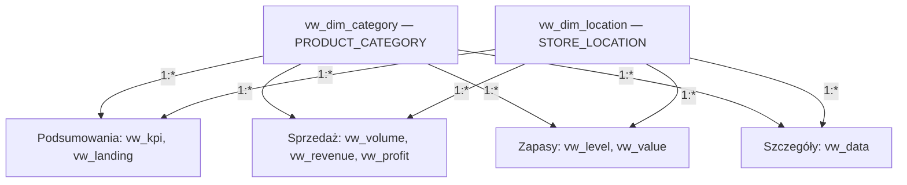

# Maven Toys — sprzedaż i zapasy w sklepach z zabawkami w Meksyku

## Od danych sprzedażowych do analizy produktów, lokalizacji i stanów magazynowych

Projekt analityczny łączący **MySQL, analizę sprzedaży i zapasów oraz Power BI**. Na podstawie historii sprzedaży, katalogu produktów, informacji o sklepach i stanów magazynowych przedstawia skalę działalności sieci Maven Toys, udział poszczególnych kategorii w przychodzie i zysku oraz strukturę zapasu.

Przygotowałem tę analizę, aby porównać popularność produktów z ich rentownością i dostępnością. Zestawiłem liczbę sprzedanych sztuk z przychodem i zyskiem, uwzględniając kategorie produktów, rodzaje lokalizacji sklepów oraz rozkład sprzedaży w czasie. Część magazynowa uzupełnia ten obraz o ilość i wartość zapasu oraz wskaźnik jego pokrycia historyczną sprzedażą.

**[Otwórz interaktywny raport w Power BI](https://app.powerbi.com/view?r=eyJrIjoiNjZmM2I0Y2QtNmYzMC00ODE4LWJiOTQtZDQzODA5MmIzN2Q0IiwidCI6ImE0ZmE1ZWNhLTdhM2YtNDRhYS04ZTI4LTc2MjBhMzk0NjEwZiJ9)**

> **Zakres danych:** od 1 stycznia 2022 do 30 września 2023 r., łącznie 829 262 rekordy sprzedaży w 638 dniach i 21 miesiącach kalendarzowych. Dane obejmują pełny 2022 r. oraz pierwsze trzy kwartały 2023 r. Stany magazynowe są pojedynczym zapisem, bez historii zmian i daty przypisanej do każdego rekordu.

| Element | Zakres |
| --- | --- |
| Autor analizy i raportu | Paweł Bugowski |
| Przedmiot analizy | Sprzedaż, przychody, zysk i zapasy sieci sklepów z zabawkami |
| Źródło | Maven Analytics — zbiór Mexico Toy Sales |
| Charakter danych | Dane fikcyjnej sieci Maven Toys |
| Dane wejściowe | 5 plików CSV w katalogu `Raw Data/` |
| Sprzedaż | 829 262 rekordy, 1 090 565 sprzedanych sztuk |
| Sieć i asortyment | 50 sklepów, 35 produktów, 5 kategorii i 4 rodzaje lokalizacji |
| Przygotowanie danych | 7 udokumentowanych skryptów MySQL |
| Warstwa SQL | 5 tabel źródłowych i 10 widoków |
| Model raportowy | 2 wspólne wymiary i 8 widoków analitycznych |
| Raport | 6 stron Power BI |
| Udostępnienie raportu | KajoDataSpace, zgodnie ze stopką raportu |

## Spis treści

- [Cele i pytania analityczne](#cele-i-pytania-analityczne)
- [Dane i zakres analizy](#dane-i-zakres-analizy)
- [Najważniejsze wyniki](#najważniejsze-wyniki)
- [Zawartość repozytorium](#zawartość-repozytorium)
- [Przygotowanie danych w SQL](#przygotowanie-danych-w-sql)
- [Model danych i zasady agregacji](#model-danych-i-zasady-agregacji)
- [Raport Power BI](#raport-power-bi)
- [Jak odtworzyć projekt](#jak-odtworzyć-projekt)
- [Kontrola jakości danych i zapytania walidacyjne](#kontrola-jakości-danych-i-zapytania-walidacyjne)
- [Źródła i autor](#źródła-i-autor)

## Cele i pytania analityczne

Wysoka sprzedaż produktu nie musi oznaczać wysokiego zysku, a duży zapas nie musi oznaczać nadmiaru. Interpretacja wymaga zestawienia kilku wielkości: wolumenu, ceny, kosztu katalogowego, rodzaju lokalizacji oraz tempa sprzedaży. Projekt łączy te perspektywy w jednej warstwie danych i sześciu stronach raportu.

Analiza odpowiada na następujące pytania:

1. Ile sztuk sprzedano i jaki przychód oraz zysk wygenerowała sprzedaż?
2. Które kategorie odpowiadają za największy wolumen, a które za najwyższy wynik finansowy?
3. Jak różnią się wyniki sklepów w lokalizacjach miejskich, komercyjnych, mieszkalnych i na lotniskach?
4. Które produkty dominują pod względem sprzedaży i przychodu?
5. Jak rozkładają się sprzedaż, przychody i zysk w poszczególnych miesiącach?
6. W jakich produktach i kategoriach znajduje się największy zapas oraz jego wartość detaliczna?
7. Jak wygląda pokrycie zapasu historycznym tempem sprzedaży i które produkty wymagają bliższego sprawdzenia?

W tym projekcie **przychód** oznacza liczbę sprzedanych sztuk pomnożoną przez cenę z katalogu. **Zysk** to różnica między tak wyznaczonym przychodem a kosztem sprzedanych produktów według tego samego katalogu. Nie jest to wynik netto po kosztach funkcjonowania sklepów.

**Wartość zapasu jest wyceną detaliczną**, czyli iloczynem stanu magazynowego i ceny sprzedaży. Nie opisuje kapitału zaangażowanego w zakup towaru według kosztu nabycia.

## Dane i zakres analizy

### Pochodzenie i jednostka obserwacji

Źródłem jest zbiór [Mexico Toy Sales udostępniony przez Maven Analytics](https://mavenanalytics.io/data-playground/mexico-toy-sales), opisujący fikcyjną sieć sklepów z zabawkami w Meksyku. Wszystkie wartości przedstawione w tym README odnoszą się do konkretnych plików CSV znajdujących się w repozytorium.

Wiersz `sales.csv` opisuje sprzedaż określonej liczby sztuk **jednego produktu w jednym sklepie w danym dniu**. Identyfikator `Sale_ID` rozróżnia rekordy sprzedaży. W danych nie ma identyfikatora klienta ani osobnego identyfikatora koszyka, dlatego liczba rekordów nie oznacza liczby kupujących ani pełnych paragonów obejmujących wiele produktów.

W `inventory.csv` jednostką obserwacji jest para **sklep–produkt**. Ten plik przedstawia stan zapasu, a nie kolejne przyjęcia, wydania lub dostawy. Katalog produktów i katalog sklepów dostarczają nazw oraz atrybutów wykorzystywanych w grupowaniu.

### Pliki źródłowe

| Plik | Rekordy | Kolumny | Jednostka obserwacji |
| --- | ---: | ---: | --- |
| `sales.csv` | 829 262 | 5 | Rekord sprzedaży produktu w sklepie i dniu |
| `products.csv` | 35 | 5 | Produkt z kategorią, kosztem i ceną |
| `stores.csv` | 50 | 5 | Sklep z miastem, rodzajem lokalizacji i datą otwarcia |
| `inventory.csv` | 1 593 | 3 | Stan magazynowy dla pary sklep–produkt |
| `calendar.csv` | 638 | 1 | Dzień kalendarzowy |

Kalendarz obejmuje wszystkie dni od 1 stycznia 2022 do 30 września 2023 r. Daty sprzedaży mieszczą się w tym zakresie. Kolumna daty otwarcia sklepu opisuje historię placówki i nie wyznacza początku okresu analizy sprzedaży.

### Definicje pól źródłowych

| Plik | Pole CSV | Pole SQL | Znaczenie |
| --- | --- | --- | --- |
| `sales.csv` | `Sale_ID` | `SALE_ID` | Unikalny identyfikator rekordu sprzedaży |
| `sales.csv` | `Date` | `D_DATE` | Data sprzedaży |
| `sales.csv` | `Store_ID` | `STORE_ID` | Identyfikator sklepu |
| `sales.csv` | `Product_ID` | `PRODUCT_ID` | Identyfikator produktu |
| `sales.csv` | `Units` | `UNITS` | Liczba sprzedanych sztuk w rekordzie |
| `products.csv` | `Product_ID` | `PRODUCT_ID` | Identyfikator produktu |
| `products.csv` | `Product_Name` | `PRODUCT_NAME` | Nazwa produktu |
| `products.csv` | `Product_Category` | `PRODUCT_CATEGORY` | Kategoria asortymentowa |
| `products.csv` | `Product_Cost` | `PRODUCT_COST` | Jednostkowy koszt katalogowy |
| `products.csv` | `Product_Price` | `PRODUCT_PRICE` | Jednostkowa cena katalogowa |
| `stores.csv` | `Store_ID` | `STORE_ID` | Identyfikator sklepu |
| `stores.csv` | `Store_Name` | `STORE_NAME` | Nazwa sklepu |
| `stores.csv` | `Store_City` | `STORE_CITY` | Miasto |
| `stores.csv` | `Store_Location` | `STORE_LOCATION` | Rodzaj lokalizacji sklepu |
| `stores.csv` | `Store_Open_Date` | `STORE_OPEN_DATE` | Data otwarcia sklepu |
| `inventory.csv` | `Store_ID`, `Product_ID` | `STORE_ID`, `PRODUCT_ID` | Para identyfikująca stan produktu w sklepie |
| `inventory.csv` | `Stock_On_Hand` | `STOCK_ON_HAND` | Liczba sztuk w zapasie |
| `calendar.csv` | `Date` | `D_DATE` | Data kalendarzowa |

Kategorie produktów to `Art & Crafts`, `Electronics`, `Games`, `Sports & Outdoors` i `Toys`. Rodzaje lokalizacji to `Airport`, `Commercial`, `Downtown` i `Residential`. **Rodzaj lokalizacji nie jest nazwą miasta ani konkretnego sklepu** — wiele placówek może należeć do tej samej grupy.

Kwoty zachowują symbol `$` używany w katalogu i raporcie. CSV nie zawierają osobnej kolumny z kodem waluty ani kursów przeliczeniowych. Ceny i koszty są atrybutami produktu; plik sprzedaży nie przechowuje ceny faktycznie zastosowanej przy każdym zakupie, rabatu ani historycznych zmian kosztu.

### Jakość danych wejściowych

| Kontrola | Wynik |
| --- | ---: |
| Puste pola w pięciu plikach CSV | 0 |
| Powtórzone całe wiersze w poszczególnych plikach | 0 |
| Rekordy sprzedaży z nieznanym produktem | 0 |
| Rekordy sprzedaży z nieznanym sklepem | 0 |
| Daty sprzedaży poza dostarczonym kalendarzem | 0 |
| Rekordy zapasu z nieznanym produktem lub sklepem | 0 |
| Powtórzone pary sklep–produkt w zapasie | 0 |
| Sprzedaż z liczbą sztuk równą zero lub ujemną | 0 |
| Ujemne stany magazynowe | 0 |

Możliwych kombinacji 50 sklepów i 35 produktów jest 1 750, natomiast plik zapasu zawiera 1 593 pary. **Brakujących 157 kombinacji nie uzupełniam automatycznie zerami.** Brak rekordu i zarejestrowany zerowy stan to różne informacje. Sam plik nie wyjaśnia, czy brakująca para oznacza produkt nieobecny w asortymencie sklepu, czy brak obserwacji.

## Najważniejsze wyniki

Wyniki poniżej odnoszą się do pełnego zakresu danych. Obliczenia SQL wykorzystują niezmienione ilości, ceny i koszty z CSV. Karty raportu skracają duże liczby do tysięcy i milionów; dokładne wartości pochodzą z obliczeń na danych źródłowych.

### Skala sprzedaży i zapasu

| Wskaźnik | Wartość | Interpretacja |
| --- | ---: | --- |
| Rekordy sprzedaży | **829 262** | Liczba pozycji oznaczonych `SALE_ID` |
| Sprzedane sztuki | **1 090 565** | Suma `UNITS` |
| Przychód | **14 444 572,35 $** | Sprzedane sztuki × cena katalogowa |
| Zysk | **4 014 029,00 $** | Sprzedane sztuki × różnica ceny i kosztu |
| Produkty obecne w sprzedaży | **35** | Unikalne nazwy produktów w szczegółach sprzedaży |
| Sklepy obecne w sprzedaży | **50** | Unikalne nazwy sklepów w szczegółach sprzedaży |
| Kategorie produktów | **5** | Kategorie występujące w sprzedaży |
| Stan magazynowy | **29 742 szt.** | Suma zapisanych stanów |
| Detaliczna wartość zapasu | **410 240,58 $** | Stan magazynowy × cena katalogowa |

Sprzedaż obejmuje cały okres obserwacji, a zapas jest pojedynczym stanem. Nie należy traktować 29 742 sztuk jako sumy dostaw w tych 21 miesiącach ani porównywać wartości zapasu z przychodem tak, jakby obie wielkości opisywały przepływ w tym samym okresie.

### Kategorie: popularność a wynik finansowy

| Kategoria | Sprzedane sztuki | Przychód | Zysk | Stan magazynowy |
| --- | ---: | ---: | ---: | ---: |
| Art & Crafts | 325 574 | 2 705 364,26 $ | 753 354,00 $ | 8 635 |
| Electronics | 134 075 | 2 246 771,25 $ | 1 001 437,00 $ | 2 418 |
| Games | 194 673 | 2 226 836,27 $ | 673 993,00 $ | 6 155 |
| Sports & Outdoors | 169 043 | 2 172 359,57 $ | 505 718,00 $ | 4 981 |
| Toys | 267 200 | 5 093 241,00 $ | 1 079 527,00 $ | 7 553 |

**Art & Crafts** prowadzi pod względem liczby sprzedanych sztuk i wielkości zapasu. **Toys** generuje najwyższy przychód i zysk. **Electronics** ma najniższy wolumen spośród pięciu kategorii, ale drugi najwyższy zysk. Sama popularność mierzona liczbą sztuk nie wystarcza więc do ustalenia znaczenia kategorii dla wyniku finansowego.

| Rodzaj lokalizacji | Zysk |
| --- | ---: |
| Downtown | 2 248 728,00 $ |
| Commercial | 926 864,00 $ |
| Residential | 460 388,00 $ |
| Airport | 378 049,00 $ |

Największy łączny zysk przypada na sklepy `Downtown`. To wynik całej grupy placówek, a nie przeciętnego sklepu. Ocena efektywności lokalizacji wymaga dodatkowo uwzględnienia liczby sklepów, ich wielkości i dostępnego asortymentu.

### Produkty dominujące w sprzedaży

| Produkt | Sprzedane sztuki |
| --- | ---: |
| Colorbuds | 104 368 |
| PlayDoh Can | 103 128 |
| Barrel O' Slime | 91 663 |
| Deck Of Cards | 84 034 |
| Magic Sand | 60 598 |

Najwyższy przychód generują **Lego Bricks — 2 388 882,63 $**, następnie **Colorbuds — 1 564 476,32 $**, **Magic Sand — 968 962,02 $**, **Action Figure — 926 748,42 $** i **Rubik's Cube — 912 983,28 $**.

Lider wolumenu i lider przychodu to różne produkty. Zestawienie obu rankingów pozwala odróżnić artykuły sprzedawane często od tych, których wyższa cena jednostkowa ma duży udział w wartości sprzedaży.

### Zapasy i ich pokrycie sprzedażą

Najwyższa detaliczna wartość zapasu przypada na **Lego Bricks — 44 708,82 $**. Kolejne pozycje to **Dinosaur Figures — 34 057,28 $**, **Magic Sand — 30 732,78 $**, **Rubik's Cube — 29 925,03 $** oraz **Nerf Gun — 24 227,88 $**.

Wykres pięciu produktów pokazujący dni zapasu wybiera produkty według **sumy sztuk w zapasie**, a następnie prezentuje ich średni wskaźnik DOI:

| Produkt | Stan magazynowy | Średnie dni zapasu, w przybliżeniu |
| --- | ---: | ---: |
| Deck Of Cards | 2 738 | 4,48 |
| Dinosaur Figures | 2 272 | 4,09 |
| PlayDoh Can | 2 129 | 3,10 |
| Magic Sand | 1 922 | 2,88 |
| Rubik's Cube | 1 497 | 2,68 |

Wskaźnik opiera się na dniach, w których dany produkt sprzedawał się w danym sklepie. Nie uwzględnia wszystkich dni kalendarzowych, dlatego wartości nie należy odczytywać jako prognozy faktycznego czasu do wyczerpania towaru.

Niski wskaźnik dla **Jenga — około 0,66**, **Playfoam — około 0,66** i **Hot Wheels 5-Pack — około 0,76** wskazuje produkty warte sprawdzenia pod kątem dostępności i terminów dostaw. Z kolei wysoka wartość zapasu Lego Bricks uzasadnia monitorowanie tego produktu zarówno pod kątem sprzedaży, jak i środków związanych z utrzymywaniem asortymentu. Decyzja o dostawie wymaga potwierdzenia bieżącego stanu w konkretnym sklepie oraz czasu realizacji zamówienia.

### Miesiące i porównywalność okresów

Wykresy miesięczne prezentują sumy według nazwy miesiąca, łącząc lata. **Styczeń–wrzesień obejmują dwa lata, natomiast październik–grudzień tylko 2022 r.** Niższy wynik końcówki wykresu nie jest więc sam w sobie dowodem sezonowego spadku sprzedaży.

Widoki `vw_volume`, `vw_revenue` i `vw_profit` zachowują kolumnę `YEAR`. Pozwala ona przygotować porównanie rok do roku dla wspólnego zakresu styczeń–wrzesień lub analizę kolejnych 21 miesięcy bez łączenia lat. `vw_landing` celowo agreguje dane według miesiąca bez roku, zgodnie z przeglądowym układem raportu.

## Zawartość repozytorium

Repozytorium obejmuje katalogi `Assets/`, `Raw Data/` i `SQL/`. Dokumentacja `README.md` znajduje się w katalogu głównym.

| Plik | Zawartość |
| --- | --- |
| `Raw Data/sales.csv` | Historia sprzedaży produktów w sklepach |
| `Raw Data/products.csv` | Katalog produktów, kategorii, kosztów i cen |
| `Raw Data/stores.csv` | Katalog sklepów, miast i rodzajów lokalizacji |
| `Raw Data/inventory.csv` | Zapis stanów magazynowych dla par sklep–produkt |
| `Raw Data/calendar.csv` | Kalendarz obejmujący okres sprzedaży |
| `SQL/1_Database_and_Tables.sql` | Baza `toys_in_mexico` i pięć tabel źródłowych |
| `SQL/2_Import_of_Data.sql` | Import CSV, odczyt dat i przekształcenie kwot |
| `SQL/3.1_Dimension_Views.sql` | Wymiary kategorii produktów i rodzaju lokalizacji |
| `SQL/3.2_Summary_Views.sql` | Podsumowania sklepów, miesięcy i szczegóły rekordów sprzedaży |
| `SQL/3.3_Sales_Views.sql` | Miesięczny wolumen, przychód, zysk i marża |
| `SQL/3.4_Inventory_Views.sql` | Stan magazynowy, dni zapasu i wycena detaliczna |
| `SQL/5_Data_Validation.sql` | Kontrole jakości, sumy referencyjne i uzgodnienie widoków |
| `Assets/cover.webp`, `Assets/cover-thumb.webp` | Podgląd strony przeglądowej i miniatura |
| `Assets/gallery-01.webp`, `Assets/gallery-01-thumb.webp` | Podgląd analizy przychodów i miniatura |
| `Assets/gallery-02.webp`, `Assets/gallery-02-thumb.webp` | Podgląd analizy zysku i miniatura |
| `Assets/gallery-03.webp`, `Assets/gallery-03-thumb.webp` | Podgląd analizy poziomu zapasów i miniatura |
| `README.md` | Opis danych, wyników, SQL, modelu i sposobu odtworzenia |

Publiczny link udostępnia interaktywny raport, a skrypty odtwarzają warstwę SQL. Zestaw plików nie zawiera `.pbix` ani `.pbit`. Definicje miar, ustawienia interakcji i formatowanie wizualizacji pozostają częścią pliku raportu.

## Przygotowanie danych w SQL

### 1. Utworzenie bazy i tabel

Skrypt `1_Database_and_Tables.sql` tworzy bazę `toys_in_mexico` z kodowaniem `utf8mb4` i regułą porównywania tekstu `utf8mb4_unicode_ci`.

Pięć tabel odpowiada plikom CSV. Ceny i koszty mają typ `DECIMAL(10,2)`, identyfikatory i liczby sztuk — `INT`, daty — `DATE`, a nazwy i kategorie — `VARCHAR(255)`.

Klucze główne to `PRODUCT_ID` w produktach, `STORE_ID` w sklepach, `SALE_ID` w sprzedaży oraz `D_DATE` w kalendarzu. Tabela zapasów ma klucz złożony z `STORE_ID` i `PRODUCT_ID`. Indeks `idx_sales_product_store_date` wspiera grupowanie historii według produktu i sklepu oraz odczyt dni sprzedaży.

Skrypt nie deklaruje kluczy obcych. Spójność identyfikatorów jest sprawdzana osobnymi zapytaniami walidacyjnymi. Utworzenie tabel nie usuwa ani nie zastępuje istniejącej bazy.

### 2. Import i interpretacja wartości źródłowych

`2_Import_of_Data.sql` używa `LOAD DATA LOCAL INFILE`, pomija nagłówki i odczytuje pola rozdzielone przecinkami, z opcjonalnymi podwójnymi cudzysłowami. Zmienne użytkownika pozwalają przekształcić tekst przed przypisaniem go do kolumn tabel.

Przy imporcie:

- `TRIM` usuwa otaczające spacje, a `NULLIF(..., '')` zamienia puste wartości na `NULL`;
- `REPLACE` usuwa znak `$` z kosztów i cen oraz znak powrotu karetki z ostatniego pola rekordu;
- daty sprzedaży i otwarcia sklepów są interpretowane jako `%Y-%m-%d`;
- daty kalendarza są interpretowane jako `%m/%d/%Y`;
- `SHOW WARNINGS` po każdym imporcie pozwala sprawdzić ostrzeżenia dotyczące odczytu lub konwersji.

Surowe dane pozostają niezmienione. Nie ma etapu aktualizowania cen, korygowania ilości ani usuwania rekordów sprzedaży. Przygotowanie polega na poprawnym odczycie typów i budowie widoków.

Ścieżki `Raw Data/...` odnoszą się do katalogu roboczego klienta MySQL, nie automatycznie do położenia pliku SQL.

### 3. Wymiary kategorii i lokalizacji

`3.1_Dimension_Views.sql` tworzy dwa widoki za pomocą `SELECT DISTINCT`:

| Widok | Kolumna | Liczba wierszy |
| --- | --- | ---: |
| `vw_dim_category` | `PRODUCT_CATEGORY` | 5 |
| `vw_dim_location` | `STORE_LOCATION` | 4 |

Źródłem wymiarów są katalogi produktów i sklepów. Wymiary zapewniają wspólne wartości filtrów dla wszystkich części analizy, niezależnie od poziomu szczegółowości poszczególnych widoków.

### 4. Podsumowania i szczegóły sprzedaży

`3.2_Summary_Views.sql` tworzy `vw_kpi`, `vw_landing` i `vw_data`.

W `vw_kpi` dwa CTE niezależnie agregują sprzedaż i zapas do poziomu **sklep × kategoria**. Dopiero gotowe podsumowania są łączone po `STORE_ID` i `PRODUCT_CATEGORY`. Dzięki temu stan magazynowy nie jest powielany przez każdą transakcję danego produktu.

Punktem wyjścia jest sprzedaż, a `LEFT JOIN` dołącza zapas. `COALESCE` zastępuje brak podsumowania zapasu zerem w tym konkretnym widoku. Grupa sklep–kategoria występująca wyłącznie w magazynie nie weszłaby do `vw_kpi`; w dostarczonym zbiorze sumy tego widoku są zgodne z sumami pełnej tabeli zapasu.

`vw_landing` agreguje przychód i zysk według kategorii, produktu, rodzaju lokalizacji i miesiąca, bez rozdzielania lat. `vw_data` zachowuje jeden wiersz na rekord sprzedaży, dołączając nazwy produktu i sklepu oraz kategorię i lokalizację.

Skrypt ustawia `lc_time_names = 'en_US'`, aby funkcja `MONTHNAME` zwracała angielskie nazwy miesięcy. Ustawienie dotyczy bieżącej sesji; połączenia później odczytujące te widoki powinny używać tej samej konfiguracji.

### 5. Miesięczny wolumen, przychód i zysk

`3.3_Sales_Views.sql` tworzy trzy widoki o wspólnym poziomie szczegółowości: **produkt × kategoria × rodzaj lokalizacji × rok × miesiąc**.

| Widok | Wartości liczbowe |
| --- | --- |
| `vw_volume` | `UNITS_SOLD` — suma sprzedanych sztuk |
| `vw_revenue` | `REVENUE` — suma sztuk przemnożonych przez cenę |
| `vw_profit` | `PROFIT` oraz `PROFIT_MARGIN` |

Marża jest liczona w każdej grupie jako zysk podzielony przez przychód, a następnie zaokrąglana do dwóch miejsc **jako ułamek**. Wartość `0.30` oznacza 30%. `NULLIF` zabezpiecza mianownik przed zerem.

Późniejsze `AVG(PROFIT_MARGIN)` uśrednia już zaokrąglone wartości i nadaje każdemu wierszowi taką samą wagę. Nie jest równoważne podzieleniu łącznego zysku przez łączny przychód. Zachowanie tej kolejności obliczeń jest konieczne do odtworzenia tabeli średnich marż.

### 6. Poziom i wartość zapasu

`3.4_Inventory_Views.sql` tworzy `vw_level` oraz `vw_value`.

W `vw_level` CTE wyznacza przeciętną liczbę sprzedanych sztuk dla każdej pary produkt–sklep:

```sql
SUM(UNITS) / COUNT(DISTINCT D_DATE)
```

Mianownik obejmuje wyłącznie dni z zarejestrowaną sprzedażą tej pary. Następnie stan magazynowy jest dzielony przez otrzymaną średnią, a wynik zaokrąglany do jednego miejsca po przecinku jako `DAYS_OF_INVENTORY`.

Zerowy zapas przy istniejącej historii sprzedaży daje zero dni. Brak historii lub zerowe tempo sprzedaży daje `NULL`. Średnia wskaźnika pomija `NULL`; zamiana takich wartości na zero zmieniłaby jej znaczenie.

Obliczenia zakładają domyślne ustawienie MySQL `div_precision_increment = 4`. Precyzja pośredniego dzielenia ma znaczenie dla wartości znajdujących się blisko granicy zaokrąglenia.

`vw_value` wycenia każdy zapis zapasu według ceny detalicznej. Oba widoki zachowują wiersze źródłowych par sklep–produkt, mimo że nie udostępniają `STORE_ID` w swojej końcowej liście kolumn.

### 7. Kontrola i uzgodnienie wyników

`5_Data_Validation.sql` zawiera zapytania tylko do odczytu. Sprawdza liczebności tabel, zakres dat, brakujące powiązania, niepoprawne ilości i sumy finansowe. Porównuje też łączny wynik `vw_kpi` z osobnymi widokami sprzedaży i zapasu.

Wartości referencyjne są opisem dołączonego zbioru. Nie są używane do nadpisywania danych ani dopasowywania wyniku. Skrypt pokazuje również średnie marże według kategorii oraz średnie dni zapasu według produktu.

## Model danych i zasady agregacji

### Struktura modelu raportowego

Model wykorzystuje **dwa wspólne wymiary**, które filtrują **osiem widoków analitycznych**. Każdy wymiar łączy się ze wszystkimi ośmioma widokami relacją jeden-do-wielu. Filtrowanie przebiega od wymiaru do danych analitycznych.

Poniższy schemat grupuje widoki tematycznie dla czytelności. Każda nazwa wewnątrz grupy oznacza osobny widok i osobne połączenie z oboma wymiarami.



Widoki analityczne nie są ze sobą łączone bezpośrednimi relacjami. Wspólny wybór kategorii lub rodzaju lokalizacji dociera do nich przez wymiary. Pozwala to zestawiać wartości obliczane na różnych poziomach szczegółowości bez łączenia samych agregatów w jedną tabelę.

Tabele `products`, `stores`, `sales`, `inventory` i `calendar` są warstwą źródłową w MySQL. Nie są dodatkowymi tabelami na pokazanym modelu raportowym. W szczególności dostarczony `calendar` nie stanowi w nim powiązanego wymiaru czasu; atrybuty roku i miesiąca znajdują się bezpośrednio w odpowiednich widokach.

### Widoki, kolumny i poziom szczegółowości

Wszystkie widoki analityczne zawierają `PRODUCT_CATEGORY` i `STORE_LOCATION`.

| Widok | Pozostałe kolumny | Poziom szczegółowości | Wiersze |
| --- | --- | --- | ---: |
| `vw_kpi` | `STORE_ID`, `STORE_NAME`, `STORE_CITY`, `REVENUE`, `PROFIT`, `UNITS_SOLD`, `INVENTORY`, `INVENTORY_VALUE` | Sklep × kategoria | 250 |
| `vw_landing` | `PRODUCT_NAME`, `MONTH_NAME`, `MONTH_NUMBER`, `REVENUE`, `PROFIT` | Produkt × lokalizacja × miesiąc, łącznie dla lat | 1 572 |
| `vw_data` | `STORE_NAME`, `PRODUCT_NAME`, `SALE_ID` | Rekord sprzedaży | 829 262 |
| `vw_volume` | `PRODUCT_NAME`, `YEAR`, `MONTH_NUMBER`, `MONTH_NAME`, `UNITS_SOLD` | Produkt × lokalizacja × rok × miesiąc | 2 459 |
| `vw_revenue` | `PRODUCT_NAME`, `YEAR`, `MONTH_NUMBER`, `MONTH_NAME`, `REVENUE` | Produkt × lokalizacja × rok × miesiąc | 2 459 |
| `vw_profit` | `PRODUCT_NAME`, `YEAR`, `MONTH_NUMBER`, `MONTH_NAME`, `PROFIT`, `PROFIT_MARGIN` | Produkt × lokalizacja × rok × miesiąc | 2 459 |
| `vw_level` | `PRODUCT_NAME`, `STOCK_ON_HAND`, `DAYS_OF_INVENTORY` | Źródłowa para sklep–produkt, bez identyfikatora sklepu w wyniku | 1 593 |
| `vw_value` | `PRODUCT_NAME`, `INVENTORY_VALUE` | Źródłowa para sklep–produkt, bez identyfikatora sklepu w wyniku | 1 593 |

W widokach magazynowych dwa wiersze z tą samą nazwą produktu i tym samym rodzajem lokalizacji mogą pochodzić z różnych sklepów. Nawet identyczne widoczne wartości nie są podstawą do usunięcia wiersza. Dodanie `DISTINCT` mogłoby zaniżyć sumę zapasu i zmienić średnie DOI.

### Zasady poprawnej agregacji

1. **Sztuki a rekordy:** sumuj `UNITS_SOLD` dla wolumenu. Liczbę rekordów sprzedaży obliczaj z `SALE_ID` w `vw_data`, a nie przez zliczenie wierszy zagregowanego widoku.
2. **Sprzedaż a zapas:** agreguj obie wielkości niezależnie przed ich łączeniem. Nie dołączaj zapasu do każdej transakcji i nie sumuj tak powielonych wartości.
3. **Średnia marża:** tabela raportu używa średniej z `PROFIT_MARGIN`. Marża całej sprzedaży wymaga ilorazu łącznego zysku i przychodu — to inny wskaźnik.
4. **Dni zapasu:** średnia w raporcie jest średnią z zaokrąglonych wskaźników poszczególnych par sklep–produkt, a nie ilorazem łącznego zapasu i łącznego tempa sprzedaży.
5. **Miesiące:** `MONTH_NAME` sortuj po `MONTH_NUMBER`. Do zachowania kolejności 21 miesięcy dodaj `YEAR`; sama nazwa miesiąca łączy lata.
6. **Rankingi:** najpierw zastosuj kontekst kategorii i lokalizacji, potem agreguj produkty i wybierz ranking. Widoki SQL zachowują wszystkie produkty, dzięki czemu wybór filtrów nie jest ograniczony wcześniejszym globalnym `LIMIT`.

## Raport Power BI

Raport prowadzi od ogólnej skali działalności przez wolumen, przychody i zysk do poziomu oraz wartości zapasu. Wspólne filtry kategorii produktów i rodzaju lokalizacji pozwalają porównywać te perspektywy w tym samym kontekście.

### Przegląd sprzedaży i zapasów

Strona otwierająca zawiera pięć głównych KPI: sprzedane sztuki, przychód, zysk, stan magazynowy i detaliczną wartość zapasu. Uzupełniają je liczba produktów, kategorii, rekordów sprzedaży i sklepów obecnych w danych.

Wykresy przedstawiają zysk kategorii, zysk rodzajów lokalizacji oraz rozkład zysku według miesięcy. Wykres podpisany „Top 5 Products by Profit” grupuje dane według `PRODUCT_CATEGORY`, więc jego pięć słupków reprezentuje **kategorie**, nie pięć pojedynczych produktów.

Podstawą kart finansowych i magazynowych jest `vw_kpi`, miesięcznego trendu — `vw_landing`, a liczników szczegółowych — `vw_data`.

### Wolumen sprzedaży

Strona pokazuje liczbę sprzedanych sztuk według kategorii, rodzaju lokalizacji i produktu. Ranking pięciu najlepiej sprzedających się produktów jest oparty na sumie `UNITS_SOLD`. Wykres liniowy przedstawia miesięczne wartości dla pięciu kategorii.

Źródłem jest `vw_volume`. Ta część raportu pomaga określić, które produkty i grupy asortymentowe odpowiadają za największą liczbę sprzedanych sztuk, bez mieszania wolumenu z różnicami cen jednostkowych.

### Przychody i produkty o największej wartości sprzedaży

Strona przedstawia przychód według kategorii oraz rodzaju lokalizacji, miesięczny rozkład przychodu kategorii i pięć produktów z najwyższą wartością sprzedaży.

Źródłem jest `vw_revenue`. Porównanie tej strony z wolumenem pokazuje różnicę między liczbą sprzedanych sztuk a ich wartością: Colorbuds prowadzi w liczbie sztuk, natomiast Lego Bricks w przychodzie.

### Zysk i średnia marża

Strona prezentuje zysk kategorii, przekrój lokalizacji i kategorii oraz rozkład miesięczny. Tabela obok wykresów zawiera średnią marżę obliczaną z `vw_profit`:

| Kategoria | Średnia marża w raporcie |
| --- | ---: |
| Art & Crafts | 29,68% |
| Electronics | 34,25% |
| Games | 35,77% |
| Sports & Outdoors | 27,61% |
| Toys | 27,98% |

Tabela opisuje średnią zaokrąglonych marż grup produkt–lokalizacja–rok–miesiąc. Na przykład druga pozycja Electronics w zysku nie wynika bezpośrednio z tej średniej: o sumie zysku decydują również wartość i struktura sprzedaży.

### Poziom zapasów i dni pokrycia

Strona łączy stan magazynowy według kategorii i lokalizacji z dwoma rankingami pokrycia zapasu. Wykorzystuje `vw_level`, natomiast główna karta stanu korzysta z podsumowania zapasu w `vw_kpi`.

Wizualizacja „Top 5 Products by DOI” wybiera pięć produktów według `SUM(STOCK_ON_HAND)` i wyświetla ich `AVG(DAYS_OF_INVENTORY)`. Nie jest to ranking pięciu największych średnich DOI w całym asortymencie.

Wizualizacja „Bottom 10 Products by DOI” wybiera dziesięć produktów według najniższej średniej `DAYS_OF_INVENTORY`. Oba wykresy prezentują ten sam wskaźnik, lecz stosują inne kryterium wyboru produktów.

### Detaliczna wartość zapasu

Ostatnia strona pokazuje wycenę zapasu według kategorii i rodzaju lokalizacji oraz pięć produktów o najwyższej wartości zapasu. Źródłem jest `vw_value`, a główna karta korzysta z `INVENTORY_VALUE` w `vw_kpi`.

Najwyższa wartość kategorii przypada na Toys: **132 107,47 $**. Połączenie tej perspektywy z poziomem zapasów i sprzedażą pozwala wskazać, w których produktach koncentruje się największa detaliczna wartość dostępnego towaru.

### Filtry i forma wizualna

Raport wykorzystuje ciemne tło, żółte akcenty i spójną nawigację. Kategorie są dostępne po lewej stronie, a rodzaje lokalizacji po prawej. Wykresy rankingowe produktów są wyróżnione kolorem łososiowym; pozostałe serie korzystają z odcieni żółtego.

Praktyczna kolejność analizy to przegląd KPI, wybór kategorii i lokalizacji, zestawienie wolumenu z przychodem i zyskiem, a następnie sprawdzenie zapasu. Wnioski o zamówieniach warto potwierdzić bieżącą dostępnością, planem dostaw i czasem realizacji. Sam zapis zapasu nie pokazuje utraconej sprzedaży, a dane katalogowe nie ujawniają faktycznych rabatów.

## Jak odtworzyć projekt

### Wymagania

- MySQL 8.0 lub nowszy, obsługujący CTE używane w definicjach widoków.
- Klient SQL obsługujący `LOAD DATA LOCAL INFILE`.
- Pięć plików źródłowych w katalogu `Raw Data/`.
- Uprawnienia do utworzenia bazy, tabel i widoków oraz importowania danych.
- Power BI Desktop i skonfigurowane połączenie z MySQL, jeśli celem jest odtworzenie modelu raportowego.

### Przygotowanie środowiska

1. Pobierz repozytorium i zachowaj nazwy plików CSV.
2. Sprawdź ścieżki w `SQL/2_Import_of_Data.sql`. Jeżeli klient nie pracuje w katalogu głównym repozytorium, wpisz pełne ścieżki do plików.
3. Upewnij się, że lokalny import jest włączony po stronie serwera i klienta. Skrypt zawiera opcjonalną, zakomentowaną instrukcję `SET GLOBAL local_infile = 1`; jej wykonanie wymaga odpowiednich uprawnień.
4. Rozpocznij od nowej bazy i pustych tabel. Wykonaj import jeden raz i sprawdź komunikaty `SHOW WARNINGS`.
5. Utwórz widoki, a następnie wykonaj kontrolę danych i porównaj sumy referencyjne.

### Kolejność wykonania

| Kolejność | Skrypt w `SQL/` | Oczekiwany rezultat |
| --- | --- | --- |
| 1 | `1_Database_and_Tables.sql` | Baza i pięć pustych tabel |
| 2 | `2_Import_of_Data.sql` | Dane z pięciu CSV z poprawnymi typami |
| 3 | `3.1_Dimension_Views.sql` | `vw_dim_category`, `vw_dim_location` |
| 4 | `3.2_Summary_Views.sql` | `vw_kpi`, `vw_landing`, `vw_data` |
| 5 | `3.3_Sales_Views.sql` | `vw_volume`, `vw_revenue`, `vw_profit` |
| 6 | `3.4_Inventory_Views.sql` | `vw_level`, `vw_value` |
| 7 | `5_Data_Validation.sql` | Kontrole jakości i uzgodnienie wyników |

Każdy skrypt wybiera bazę `toys_in_mexico`. Dla samodzielnych zapytań można użyć:

```sql
USE toys_in_mexico;
```

Nazwy miesięcy powinny być odczytywane w sesji z `lc_time_names = 'en_US'`, a obliczenia dzielenia z domyślnym `div_precision_increment = 4`.

Skrypty tworzą proces odtworzenia danych, nie migracje przeznaczone do dowolnego powtarzania. Klucze główne zabezpieczają przed ponownym zapisaniem tych samych identyfikatorów, ale kolejny import może generować pominięcia i ostrzeżenia. Nie jest procedurą aktualizacji źródła. Definicje widoków można ponownie wykonać przez `CREATE OR REPLACE VIEW`, bez ponownego ładowania CSV.

### Odtworzenie warstwy Power BI

Połącz Power BI z bazą i zaimportuj dziesięć widoków wymienionych w opisie modelu. Sprawdź typy kolumn liczbowych, nazwy kategorii oraz lokalizacji. Utwórz połączenia `1:*` od obu wymiarów do każdego z ośmiu widoków analitycznych, z pojedynczym kierunkiem filtrowania.

Ustaw sortowanie `MONTH_NAME` według `MONTH_NUMBER`. Dla wyglądu i wartości opublikowanych wykresów miesięcznych zachowaj agregowanie po nazwie miesiąca, łącznie dla lat. W analizie rozdzielającej lata wykorzystaj dodatkowo `YEAR` — będzie to inny układ osi czasu.

Dla tabeli marż użyj średniej `PROFIT_MARGIN`, dla rankingów DOI średniej `DAYS_OF_INVENTORY`, a dla wolumenu i wartości odpowiednich sum. Ustaw wybór pięciu produktów na stronie zapasów według stanu magazynowego. Liczbę produktów i sklepów obliczaj jako liczbę unikalnych nazw w szczegółach sprzedaży.

Skrypty odtwarzają dane potrzebne do raportu, ale nie tworzą automatycznie pliku Power BI, formatowania, nawigacji ani ustawień wizualizacji.

## Kontrola jakości danych i zapytania walidacyjne

Pełny zestaw kontroli znajduje się w `SQL/5_Data_Validation.sql`. Poniższe przykłady pozwalają szybko sprawdzić najważniejsze etapy odtworzenia.

Weryfikacja obliczeń obejmowała porównanie wszystkich dziesięciu widoków z pierwotnymi definicjami oraz 345 kontroli liczbowych, w tym 180 wartości miesięcznych i 100 wartości w przekroju kategoria–lokalizacja. Sprawdzono sześć stron raportu, średnie marże i rankingi. Były to obliczenia kontrolne na CSV i w środowisku odtwarzającym potrzebne funkcje SQL; nie pełne uruchomienie importu na natywnym serwerze MySQL.

### Liczba rekordów, identyfikatory i zakres dat

```sql
SELECT
    COUNT(*) AS SALES_RECORDS,
    COUNT(DISTINCT SALE_ID) AS DISTINCT_SALES_RECORDS,
    COUNT(DISTINCT STORE_ID) AS STORES,
    COUNT(DISTINCT PRODUCT_ID) AS PRODUCTS,
    MIN(D_DATE) AS FIRST_SALE_DATE,
    MAX(D_DATE) AS LAST_SALE_DATE,
    SUM(UNITS) AS UNITS_SOLD
FROM sales;
```

Oczekiwane wartości: `829262`, `829262`, `50`, `35`, `2022-01-01`, `2023-09-30`, `1090565`.

### Sumy sprzedaży i zapasu

```sql
SELECT
    SUM(UNITS_SOLD) AS UNITS_SOLD,
    SUM(REVENUE) AS REVENUE,
    SUM(PROFIT) AS PROFIT,
    SUM(INVENTORY) AS INVENTORY,
    SUM(INVENTORY_VALUE) AS INVENTORY_VALUE
FROM vw_kpi;
```

Oczekiwane wartości: `1090565`, `14444572.35`, `4014029.00`, `29742`, `410240.58`.

### Niezależna kontrola wyceny zapasu

```sql
SELECT
    SUM(i.STOCK_ON_HAND) AS INVENTORY,
    SUM(i.STOCK_ON_HAND * p.PRODUCT_PRICE) AS INVENTORY_VALUE
FROM inventory i
JOIN products p
    ON i.PRODUCT_ID = p.PRODUCT_ID;
```

Oczekiwany wynik: `29742` i `410240.58`. Porównanie z `vw_kpi` pozwala sprawdzić, czy łączenie zagregowanej sprzedaży i zapasu nie zmieniło sumy.

### Średnie marże według kategorii

```sql
SELECT
    PRODUCT_CATEGORY,
    ROUND(AVG(PROFIT_MARGIN) * 100, 2) AS AVG_PROFIT_MARGIN_PERCENT
FROM vw_profit
GROUP BY PRODUCT_CATEGORY
ORDER BY PRODUCT_CATEGORY;
```

Oczekiwane wartości w kolejności kategorii: `29.68`, `34.25`, `35.77`, `27.61`, `27.98`. Zmiana tego wyrażenia na iloraz sum zysku i przychodu da inny wskaźnik.

### Nieznane identyfikatory i powtórzone pary zapasu

```sql
SELECT
    COUNT(*) AS SALES_WITH_UNKNOWN_PRODUCT
FROM sales s
LEFT JOIN products p
    ON s.PRODUCT_ID = p.PRODUCT_ID
WHERE p.PRODUCT_ID IS NULL;

SELECT
    STORE_ID,
    PRODUCT_ID,
    COUNT(*) AS RECORDS_PER_PAIR
FROM inventory
GROUP BY STORE_ID, PRODUCT_ID
HAVING COUNT(*) > 1;
```

Pierwsze zapytanie powinno zwrócić `0`, a drugie pusty zbiór. Kontrole pozostałych powiązań i niepoprawnych ilości znajdują się w skrypcie walidacyjnym.

## Źródła i autor

- **Źródło danych:** [Maven Analytics — Mexico Toy Sales](https://mavenanalytics.io/data-playground/mexico-toy-sales). Strona źródłowa oznacza zbiór jako Public Domain.
- **Dane użyte w obliczeniach:** pięć plików CSV w katalogu [`Raw Data/`](Raw%20Data/).
- **Przygotowanie danych:** siedem udokumentowanych skryptów w katalogu [`SQL/`](SQL/).
- **Raport interaktywny:** [Maven Toys — Sales and Inventory Analysis](https://app.powerbi.com/view?r=eyJrIjoiNjZmM2I0Y2QtNmYzMC00ODE4LWJiOTQtZDQzODA5MmIzN2Q0IiwidCI6ImE0ZmE1ZWNhLTdhM2YtNDRhYS04ZTI4LTc2MjBhMzk0NjEwZiJ9).
- **Grafiki raportu:** podgląd strony głównej, trzy podglądy analiz i cztery miniatury w katalogu [`Assets/`](Assets/).
- **Autor projektu i raportu:** Paweł Bugowski.
- **Udostępnienie raportu:** KajoDataSpace, zgodnie ze stopką raportu.
