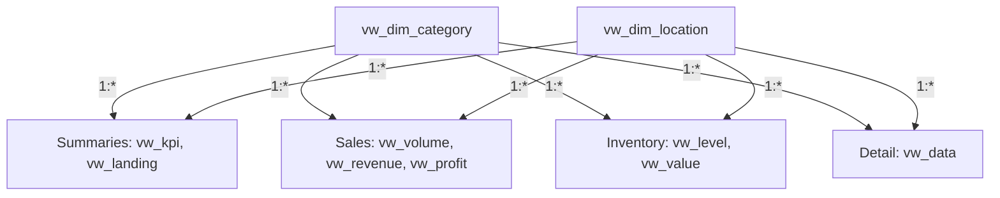

# Maven Toys — Sales and Inventory in Mexican Toy Stores

## From Sales Data to Product, Location and Inventory Analysis

An analytics project combining **MySQL, sales and inventory analysis, and Power BI**. Using sales history, a product catalog, store information and inventory records, it presents the scale of the Maven Toys chain, each category's contribution to revenue and profit, and the composition of stock.

I prepared this analysis to compare product popularity with profitability and availability. I examined units sold alongside revenue and profit, considering product categories, store location types and sales patterns over time. The inventory analysis adds stock quantities, retail inventory value and a coverage indicator based on historical sales.

**[Open the interactive Power BI report](https://app.powerbi.com/view?r=eyJrIjoiNjZmM2I0Y2QtNmYzMC00ODE4LWJiOTQtZDQzODA5MmIzN2Q0IiwidCI6ImE0ZmE1ZWNhLTdhM2YtNDRhYS04ZTI4LTc2MjBhMzk0NjEwZiJ9)**

> **Data coverage:** January 1, 2022 to September 30, 2023, with 829,262 sales records across 638 days and 21 calendar months. The data covers the full year of 2022 and the first three quarters of 2023. Inventory is a single snapshot, with no change history or date assigned to individual records.

| Item | Scope |
| --- | --- |
| Analysis and report author | Paweł Bugowski |
| Subject | Sales, revenue, profit and inventory across a toy store chain |
| Source | Maven Analytics — Mexico Toy Sales dataset |
| Data type | Data for the fictional Maven Toys chain |
| Input data | 5 CSV files in `Raw Data/` |
| Sales | 829,262 records, 1,090,565 units sold |
| Stores and assortment | 50 stores, 35 products, 5 categories and 4 location types |
| Data preparation | 7 documented MySQL scripts |
| SQL layer | 5 source tables and 10 views |
| Reporting model | 2 shared dimensions and 8 analytical views |
| Report | 6 Power BI pages |
| Report hosting | KajoDataSpace, as credited in the report footer |

## Table of Contents

- [Objectives and Analytical Questions](#objectives-and-analytical-questions)
- [Data and Scope](#data-and-scope)
- [Key Findings](#key-findings)
- [Repository Contents](#repository-contents)
- [Data Preparation in SQL](#data-preparation-in-sql)
- [Data Model and Aggregation Rules](#data-model-and-aggregation-rules)
- [Power BI Report](#power-bi-report)
- [Reproducing the Project](#reproducing-the-project)
- [Data Quality Checks and Validation Queries](#data-quality-checks-and-validation-queries)
- [Sources and Author](#sources-and-author)

## Objectives and Analytical Questions

High unit sales do not necessarily mean high profit, and a large stock quantity does not necessarily indicate excess inventory. Interpretation requires several measures to be considered together: volume, price, catalog cost, location type and sales pace. The project brings these perspectives together in a single data layer and six report pages.

The analysis addresses the following questions:

1. How many units were sold, and how much revenue and profit did they generate?
2. Which categories account for the largest volume, and which deliver the strongest financial results?
3. How do results differ between downtown, commercial, residential and airport locations?
4. Which products lead in units sold and revenue?
5. How are sales, revenue and profit distributed across months?
6. Which products and categories hold the largest stock quantities and retail inventory values?
7. How does stock coverage compare with historical sales pace, and which products warrant closer examination?

In this project, **revenue** means units sold multiplied by the catalog price. **Profit** is the difference between that revenue and the cost of the products sold, using the same catalog. It is not net profit after store operating expenses.

**Inventory value is measured at retail prices**: stock on hand multiplied by the selling price. It does not represent the capital invested in purchasing goods at acquisition cost.

## Data and Scope

### Origin and Unit of Observation

The source is the [Mexico Toy Sales dataset published by Maven Analytics](https://mavenanalytics.io/data-playground/mexico-toy-sales), describing a fictional toy store chain in Mexico. All figures in this README refer to the specific CSV files included in this repository.

Each row in `sales.csv` records the sale of a quantity of **one product at one store on a given day**. `Sale_ID` distinguishes sales records. There is no customer identifier or separate shopping basket identifier, so the record count does not represent the number of customers or complete receipts containing multiple products.

In `inventory.csv`, the unit of observation is a **store–product pair**. The file captures stock on hand rather than successive receipts, issues or deliveries. The product and store catalogs provide names and attributes used for grouping.

### Source Files

| File | Records | Columns | Unit of observation |
| --- | ---: | ---: | --- |
| `sales.csv` | 829,262 | 5 | A product sales record for a store and date |
| `products.csv` | 35 | 5 | A product with its category, cost and price |
| `stores.csv` | 50 | 5 | A store with its city, location type and opening date |
| `inventory.csv` | 1,593 | 3 | Stock on hand for a store–product pair |
| `calendar.csv` | 638 | 1 | A calendar day |

The calendar includes every day from January 1, 2022 to September 30, 2023. All sales dates fall within this range. Store opening dates describe each store's history and do not define the start of the sales analysis period.

### Source Field Definitions

| File | CSV field | SQL field | Meaning |
| --- | --- | --- | --- |
| `sales.csv` | `Sale_ID` | `SALE_ID` | Unique sales record identifier |
| `sales.csv` | `Date` | `D_DATE` | Sales date |
| `sales.csv` | `Store_ID` | `STORE_ID` | Store identifier |
| `sales.csv` | `Product_ID` | `PRODUCT_ID` | Product identifier |
| `sales.csv` | `Units` | `UNITS` | Number of units sold in the record |
| `products.csv` | `Product_ID` | `PRODUCT_ID` | Product identifier |
| `products.csv` | `Product_Name` | `PRODUCT_NAME` | Product name |
| `products.csv` | `Product_Category` | `PRODUCT_CATEGORY` | Product category |
| `products.csv` | `Product_Cost` | `PRODUCT_COST` | Catalog unit cost |
| `products.csv` | `Product_Price` | `PRODUCT_PRICE` | Catalog unit price |
| `stores.csv` | `Store_ID` | `STORE_ID` | Store identifier |
| `stores.csv` | `Store_Name` | `STORE_NAME` | Store name |
| `stores.csv` | `Store_City` | `STORE_CITY` | City |
| `stores.csv` | `Store_Location` | `STORE_LOCATION` | Store location type |
| `stores.csv` | `Store_Open_Date` | `STORE_OPEN_DATE` | Store opening date |
| `inventory.csv` | `Store_ID`, `Product_ID` | `STORE_ID`, `PRODUCT_ID` | Pair identifying a product's stock at a store |
| `inventory.csv` | `Stock_On_Hand` | `STOCK_ON_HAND` | Number of units in stock |
| `calendar.csv` | `Date` | `D_DATE` | Calendar date |

The product categories are `Art & Crafts`, `Electronics`, `Games`, `Sports & Outdoors` and `Toys`. Location types are `Airport`, `Commercial`, `Downtown` and `Residential`. **A location type is not a city or a specific store** — multiple stores can belong to the same group.

Amounts retain the `$` symbol used in the catalog and report. The CSV files do not contain a separate currency code or exchange rates. Prices and costs are product attributes; the sales file does not record the actual price applied to each purchase, discounts or historical cost changes.

### Input Data Quality

| Check | Result |
| --- | ---: |
| Empty fields across the five CSV files | 0 |
| Duplicate complete rows within individual files | 0 |
| Sales records with an unknown product | 0 |
| Sales records with an unknown store | 0 |
| Sales dates outside the supplied calendar | 0 |
| Inventory records with an unknown product or store | 0 |
| Duplicate store–product pairs in inventory | 0 |
| Sales records with zero or negative units | 0 |
| Negative stock quantities | 0 |

There are 1,750 possible combinations of 50 stores and 35 products, while the inventory file contains 1,593 pairs. **I do not automatically fill the 157 missing combinations with zeros.** A missing record and a recorded zero stock quantity convey different information. The file does not explain whether a missing pair represents a product excluded from a store's assortment or a missing observation.

## Key Findings

The results below cover the full dataset. SQL calculations use the original quantities, prices and costs from the CSV files. Report cards abbreviate large numbers to thousands and millions; exact figures come from calculations on the source data.

### Sales and Inventory at a Glance

| Metric | Value | Interpretation |
| --- | ---: | --- |
| Sales records | **829,262** | Number of records identified by `SALE_ID` |
| Units sold | **1,090,565** | Sum of `UNITS` |
| Revenue | **$14,444,572.35** | Units sold × catalog price |
| Profit | **$4,014,029.00** | Units sold × the difference between price and cost |
| Products with recorded sales | **35** | Distinct product names in sales detail |
| Stores with recorded sales | **50** | Distinct store names in sales detail |
| Product categories | **5** | Categories appearing in sales |
| Stock on hand | **29,742 units** | Sum of recorded stock quantities |
| Retail inventory value | **$410,240.58** | Stock on hand × catalog price |

Sales cover the entire observation period, while inventory is a single snapshot. The 29,742 units should not be treated as total deliveries over those 21 months. Inventory value and revenue should not be compared as if both represented flows over the same period.

### Categories: Popularity and Financial Contribution

| Category | Units sold | Revenue | Profit | Stock on hand |
| --- | ---: | ---: | ---: | ---: |
| Art & Crafts | 325,574 | $2,705,364.26 | $753,354.00 | 8,635 |
| Electronics | 134,075 | $2,246,771.25 | $1,001,437.00 | 2,418 |
| Games | 194,673 | $2,226,836.27 | $673,993.00 | 6,155 |
| Sports & Outdoors | 169,043 | $2,172,359.57 | $505,718.00 | 4,981 |
| Toys | 267,200 | $5,093,241.00 | $1,079,527.00 | 7,553 |

**Art & Crafts** leads in units sold and stock quantity. **Toys** generates the highest revenue and profit. **Electronics** has the lowest sales volume of the five categories but the second-highest profit. Popularity measured in units alone is therefore insufficient to assess a category's financial contribution.

| Location type | Profit |
| --- | ---: |
| Downtown | $2,248,728.00 |
| Commercial | $926,864.00 |
| Residential | $460,388.00 |
| Airport | $378,049.00 |

`Downtown` stores generate the highest total profit. This is the result for the entire group, not an average store. Assessing location efficiency also requires the number of stores, their size and their available assortment to be considered.

### Leading Products by Sales

| Product | Units sold |
| --- | ---: |
| Colorbuds | 104,368 |
| PlayDoh Can | 103,128 |
| Barrel O' Slime | 91,663 |
| Deck Of Cards | 84,034 |
| Magic Sand | 60,598 |

The highest revenue comes from **Lego Bricks — $2,388,882.63**, followed by **Colorbuds — $1,564,476.32**, **Magic Sand — $968,962.02**, **Action Figure — $926,748.42** and **Rubik's Cube — $912,983.28**.

The volume leader and revenue leader are different products. Comparing the two rankings distinguishes products sold in large quantities from those whose higher unit prices contribute substantially to sales value.

### Inventory and Sales Coverage

**Lego Bricks — $44,708.82** has the highest retail inventory value. It is followed by **Dinosaur Figures — $34,057.28**, **Magic Sand — $30,732.78**, **Rubik's Cube — $29,925.03** and **Nerf Gun — $24,227.88**.

The five-product chart displaying days of inventory selects products by **total units in stock** and then presents their average DOI:

| Product | Stock on hand | Approximate average days of inventory |
| --- | ---: | ---: |
| Deck Of Cards | 2,738 | 4.48 |
| Dinosaur Figures | 2,272 | 4.09 |
| PlayDoh Can | 2,129 | 3.10 |
| Magic Sand | 1,922 | 2.88 |
| Rubik's Cube | 1,497 | 2.68 |

The indicator uses days on which a product recorded sales at a particular store. It does not include every calendar day, so it should not be interpreted as a forecast of the actual time until stock runs out.

Low values for **Jenga — approximately 0.66**, **Playfoam — approximately 0.66** and **Hot Wheels 5-Pack — approximately 0.76** identify products worth checking for availability and delivery schedules. The high inventory value of Lego Bricks, in turn, supports monitoring both its sales and the resources associated with carrying it. A replenishment decision requires confirmation of current stock at the specific store and the order lead time.

### Months and Period Comparability

The monthly charts show totals by month name, combining years. **January–September include two years, while October–December include only 2022.** Lower values at the end of the chart are therefore not, by themselves, evidence of a seasonal decline in sales.

The `vw_volume`, `vw_revenue` and `vw_profit` views retain the `YEAR` column. This supports a year-over-year comparison for the shared January–September period or an analysis of 21 consecutive months without combining years. `vw_landing` deliberately aggregates by month without year, matching the report's overview layout.

## Repository Contents

The repository contains `Assets/`, `Raw Data/` and `SQL/` directories. The `README.md` documentation is stored at the repository root.

| File | Contents |
| --- | --- |
| `Raw Data/sales.csv` | Product sales history by store |
| `Raw Data/products.csv` | Product catalog with categories, costs and prices |
| `Raw Data/stores.csv` | Store directory with cities and location types |
| `Raw Data/inventory.csv` | Stock snapshot for store–product pairs |
| `Raw Data/calendar.csv` | Calendar covering the sales period |
| `SQL/1_Database_and_Tables.sql` | The `toys_in_mexico` database and five source tables |
| `SQL/2_Import_of_Data.sql` | CSV import, date parsing and monetary value conversion |
| `SQL/3.1_Dimension_Views.sql` | Product category and location type dimensions |
| `SQL/3.2_Summary_Views.sql` | Store and monthly summaries, plus sales record detail |
| `SQL/3.3_Sales_Views.sql` | Monthly volume, revenue, profit and margin |
| `SQL/3.4_Inventory_Views.sql` | Stock on hand, days of inventory and retail valuation |
| `Assets/cover.webp`, `Assets/cover-thumb.webp` | Overview page preview and thumbnail |
| `Assets/gallery-01.webp`, `Assets/gallery-01-thumb.webp` | Revenue analysis preview and thumbnail |
| `Assets/gallery-02.webp`, `Assets/gallery-02-thumb.webp` | Profit analysis preview and thumbnail |
| `Assets/gallery-03.webp`, `Assets/gallery-03-thumb.webp` | Inventory level analysis preview and thumbnail |
| `README.md` | Data, findings, SQL, model and reproduction guide |

The public link provides access to the interactive report, while the scripts reproduce the SQL layer. The file set does not include a `.pbix` or `.pbit` file. Measure definitions, interaction settings and visual formatting remain part of the report file.

## Data Preparation in SQL

### 1. Creating the Database and Tables

`1_Database_and_Tables.sql` creates the `toys_in_mexico` database with the `utf8mb4` character set and `utf8mb4_unicode_ci` collation.

The five tables correspond to the CSV files. Prices and costs use `DECIMAL(10,2)`, identifiers and unit quantities use `INT`, dates use `DATE`, and names and categories use `VARCHAR(255)`.

The primary keys are `PRODUCT_ID` for products, `STORE_ID` for stores, `SALE_ID` for sales and `D_DATE` for the calendar. The inventory table has a composite key consisting of `STORE_ID` and `PRODUCT_ID`. The `idx_sales_product_store_date` index supports grouping sales history by product and store and accessing sales dates.

The script does not declare foreign keys. Identifier consistency is checked through separate validation queries. Creating the tables does not delete or replace an existing database.

### 2. Importing and Interpreting Source Values

`2_Import_of_Data.sql` uses `LOAD DATA LOCAL INFILE`, skips headers and reads comma-separated fields with optional double quotes. User variables allow text to be transformed before it is assigned to table columns.

During import:

- `TRIM` removes surrounding spaces, and `NULLIF(..., '')` converts empty values to `NULL`;
- `REPLACE` removes the `$` symbol from costs and prices and the carriage return character from the last field in a record;
- sales dates and store opening dates are parsed using `%Y-%m-%d`;
- calendar dates are parsed using `%m/%d/%Y`;
- `SHOW WARNINGS` after each import exposes any reading or conversion warnings.

The raw data remains unchanged. There is no step that updates prices, adjusts quantities or removes sales records. Preparation consists of correctly parsing data types and building views.

Paths such as `Raw Data/...` are relative to the MySQL client's working directory, not automatically to the location of the SQL file.

### 3. Category and Location Dimensions

`3.1_Dimension_Views.sql` creates two views using `SELECT DISTINCT`:

| View | Column | Rows |
| --- | --- | ---: |
| `vw_dim_category` | `PRODUCT_CATEGORY` | 5 |
| `vw_dim_location` | `STORE_LOCATION` | 4 |

The dimensions are sourced from the product and store catalogs. They provide shared filter values for every part of the analysis, regardless of the level of detail in individual views.

### 4. Sales Summaries and Detail

`3.2_Summary_Views.sql` creates `vw_kpi`, `vw_landing` and `vw_data`.

In `vw_kpi`, two CTEs independently aggregate sales and inventory to the **store × category** level. Only then are the summaries joined on `STORE_ID` and `PRODUCT_CATEGORY`. This prevents stock quantities from being repeated for every sales transaction involving a product.

Sales form the starting point, and a `LEFT JOIN` adds inventory. `COALESCE` replaces a missing inventory summary with zero in this particular view. A store–category group appearing only in inventory would not enter `vw_kpi`; for the supplied dataset, the totals in this view match those of the complete inventory table.

`vw_landing` aggregates revenue and profit by category, product, location type and month, without separating years. `vw_data` retains one row per sales record and adds product and store names, category and location.

### 5. Monthly Volume, Revenue and Profit

`3.3_Sales_Views.sql` creates three views with the same level of detail: **product × category × location type × year × month**.

| View | Numeric values |
| --- | --- |
| `vw_volume` | `UNITS_SOLD` — total units sold |
| `vw_revenue` | `REVENUE` — total units multiplied by price |
| `vw_profit` | `PROFIT` and `PROFIT_MARGIN` |

Within each group, margin is calculated as profit divided by revenue and then rounded to two decimal places **as a ratio**. A value of `0.30` means 30%. `NULLIF` protects against a zero denominator.

A subsequent `AVG(PROFIT_MARGIN)` averages values that have already been rounded and gives each row equal weight. This is not equivalent to dividing total profit by total revenue. Preserving this calculation order is necessary to reproduce the average margin table.

### 6. Inventory Level and Value

`3.4_Inventory_Views.sql` creates `vw_level` and `vw_value`.

In `vw_level`, a CTE calculates average units sold per sales day for each product–store pair:

```sql
SUM(UNITS) / COUNT(DISTINCT D_DATE)
```

The denominator includes only dates with recorded sales for that pair. Stock on hand is then divided by the resulting average, and the result is rounded to one decimal place as `DAYS_OF_INVENTORY`.

Zero stock with an existing sales history gives zero days. No history or a zero sales rate gives `NULL`. The average excludes `NULL` values; replacing them with zeros would change its meaning.

The calculations assume the default MySQL setting `div_precision_increment = 4`. Intermediate division precision matters for values close to a rounding threshold.

`vw_value` values each inventory record at its retail price. Both views retain the rows of the original store–product pairs, even though `STORE_ID` is not included in their final column lists.

## Data Model and Aggregation Rules

### Reporting Model Structure

The model uses **two shared dimensions** to filter **eight analytical views**. Each dimension connects to all eight views through one-to-many relationships. Filters flow from the dimension to the analytical data.

The diagram below groups views by subject for readability. Each name within a group represents a separate view and a separate relationship with both dimensions.



There are no direct relationships between analytical views. A shared category or location selection reaches them through the dimensions. This allows values calculated at different levels of detail to be compared without joining the aggregates into a single table.

The `products`, `stores`, `sales`, `inventory` and `calendar` tables form the source layer in MySQL. They are not additional tables in the reporting model shown above. In particular, the supplied `calendar` is not a connected date dimension in this model; year and month attributes are included directly in the relevant views.

### Views, Columns and Level of Detail

All analytical views contain `PRODUCT_CATEGORY` and `STORE_LOCATION`.

| View | Other columns | Level of detail | Rows |
| --- | --- | --- | ---: |
| `vw_kpi` | `STORE_ID`, `STORE_NAME`, `STORE_CITY`, `REVENUE`, `PROFIT`, `UNITS_SOLD`, `INVENTORY`, `INVENTORY_VALUE` | Store × category | 250 |
| `vw_landing` | `PRODUCT_NAME`, `MONTH_NAME`, `MONTH_NUMBER`, `REVENUE`, `PROFIT` | Product × location × month, combining years | 1,572 |
| `vw_data` | `STORE_NAME`, `PRODUCT_NAME`, `SALE_ID` | Sales record | 829,262 |
| `vw_volume` | `PRODUCT_NAME`, `YEAR`, `MONTH_NUMBER`, `MONTH_NAME`, `UNITS_SOLD` | Product × location × year × month | 2,459 |
| `vw_revenue` | `PRODUCT_NAME`, `YEAR`, `MONTH_NUMBER`, `MONTH_NAME`, `REVENUE` | Product × location × year × month | 2,459 |
| `vw_profit` | `PRODUCT_NAME`, `YEAR`, `MONTH_NUMBER`, `MONTH_NAME`, `PROFIT`, `PROFIT_MARGIN` | Product × location × year × month | 2,459 |
| `vw_level` | `PRODUCT_NAME`, `STOCK_ON_HAND`, `DAYS_OF_INVENTORY` | Original store–product pair, without a store identifier in the output | 1,593 |
| `vw_value` | `PRODUCT_NAME`, `INVENTORY_VALUE` | Original store–product pair, without a store identifier in the output | 1,593 |

In the inventory views, two rows with the same product name and location type may come from different stores. Even identical visible values are not grounds for removing a row. Adding `DISTINCT` could understate total stock and change average DOI.

### Correct Aggregation Rules

1. **Units versus records:** sum `UNITS_SOLD` for volume. Count sales records using `SALE_ID` in `vw_data`, rather than counting rows in an aggregated view.
2. **Sales and inventory:** aggregate both independently before joining them. Do not attach stock to every transaction and then sum the repeated values.
3. **Average margin:** the report table uses the average of `PROFIT_MARGIN`. The margin for total sales requires total profit divided by total revenue — a different metric.
4. **Days of inventory:** the report average is the mean of rounded indicators for individual store–product pairs, not total stock divided by the combined sales rate.
5. **Months:** sort `MONTH_NAME` by `MONTH_NUMBER`. Include `YEAR` to preserve a sequence of 21 months; month names alone combine years.
6. **Rankings:** apply the category and location context first, then aggregate products and select the ranking. SQL views retain all products, so filter selections are not constrained by an earlier global `LIMIT`.

## Power BI Report

The report moves from an overview of the business through volume, revenue and profit to inventory levels and value. Shared product category and location type filters allow these perspectives to be compared in the same context.

### Sales and Inventory Overview

The opening page contains five main KPIs: units sold, revenue, profit, stock on hand and retail inventory value. These are complemented by counts of products, categories, sales records and stores present in the data.

The charts show profit by category, profit by location type and the monthly distribution of profit. The chart titled “Top 5 Products by Profit” groups data by `PRODUCT_CATEGORY`, so its five bars represent **categories**, not five individual products.

Financial and inventory cards use `vw_kpi`, the monthly trend uses `vw_landing`, and detail counts use `vw_data`.

### Sales Volume

This page shows units sold by category, location type and product. The top five products ranking is based on the sum of `UNITS_SOLD`. A line chart displays monthly values for the five categories.

The source is `vw_volume`. This part of the report identifies the products and categories responsible for the largest number of units sold, without mixing volume with differences in unit prices.

### Revenue and Leading Products by Sales Value

This page presents revenue by category and location type, the monthly distribution of category revenue, and the five products with the highest sales value.

The source is `vw_revenue`. Comparing this page with volume highlights the difference between units sold and their value: Colorbuds leads in units, while Lego Bricks leads in revenue.

### Profit and Average Margin

This page presents category profit, the breakdown by location and category, and the monthly distribution. The table alongside the charts contains average margins calculated from `vw_profit`:

| Category | Average margin in the report |
| --- | ---: |
| Art & Crafts | 29.68% |
| Electronics | 34.25% |
| Games | 35.77% |
| Sports & Outdoors | 27.61% |
| Toys | 27.98% |

The table describes the average of rounded margins for product–location–year–month groups. For example, Electronics ranking second in profit cannot be explained directly by this average: total profit also depends on sales value and mix.

### Inventory Levels and Days of Coverage

This page combines stock on hand by category and location with two stock coverage rankings. It uses `vw_level`, while the main inventory card uses the stock summary in `vw_kpi`.

“Top 5 Products by DOI” selects five products by `SUM(STOCK_ON_HAND)` and displays their `AVG(DAYS_OF_INVENTORY)`. It is not a ranking of the five highest average DOI values across the full assortment.

“Bottom 10 Products by DOI” selects ten products with the lowest average `DAYS_OF_INVENTORY`. Both charts display the same indicator but use different criteria to select products.

### Retail Inventory Value

The final page shows inventory valuation by category and location type, along with the five products with the highest inventory value. Its source is `vw_value`, while the main card uses `INVENTORY_VALUE` from `vw_kpi`.

Toys has the highest category inventory value: **$132,107.47**. Combining this perspective with stock levels and sales identifies the products in which the largest retail value of available goods is concentrated.

### Filters and Visual Design

The report uses a dark background, yellow accents and consistent navigation. Category filters are on the left, and location types are on the right. Product ranking charts are highlighted in salmon; other series use shades of yellow.

A practical analysis sequence is to review the KPIs, select a category and location, compare volume with revenue and profit, and then examine inventory. Replenishment conclusions should be checked against current availability, delivery plans and lead times. The inventory snapshot does not reveal lost sales, and catalog data does not show actual discounts.

## Reproducing the Project

### Requirements

- MySQL 8.0 or later, supporting the CTEs used in view definitions.
- An SQL client supporting `LOAD DATA LOCAL INFILE`.
- The five source files in `Raw Data/`.
- Permissions to create the database, tables and views, and to import data.
- Power BI Desktop with a configured MySQL connection if the reporting model is to be reproduced.

### Environment Setup

1. Download the repository and retain the CSV filenames.
2. Check the paths in `SQL/2_Import_of_Data.sql`. If the client's working directory is not the repository root, provide absolute file paths.
3. Ensure local file loading is enabled on both the server and the client. The script includes an optional commented statement, `SET GLOBAL local_infile = 1`; executing it requires appropriate permissions.
4. Start with a new database and empty tables. Run the import once and inspect the `SHOW WARNINGS` messages.
5. Create the views, then run validation and compare the reference totals.

### Execution Order

| Order | Script in `SQL/` | Expected result |
| --- | --- | --- |
| 1 | `1_Database_and_Tables.sql` | Database and five empty tables |
| 2 | `2_Import_of_Data.sql` | Data from five CSV files with the correct types |
| 3 | `3.1_Dimension_Views.sql` | `vw_dim_category`, `vw_dim_location` |
| 4 | `3.2_Summary_Views.sql` | `vw_kpi`, `vw_landing`, `vw_data` |
| 5 | `3.3_Sales_Views.sql` | `vw_volume`, `vw_revenue`, `vw_profit` |
| 6 | `3.4_Inventory_Views.sql` | `vw_level`, `vw_value` |

Each script selects the `toys_in_mexico` database. For standalone queries, use:

```sql
USE toys_in_mexico;
```

The scripts provide a process for reproducing the data, not migrations intended for unrestricted repeated execution. Primary keys prevent the same identifiers from being inserted again, but repeated imports can produce skipped rows and warnings. They are not a source update procedure. View definitions can be rerun using `CREATE OR REPLACE VIEW` without reloading the CSV files.

### Recreating the Power BI Layer

Connect Power BI to the database and import the ten views listed in the model description. Check numeric column types, category names and location values. Create `1:*` relationships from both dimensions to each of the eight analytical views, with single-direction filtering.

Sort `MONTH_NAME` by `MONTH_NUMBER`. To reproduce the published monthly charts and their values, retain aggregation by month name across years. Use `YEAR` as well when separating years; this produces a different time axis.

Use the average of `PROFIT_MARGIN` for the margin table, the average of `DAYS_OF_INVENTORY` for DOI rankings, and the appropriate sums for volume and value metrics. Select the five products on the inventory page by stock on hand. Count products and stores as distinct names in sales detail.

The scripts reproduce the data required for the report, but do not automatically create the Power BI file, formatting, navigation or visual settings.

## Data Quality Checks and Validation Queries

The following queries provide checks after the relevant stages have been completed. Reference values come from profiling the included CSV and reproducing the SQL rules and aggregations. Calculation validation did not constitute a complete execution of the import and pipeline on a native MySQL server.

### Record Counts, Identifiers and Date Coverage

```sql
SELECT
    COUNT(*) AS SALES_RECORDS,
    COUNT(DISTINCT SALE_ID) AS DISTINCT_SALES_RECORDS,
    COUNT(DISTINCT STORE_ID) AS STORES,
    COUNT(DISTINCT PRODUCT_ID) AS PRODUCTS,
    MIN(D_DATE) AS FIRST_SALE_DATE,
    MAX(D_DATE) AS LAST_SALE_DATE,
    SUM(UNITS) AS UNITS_SOLD
FROM sales;
```

Expected values: `829262`, `829262`, `50`, `35`, `2022-01-01`, `2023-09-30`, `1090565`.

### Sales and Inventory Totals

```sql
SELECT
    SUM(UNITS_SOLD) AS UNITS_SOLD,
    SUM(REVENUE) AS REVENUE,
    SUM(PROFIT) AS PROFIT,
    SUM(INVENTORY) AS INVENTORY,
    SUM(INVENTORY_VALUE) AS INVENTORY_VALUE
FROM vw_kpi;
```

Expected values: `1090565`, `14444572.35`, `4014029.00`, `29742`, `410240.58`.

### Independent Inventory Valuation Check

```sql
SELECT
    SUM(i.STOCK_ON_HAND) AS INVENTORY,
    SUM(i.STOCK_ON_HAND * p.PRODUCT_PRICE) AS INVENTORY_VALUE
FROM inventory i
JOIN products p
    ON i.PRODUCT_ID = p.PRODUCT_ID;
```

Expected result: `29742` and `410240.58`. Comparing these figures with `vw_kpi` checks whether joining aggregated sales and inventory changed the total.

### Average Margins by Category

```sql
SELECT
    PRODUCT_CATEGORY,
    ROUND(AVG(PROFIT_MARGIN) * 100, 2) AS AVG_PROFIT_MARGIN_PERCENT
FROM vw_profit
GROUP BY PRODUCT_CATEGORY
ORDER BY PRODUCT_CATEGORY;
```

Expected values in category order: `29.68`, `34.25`, `35.77`, `27.61`, `27.98`. Replacing this expression with total profit divided by total revenue produces a different metric.

### Unknown Identifiers and Duplicate Inventory Pairs

```sql
SELECT
    COUNT(*) AS SALES_WITH_UNKNOWN_PRODUCT
FROM sales s
LEFT JOIN products p
    ON s.PRODUCT_ID = p.PRODUCT_ID
WHERE p.PRODUCT_ID IS NULL;

SELECT
    STORE_ID,
    PRODUCT_ID,
    COUNT(*) AS RECORDS_PER_PAIR
FROM inventory
GROUP BY STORE_ID, PRODUCT_ID
HAVING COUNT(*) > 1;
```

The first query should return `0`, and the second an empty result set. Checks for other references and invalid quantities are included in the validation script.

## Sources and Author

- **Data source:** [Maven Analytics — Mexico Toy Sales](https://mavenanalytics.io/data-playground/mexico-toy-sales). The source page labels the dataset as Public Domain.
- **Data used in calculations:** five CSV files in [`Raw Data/`](Raw%20Data/).
- **Data preparation:** seven documented scripts in [`SQL/`](SQL/).
- **Interactive report:** [Maven Toys — Sales and Inventory Analysis](https://app.powerbi.com/view?r=eyJrIjoiNjZmM2I0Y2QtNmYzMC00ODE4LWJiOTQtZDQzODA5MmIzN2Q0IiwidCI6ImE0ZmE1ZWNhLTdhM2YtNDRhYS04ZTI4LTc2MjBhMzk0NjEwZiJ9).
- **Report graphics:** an overview page preview, three analysis previews and four thumbnails in [`Assets/`](Assets/).
- **Project and report author:** Paweł Bugowski.
- **Report hosting:** KajoDataSpace, as credited in the report footer.
